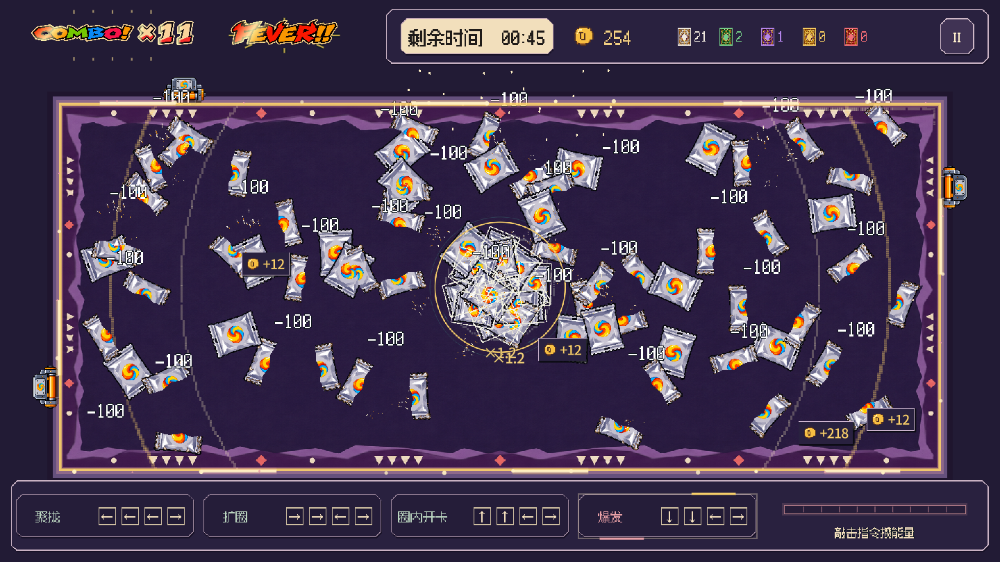
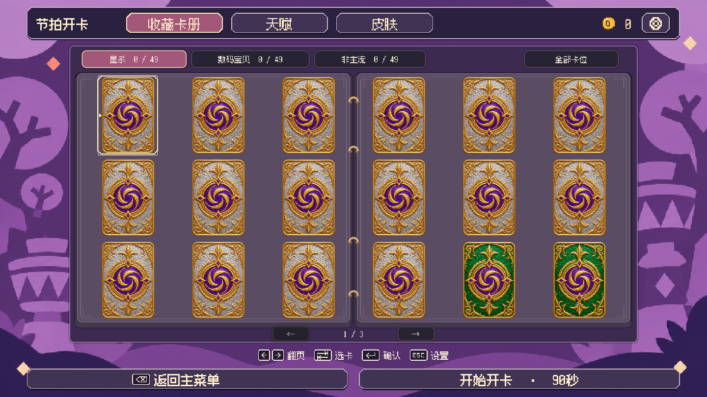
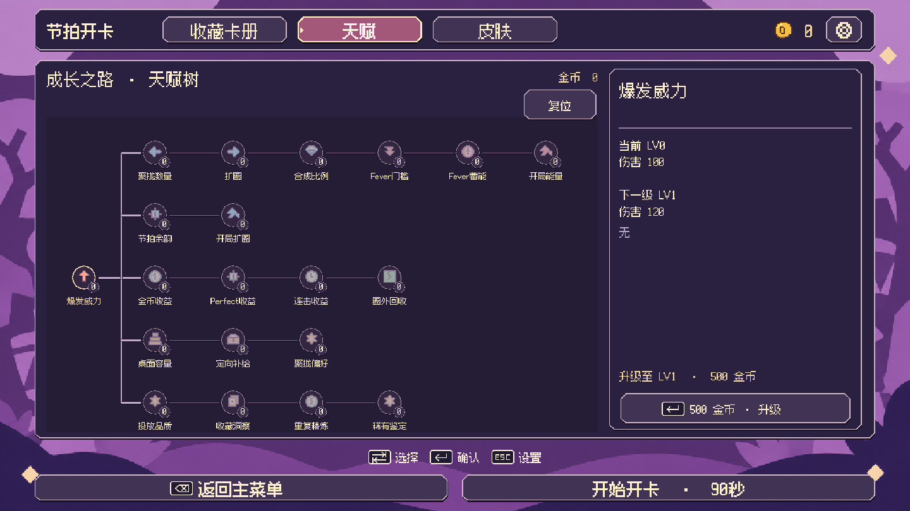
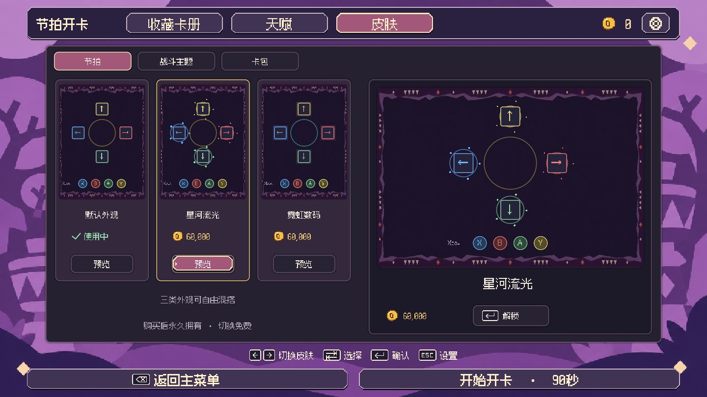
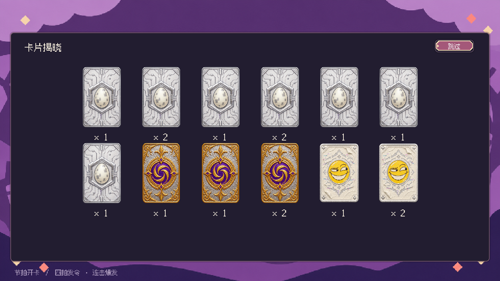

# 节拍开卡

**四拍发令，连击爆发，把一桌卡包变成你的收藏。**

一款将节奏指令、卡包合成与开卡收藏结合的单机小游戏。用四个鼓键指挥卡包聚拢、扩圈与开卡，在 **90秒** 内积累金币和收藏，再用天赋与外观打造下一局。

**[下载节拍开卡1.0 · Windows x64](https://github.com/LzTears/rhythm-card-opening/releases/download/v1.0/1.0.zip)** · [版本说明与校验文件](https://github.com/LzTears/rhythm-card-opening/releases/tag/v1.0) · [玩法与操作](#怎么玩)

## 下载与开始

当前提供 **节拍开卡1.0 · Windows 64位非商业内测版**，支持键鼠及 Xbox 布局手柄。无需安装 Godot 或 Python；需要支持 OpenGL 3.3 的显卡。

1. [下载 PC 压缩包](https://github.com/LzTears/rhythm-card-opening/releases/download/v1.0/1.0.zip)（约155.47 MiB）。
2. 完整解压，打开 `节拍开卡1.0` 文件夹，运行 **`节拍开卡.exe`**。EXE、PCK 和三个 DLL 须保持同目录。
3. 选择“开始游戏”，按首次教程敲出第一句四拍指令。

GitHub 下载文件名为 `1.0.zip`，下载页显示名为“节拍开卡1.0.zip”，可自行重命名。请下载上述游戏包；Release 自动提供的 **Source code** 是开发源码。

普通入口会沿用本机已有进度。想从0金币、空卡册开始，可运行包内的 `独立新档启动.cmd`，进度单独保存。

## 怎么玩

**玩家敲四拍 → 系统复述四拍 → 接上下一句。** 节奏为120 BPM，每拍约0.5秒；等系统复述结束，再开始下一句。已有连击时，需在复述结束后2秒内敲下下一句的第一键。

| 指令 | 键盘四拍 | 作用 |
| --- | --- | --- |
| 聚拢 | ← ← ← → | 把圈外卡包拉进圈内 |
| 扩圈 | → → ← → | 扩大作用圈，容纳更多卡包 |
| 圈内开卡 | ↑ ↑ ← → | 攻击圈内卡包，击破后获得卡片与金币 |
| 爆发 | ↓ ↓ ← → | Fever就绪后发动；能量充满时可全屏开包 |

圈内同品质卡包会自动合成为更高品质。保持正确指令可累积连击与能量：基础 **5连击** 使Fever就绪，天赋可将门槛降至4／3／2；全屏爆发还需要充满能量。完成一局后揭晓卡片，重复收藏会兑换金币，再用金币升级天赋，继续开卡。

### 收集与成长

- **147张收藏卡**：星系、数码宝贝、非主流三个主题，各49张，五个品阶。
- **20类天赋、5条成长路线**：强化威力、聚拢、合成、金币与收藏成长。
- **三类外观自由混搭**：节拍、卡包与战斗主题分别选择，额外外观用游戏金币解锁。
- **翻卡与大卡检视**：局末分批揭卡，红阶卡单独展示；已收藏卡可放大、倾斜和翻面欣赏。

## 游戏截图

| 收藏卡册 | 天赋成长 |
| --- | --- |
|  |  |
| 外观搭配 | 局末揭卡 |
|  |  |

截图来自当前PC构建的实机界面，使用独立测试进度；下载包不附带预解锁存档。

## 操作速查

| 场景 | 键盘／鼠标 | Xbox 布局手柄 |
| --- | --- | --- |
| 战斗四鼓 | ← / → / ↓ / ↑ | X / B / A / Y |
| 选择与确认 | 鼠标、Tab、Enter；按界面提示操作 | 左摇杆选择、A确认 |
| 局外主页面 | 点击顶部页签 | LB / RB |
| 卡册主题／皮肤类别 | 点击类别页签 | LT / RT |
| 翻页／预览皮肤 | ← / → | 十字键 ← / → |
| 局外开始一局 | 点击“开始开卡” | Y |
| 设置／战斗暂停 | Esc | Start／菜单键 |
| 局外返回主菜单 | Backspace | B |

战斗中手柄B仍是鼓键。窗口失焦会自动暂停，返回游戏后手动继续。

## 保存进度

正常结束一局或主动提前结算时自动保存。购买天赋、换装或修改设置后，可在设置中手动保存，也可完成一局后一起保存。直接关闭游戏或放弃战斗会丢弃本局收益；进行中的战斗不会续局。

Windows默认进度目录：`%APPDATA%/RoundCardWhirlwind/rhythm-workshop-v15/`。独立新档入口使用单独的进度目录。

## 从源码运行

开发使用 **Godot 4.7.2 标准精度版**。克隆仓库，用Godot导入根目录的 `project.godot`，等待首次资源导入完成后按 **F5** 运行。Windows x64所需的三个原生DLL已随源码保留。

安装匹配的Godot导出模板后，可使用 `Windows Desktop` 预设导出。原生模块源码与构建方式见 [native/feedback_math](native/feedback_math/README.md)、[native/geometry_math](native/geometry_math/README.md)、[native/safe_layout](native/safe_layout/README.md)。其他平台尚未验证。

## 许可与素材

原创代码采用 [MIT许可](LICENSE)。字体、音频、插画、角色及第三方组件遵循[独立权利说明](THIRD_PARTY_NOTICES.md)。Patapon音频、部分角色及网络形象尚未确认公开再分发授权；代码开源不授予这些素材的使用或商业授权。
