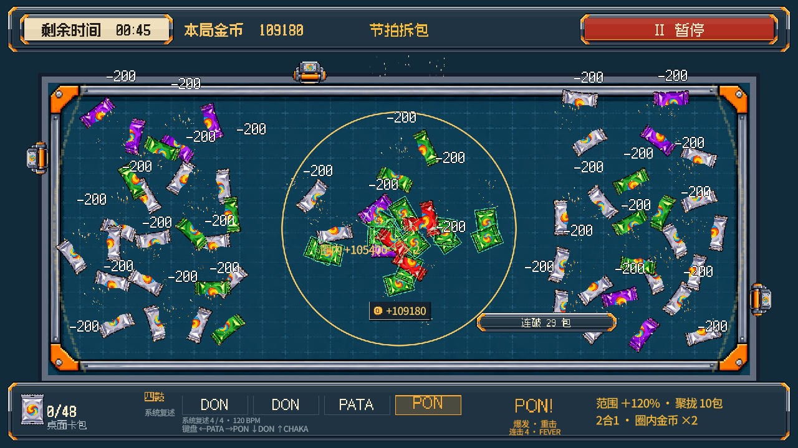
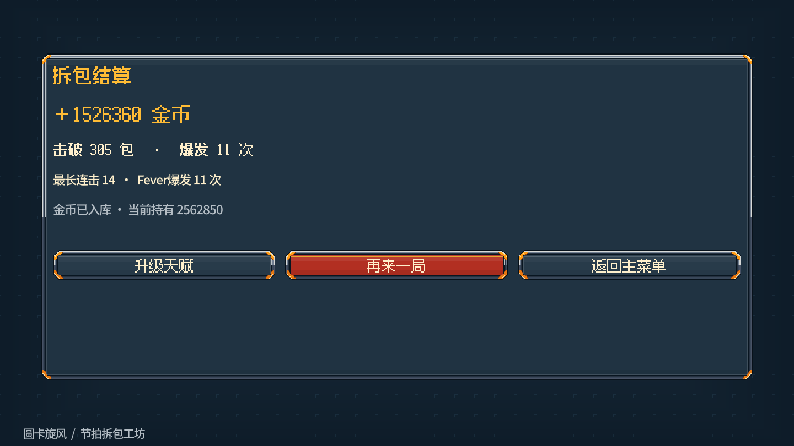
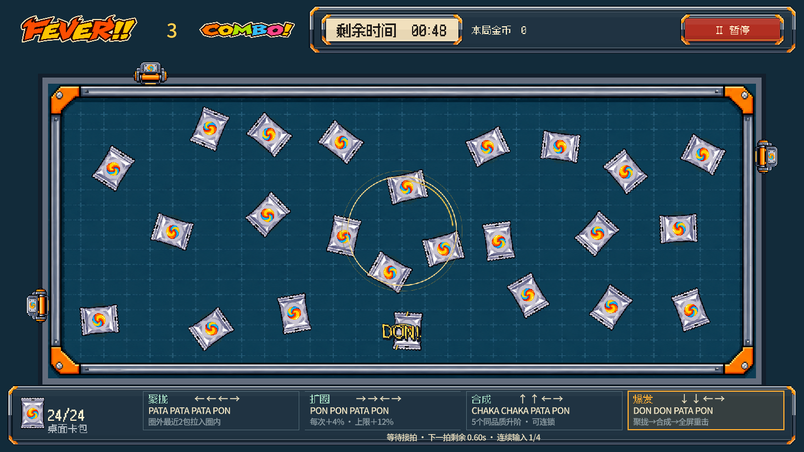
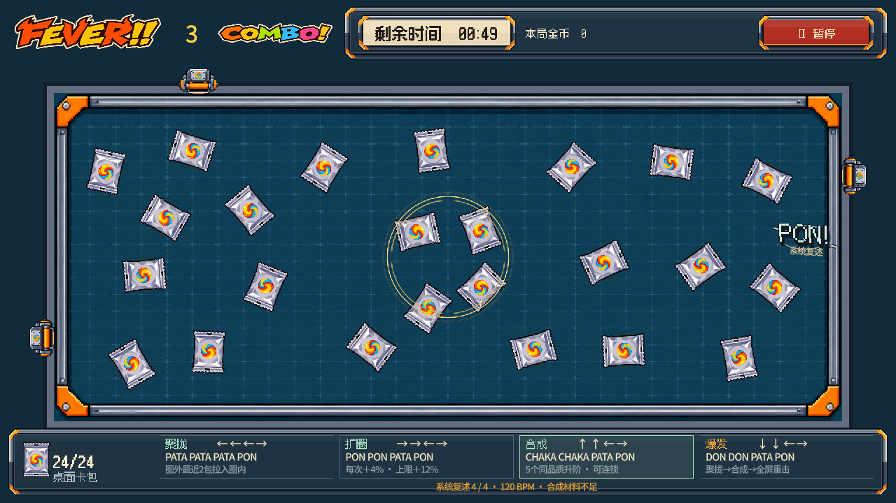

# 节拍开卡：当前规范

更新：2026-11-14。当前规则／构建／平衡为rhythm-workshop-v15，活动模拟snapshot20、Conductor19；源码候选版本15.20261114.3。当前为非商业本地内测候选源码，公开或商业发行所需素材授权未确认。本文为唯一玩法与验收入口：第1至7节为现行摘要，第8节与第9至46节保留阶段证据和决策沿革，同一事项以最新确认优先；本轮发布检查修复与验证状态见第47节。出包由用户安排，本轮不导出、不压缩。

## 1. 当前可玩循环

120BPM四字输入→系统逐拍复述→四拍扩圈／聚拢／圈内攻击→正确完整指令累积Combo与能量→Combo5就绪且能量10格时打Fever全屏并耗能→击破结算金币→每轮补满→局外购买20类关联天赋。圈内包自动逐级合成。单局由scripts/game_config.gd的RUN_DURATION_SECONDS统一配置（当前90秒），tick上限自动按固定60Hz换算；数值以第35节为准，旧数值仅保留历史来源。

## 2. 输入、回应和截止

键盘←Pata、→Pon、↓Don、↑Chaka，Xbox手柄X／B／A／Y对应四鼓，按最近有效设备显示提示。战斗鼓字旁同步弹出PC方形方向键帽或Xbox彩色圆形按钮。Space不映射鼓点，鼠标操作界面。系统复述期间锁输入，不缓冲到下一句。

首拍自由起手，之后相邻有效拍间隔15至42tick（250至700ms）接受，30tick是120BPM理想拍。输入先于同tick超时判定，间隔42tick按下仍接收；到42tick无按键则Miss，下一tick可新起手。Combo为0时完全空闲不自动断拍；已有Combo则在复述结束后2秒内起手，超时断连，详见第37节。整句Perfect以首拍为基准，后三拍在30／60／90tick各±6tick内且鼓语合法可执行，第四键完成时只判定／显示／发声／统计一次；未知鼓语仅抖指令区，禁用Fever误输不产生Perfect。

以首输入F、末输入C计算回应首拍S=max(C+30,F+120)，S／S+30／S+60／S+90复述四字，S+120结束复述、正常补包并解锁。扩圈四拍各加一层，累计12层；其他指令按各自四阶段执行。Fever默认Combo5就绪，3级门槛天赋降至4／3／2；能量默认10格，蓄能天赋降至9／8／7，每句成功完整执行充1格。满能爆发范围在回应首拍锁定，末拍才充满不追溯升级本句。非Fever误输爆发无攻击／充能，不清Combo；未满能Fever仍聚拢、自动合成、蓄势、圈内攻击。真实断连清Combo与就绪、保留能量；扩圈按余韵最多保留实际已有2／4／6层。开局预置圈层／能量只发放一次。

剩余时间不足完整复述不伪执行、不伤害、不累计。配置tick上限截止后不新增攻击或收益，已确认奖励完成结算。暂停及失焦冻结模拟与声音，不补播暂停期间事件。

## 3. 表现契约

保留桌面、镜头与底栏布局，UI底图和桌面更换为紫靛色剪影纸片背景。主圈固定中心；聚拢与扩圈不伤害，圈内开卡及未满能Fever只表现真实圈内攻击与击破奖励。Fever按已确认的四拍顺序执行与展示。卡包没有血条，每个实际受击包显示白色伤害数字；金币金色，×1.2仅表示圈内金币倍率，不改变伤害。动画、伤害和奖励消费同一模拟事件。

当前按第11节新增局外、普通战斗及Fever三段BGM，并按真实Fever状态切换；无额外爆发主击音，玩家四鼓、系统合唱优先。Fever入场使用完整Celebrate01，在下一句输入时压低尾音。轻量撕包、金币使用现成录音，来源及必要格式处理见[音频说明](../assets/audio/redesign/README.md)与manifest；游戏设置提供署名入口。未宣称扬声器主观听审通过。

## 4. 工程职责

- pack_rules.gd：唯一数值、20类85次天赋购买、费用、品质权重及冻结run_options；当前5条独立成长路线、各直接前置LV.1，以第35、36节为准。
- rhythm_conductor.gd：输入门限、四字指令、回应、整句Perfect、Combo／Fever门槛、复述后2秒起手衔接。
- simulation.gd：真实目标、空间、自动合成、损伤、伤害、金币、收藏掉落与补包；当前模拟快照版本20，不表示允许续局。
- world_view.gd／world_prepare_feedback.gd／world_skill_effect.gd：显示包体动作与特效，不选择真实目标或发奖励。
- audio_router.gd：真实事件去重、声音聚合、BGM、欢呼、duck和暂停；聚合不删减战斗事件。
- main.gd及UI模块：局外收藏／天赋／皮肤、统一设备路由、焦点、战斗HUD、教程、翻卡结算与署名；最新输入和视觉见第42至46节。

## 5. 保存与入口

正常档user://rhythm-workshop-v15，schema3、talent_economy_version15；正常新档0金币、空册、无已购天赋。不读取、不迁移、不删除旧目录。QA必须使用显式隔离目录，不把全收藏或金币夹具视为正常玩家进度。

只有一个默认档。SaveStore保留事务写入、校验及幂等结算；自动保存仅正常局末或主动提前结算。设置中的手动保存（含战斗暂停设置）仅保存局外资料，不保存本局收益或活动局；购买、换装和设置变化须手动保存或完成一局才落盘。直接关闭或放弃战斗丢弃本局收益，不自动保存、不恢复战斗；当前不启用旧WAL。旧BattleSaveJournal及恢复测试仅作历史技术证据，不代表现行产品行为。

开始游戏.cmd为正常源工程入口，调用D:/Godot/Godot_v4.7.2-stable_win64.exe，不是独立免安装包。构筑试玩.cmd和节拍器试玩.cmd为开发试玩入口，显式隔离目录，不作为正常新档验收。普通项目不保留GdaHarness常驻autoload；插件文件保留，开发检查需要时临时接入，结束后还原。出包由用户自行安排。

## 6. 实施状态与范围

当前源码包含120秒节奏开卡、20类关联天赋、三主题147张收藏卡、三类皮肤、真实翻卡结算和局外资料保存。收藏不装备战斗属性；重复卡真实兑换金币。交易买卖与经营不在当前已实现范围。现行收藏／皮肤／保存契约见第23至28节，经济及输入见第35至37节，最新页签、焦点与设备混用见第42至46节。源码存在、历史自动化通过和非商业内测定位均不等于公开发行授权、异机认证或长时真人体验验收。

<a id="verification"></a>
## 7. 当前验收入口

| 入口 | 现行范围与依据 |
| --- | --- |
| talent20-production-rules／rhythm／collection／parity、talent20-production-main | 20类天赋、生产规则、节拍、收藏和模型对照；见35.8及36.1 |
| collection_authority／meme_collection_authority／collection_presentation／collection_main | 收藏权威、主题、卡面表现与真实Main结算；collection_main本轮修正整句Perfect断言，见47 |
| combo_handoff | 已有Combo时复述后2秒起手、暂停和超时；见37.1 |
| controller_actions／mixed_input／tab_selection／focus_selection | A购买与使用、设备交接、三组页签红底和真实焦点；见44至47 |
| tiered_controller_navigation／settlement_batching／inspector_device_hints | 层级映射、结算分批和检视提示；按最新规则更新旧断言后使用 |

脚本位于verification/current/；每次使用独立QA目录，适用的真实UI专项须图形引擎执行。新档及headless拒绝保护的本轮范围见第47节。旧verify_redesign／redesign_ui及WAL恢复专项包含三句Fever、7项天赋、60秒、无收藏等旧规则，不作为当前产品门控。历史通过数量须注明对应版本，不能直接累计为本次结果。
## 8. 历史验收与证据（2026-11-12旧版）

本节保留早期7项天赋、60秒、三句Fever及WAL阶段的原始检查统计和截图，仅说明当时版本；不作为当前20天赋、120秒、收藏及局末保存的通过证据。本轮发布检查修复见第47节，以下数值和报告未重新运行或改写。

当时Godot 4.7.2、Windows图形引擎／Dummy音频检查如下。最终游戏测试日志无ERROR/WARNING；编辑器导入扫描曾报告原生PDB重命名及编辑器退出资源告警，不将导入扫描称为零告警。Dummy音频验证播放图和运输状态，不证明扬声器听感。

| 对象 | 本次结果 | 项目内证据 |
| --- | --- | --- |
| 全部脚本／主场景 | 45份脚本编译有效；主场景静态校验有效 | verification/current/redesign-validation.json |
| 模拟、费用与持久化 | 275/275；27相位真实Store往返、下一tick精确事件、1366tick真实WAL与损坏拒绝；GDA strict退出0 | verification/current/redesign-sim-results.json、redesign-sim-gda.json |
| World生命周期 | 21/21，包括圈内收益按root聚合、重复去重与清理 | verification/current/redesign-world-results.json |
| 音频 | 28/28，包括7源SHA、完整欢呼、duck、暂停、静音、无主击/BGM | verification/current/redesign-audio-results.json |
| 1440及1280真实Main | 各181/181；24／48包、购买、Fever、断拍、完整60秒11次爆发、幂等结算 | verification/current/redesign-ui-1440-results.json、redesign-ui-1280-results.json |
| 真实节拍长度样段 | 每物理帧一步，三句扩圈＋两句持续爆发；动画在重击前收束、欢呼一次；QA驱动恢复宿主抢焦产生的暂停，正式Main失焦暂停规则不改 | verification/current/redesign-realtime-results.json |

上述报告路径均相对项目根目录，截图为实际图形运行，不是生成图。最后为了1280可读性，把同次爆发圈内金币合并成一条“圈内 +金额 · ×2”，金额已含翻倍；保留每包伤害数字与独立真实奖励账本，总金币另行展示。





主观手感、扬声器听感、经济平衡和稳定FPS尚未测定；硬件手柄未实测。费用和表现强度仍是已确认的试玩起点。

<a id="confirmed-redesign"></a>
## 9. 已确认的新规则与数值

来源：2026-11-12用户提出新方向，并通过本聊天逐项弹框确认20项；第18项采用用户自由文本修正。本轮已实施玩法、美术和音效，具体运行证据见第8节。像素工坊、桌面和原底栏为表现基础。

### 9.1 桌面与投放

- DEC-N01：顶部、左、右3个发射器初始解锁。每条合法指令的系统四拍复述完整结束后补满当前容量；卡包发射至场内随机落点后停住，不再持续随机移动或反弹。仅填空位，保留已有包。
- DEC-N15：初始容量24包，同时决定开局包数；容量天赋共4次升级，每级＋6：24→30→36→42→48。原开局投包数量天赋并入容量。
- DEC-N20：主圈固定场内中心，初始直径约为可落包区域短边的50%；具体坐标和尺寸待实机适配，不直接沿用旧攻击半径。

### 9.2 四条指令与Fever

| 决策ID | 指令 | 保留的鼓语 | 新版作用 |
| --- | --- | --- | --- |
| DEC-N16 | 聚拢 | Pata Pata Pata Pon，←←←→ | 仅聚拢，不攻击开包 |
| DEC-N16 | 扩圈 | Pon Pon Pata Pon，→→←→ | 仅扩大中心圈，不攻击开包 |
| DEC-N16 | 合成 | Chaka Chaka Pata Pon，↑↑←→ | 替换原多包，处理圈内合成，不攻击开包 |
| DEC-N16 | Fever爆发 | Don Don Pata Pon，↓↓←→ | 完整聚拢→连锁合成→蓄势→全屏重击 |

- DEC-N06：三类基础指令只做准备，不造成伤害、不直接开包；收益由爆发实际击破包后兑现。
- DEC-N17：连续成功完成任意3句基础指令进入Fever，允许重复，不要求Perfect。指令合法、节拍有效且复述完整结束即可累计；扩圈达上限、无可聚拢目标、无合成材料等效果为空的情况仍累计。在第3句复述第4拍完成效果时进入Fever。
- DEC-N05：每次爆发的前置聚拢与合成等同专门指令的完整效果，不采用弱化版。持续Fever允许反复爆发，不消耗Fever或清除范围增益。
- DEC-N02：断拍清除已叠范围增益并退出Fever；已经聚入的包保留位置，已经合成的高阶包及桌面成果保留，不逆转。

### 9.3 范围、聚拢和合成天赋

- DEC-N03：范围按半径计算，按基础半径加法累计，不复利。范围天赋共10级，初始LV1；等级L取1至10，每次扩圈增加基础半径的4%×L，上限为16%×L；各等级均执行4次到顶。当前半径＝基础半径×[1＋min(本次不断拍期间扩圈次数，4)×0.04×L]。LV10每次＋40%，上限＋160%，满层半径和直径均为基础的2.6倍。
- DEC-N07：聚拢初始每次2包，天赋共8次升级，每级＋1，最高10包。只选主圈外距圈边最近的包，拉入圈内并停住；圈内包不占名额，数量不足仅处理实际目标。爆发使用同一规则。
- DEC-N04、DEC-N08：仅在合成指令或爆发前置合成阶段自动匹配；不在闲置时持续自动合成。只消耗圈内同品质包，初始5合1，3次天赋升级依次4合1、3合1、2合1，各品质共用比例；合成产物留在圈内，同次允许逐级连锁，最高品质停止，不足数量的包保留。
- DEC-N10：合成继承损伤。新包剩余血量比例＝材料包总剩余血量÷材料包总最大血量，再乘新包最大血量；整数舍入待定。不能将合成解释成恢复满血。

### 9.4 爆发、血量与收益

- DEC-N09：保留卡包血量与伤害。全屏重击覆盖全场已落位卡包，高阶包可能需要多次爆发；只有真实击破才开包和发奖，不采用无视血量直接全开的方案。
- DEC-N11：系统复述第1拍执行完整聚拢，第2拍启动连锁合成，第3拍蓄势，第4拍全屏重击。合成结果在重击前确定，视觉连锁展示可压缩至第4拍前结束，不延长节拍；不采用四拍均攻击的旧建议。
- DEC-N12、DEC-N13：按击破当拍卡包中心是否位于主圈内判定加成，圈内金币＋100%，即同条件圈外收益的2倍。未击破不发金币，不保留历史圈内命中的永久加成资格；加成只影响金币，不改变产卡概率。
- DEC-N14：相邻品质平均基础金币暂按6倍，作为已确认的试玩起点，后续调参。例：白包均值10、绿60、紫360。合成天赋降低材料数量后，高阶包基础价值不降低；圈内击破再计算2倍。具体随机区间、其他金币天赋叠算及舍入另行细化。

### 9.5 旧构筑退役与局外方向

- DEC-N18：用户明确要求直接移除旧四张战斗构筑卡：拢包器、扩圈器、多重锁定、桌面余震，不采用“仅临时停用加成、保留旧构筑待复用”的提案。此为设计退役决定，本次未删除工程资产或存档；实际移除及历史数据处理需在实施时明确，不据此擅自清空收藏。
- 局外新方向：卡片以收藏、交易买卖、经营为主，具体系统后续重新设计；不把旧四卡自动成长继续视为新版已确认的长线机制。
- DEC-N19：战斗天赋围绕7项重整：爆发威力、金币收益、投放包品质、容量、扩圈、聚拢数量、合成比例。移除左右发射器解锁和按秒投包速度天赋，开局投包数量并入容量；旧产卡相关天赋本轮停用，后续随收藏经营系统重做。

### 9.6 确定性实现与边界

基础半径106.5du，中心[0,300]，圈内判定含中心点在边界的包。开局包已落位，后续补包直线飞行12tick后停住；随机落点从24个候选中选间距较大者，满额只保留已有包、不溢出。聚拢按距离和ID排序，落点夹在合法桌面范围内。合成按品质、ID匹配，结果落在材料位置均值，损伤继承后血量向上取整，至少1。

普通指令前三拍准备、末拍执行；Fever四拍执行完整聚拢、合成、蓄势、全场伤害。显示插值不改变模拟结果，不由动画反推伤害、品质、奖励或合成。各阶段视听以9.7最终选择为准。

七项天赋独立购买，无新增前置；扩圈界面显示LV1至LV10，内部购买等级0至9。价目见9.7。当前只结算金币；收藏、交易与经营不在本轮实现范围，不发不存在的新收藏卡。

后续待试玩调参：圈线和动效力度、混音增益、成长费用和收益节奏。现有数值是用户已确认的试玩起点，未做经济模拟或主观体验验收。

### 9.7 第二轮逐项确认：数值、费用与反馈（2026-11-12）

以下DEC-N21至DEC-N51记录用户逐条确认的新增设计及后续修正；费用和参数作为试玩起点，未做经济模拟或实机平衡验证。与9.6原待定项重叠的内容，以本节已确认值为准，未覆盖部分仍待细化。DEC-N42按用户最新回复只确认素材来源方向，混音在DEC-N44确认，新增主击音已被DEC-N50取消；同一事项以后续明确选择为准。

#### 战斗与经济参数

- DEC-N21：品质顺序明确为白、绿、紫、金、红。基础爆发伤害100，最大血量分别100、120、150、180、200。“绿1.2次”等表示血量与基础伤害之比；在离散攻击中，未升级时满血白包1次击破，其余品质2次。合成继续比例继承损伤。
- DEC-N22：威力天赋5次升级，每次＋20基础伤害，依次120、140、160、180、200；满级一次可击破满血红包。圈内外伤害相同。
- DEC-N23：各品质固定基础金币依次10、60、360、2160、12960，不随机。保留相邻品质6倍及圈内击破翻倍规则。
- DEC-N24：金币天赋5次升级，每级＋20%基础金币，满级＋100%；按加法累计，与圈内2倍相乘。例：满级白包圈外20、圈内40，不改变伤害或产卡概率。
- DEC-N25：投放品质天赋4次升级，直接投放最高品质依次解锁绿、紫、金、红；仍混合投放低品质。圈内合成可提前获得更高品质。
- DEC-N26：独立随机、无保底，开局和补包共用下表；用户要求金、红包更稀有，采用重新确认后的概率。满级单包平均基础金币为111.95，约初始11.2倍；此前聊天出现的160.45计算错误已明确更正，不作为规则。

| 投放品质天赋 | 白 | 绿 | 紫 | 金 | 红 |
| --- | --- | --- | --- | --- | --- |
| 未升级 | 100% | 0 | 0 | 0 | 0 |
| 第1级 | 80% | 20% | 0 | 0 | 0 |
| 第2级 | 70% | 25% | 5% | 0 | 0 |
| 第3级 | 61.5% | 28% | 10% | 0.5% | 0 |
| 第4级 | 53.9% | 30% | 15% | 1% | 0.1% |

#### 7项天赋购买费用

下表均为每次购买费用，非累计费用；未确认新的分支前置条件，不擅自新增解锁门槛。

| 决策ID | 天赋 | 依次购买费用（金币） | 合计 |
| --- | --- | --- | --- |
| DEC-N27 | 威力，5次 | 500／1500／4500／13500／40500 | 60500 |
| DEC-N28 | 金币收益，5次 | 300／900／2700／8100／24300 | 36300 |
| DEC-N29 | 投放品质，4次 | 2000／10000／50000／250000 | 312000 |
| DEC-N30 | 容量，4次 | 1000／4000／16000／64000 | 85000 |
| DEC-N31 | 扩圈，初始LV1至LV10，9次 | 300／600／1200／2400／4800／9600／19200／38400／76800 | 153300 |
| DEC-N32 | 聚拢数量，8次 | 400／800／1600／3200／6400／12800／25600／51200 | 102000 |
| DEC-N33 | 合成比例，3次 | 5000／30000／180000 | 215000 |

#### 美术与音效事件规格

- DEC-N34：保留像素工坊、桌面、固定镜头和底栏，突出包体动作和拆包材质。主圈采用轻边线，Fever加强局部色彩与层次；不采用全屏闪白、持续抖屏或新增大型攻击装置。具体事件以随后选择为准。
- DEC-N35：投放选择直线快速入场、落位即停，不采用短弧线和落桌回弹。此前提出约0.6秒分批投放仍仅为时长候选，准确批次与时长待适配；不将被否决的回弹写回规格。
- DEC-N36：基础扩圈前三拍原边线逐步蓄亮，末拍真实扩大半径，约0.2秒平滑外推，新纳入包短轮廓确认；末拍合唱配轻量向外展开短音，不播放重击／裂包。已达上限仅原圈轻脉冲及“范围已满”，不伪扩圈。0.2秒为调参起点，显示不得提前改变判定。
- DEC-N37：基础聚拢前三拍标明选中圈外包，末拍直线快速滑入圈内，短像素纸屑拖迹，落位轻挤压后停住，不伤害。音效为成组滑动与轻碰，不按目标数叠重音。爆发前置聚拢同表现但在第1拍执行，第2拍合成前完成。无目标仅提示，不播放假动作。
- DEC-N38：同品质材料一致轮廓标明，向圈内合成点收拢压合，高阶包按白→绿→紫→金→红短闪确认；逐级连锁由低到高展示，短音逐阶升高，同阶多组合并声音。不展示开包、金币或产卡。基础合成末拍启动，爆发合成第2拍启动，整段约0.6秒内完成且在末拍重击前结束；逻辑先按真实规则确定结果，不由动画补结果。材料不足仅提示。时长为调参起点。
- DEC-N39：第3句基础指令末拍完成时，原底栏Fever亮起、主圈边线换暖金色并一次向外轻脉冲，配一次短群体欢呼，避开合唱末字字头。该句仍为准备，不补重击／裂包／奖励。不暂停、不延长锁键，持续Fever不重复入场；断拍退出后重新3句达成才再次播放。
- DEC-N40：爆发第3拍锁定包轻压缩、包装绷紧，圈内目标金轮廓突出；末拍一道快速中心向外全场冲击波，伤害同拍结算，不等待波传播才分批扣血。幸存包短闪并加深损伤裂纹，击破包撕开、碎纸散出。末拍以已有鼓语／合唱落点为主，不加额外主击音（按DEC-N50修正），只配低于鼓语的轻量撕包与金币声（DEC-N51）。不冻结节拍时钟、不全屏闪白、不抖镜头。
- DEC-N41：真实击破且实际产卡时，圆卡短弹出、正面可辨后收至收藏入口；少量代表性金币粒子飞收，不按金币金额生成粒子。圈内金币数字金色标×2，同次爆发显示一次总金币；奖励声组织短串，在下一句输入时降低，为鼓点让位。不锁操作、不加大弹窗。此项只确认表现，不意味着产卡规则或未来收藏系统已设计完成。
- DEC-N42（素材来源方向已确认，具体片段待试听选定）：用户要求寻找Patapon现成音频，认为本地生成效果可能不好；优先社区现成原音候选，不默认生成新增音效。本地原有57个WAV可复用；本次在公开原档Weapon目录补充13个WAV至项目外`../参考音频/Patapon补充-20261112/`，保留原字节和manifest，检查下载、WAV头、时长和SHA。武器编号不代表已确认用途，具体代际与听感未核实；未逐个试听、未导入工程，不声称已找到所有拆包材质声。来源为TheSandKid公开提取资料，不是官方授权素材包。现有Fever及庆祝片段仍需试听和适配，不因文件存在就称短入场声已验收。整体混音组织已在DEC-N44另行确认。
- DEC-N43：过快、漏拍或未知鼓语导致断连时，原底栏显示具体原因，主圈约0.2秒内收回基础大小、暖金色退回普通色，退出Fever；保留卡包位置、血量和合成品质，不撤销已确认奖励。短失误提示音优先选择Patapon现成素材，无合适音源时先只用文字和退色，不用生成音顶替。不加长失败演出、不额外锁起手；0.2秒为表现调参起点，不延后逻辑状态重置。
- DEC-N44：无持续BGM，以玩家四鼓和系统合唱组成主节奏，音源优先Patapon现成素材，具体片段待试听。输入时压低投放、金币等次要声音，复述保证合唱字头；同拍多包组织一组主击与材质声，音量不随目标数暴涨；所有声音遵循现有音量、静音、暂停控制。效果声聚合不改变真实伤害、目标或奖励数量。
- DEC-N45：用户明确要求“不要血条”。常驻及受击后短暂血条均取消，不将约0.8秒短显血条方案写入实施规格。已确认的损伤裂纹和受击短闪继续参见DEC-N40；本项未另行确认是否取消伤害数字，不将未明确选择的其余提案自动升级为已确认规则。
- DEC-N46、DEC-N47：用户明确要求显示伤害数字，并确认每个实际受击包在爆发命中时各显示一次本次伤害，击破与未击破都显示。伤害数字白色，金币金色，位置错开并快速上浮淡出；无血条。×2仅标金币，不标伤害。具体字号、位移、淡出时长待实机适配，不能为减少同屏数字删减真实伤害或奖励。
- DEC-N48、DEC-N49：Fever入场音源选用项目外参考库`../参考音频/Patapon扩展/Patapon3/Fever与庆祝/Celebrate01.wav`，约2.19秒。保留完整喊声与自然尾音，不剪成约1秒版；不延长操作等待，下一句玩家输入开始时压低欢呼，为鼓点让位。入场触发和去重遵循DEC-N39，暂停及音量遵循DEC-N44。此次仅确认音源与衔接，尚未导入、混音或实机听审，不能标记实现完成。
- DEC-N50：用户回复“不需要，4个节拍已有了”，取消额外爆发主击音，不选Weapon-01／07／11作为主击素材；用已有第4拍鼓语／合唱落点支撑爆发。此项仅取消新增主击音，不取消四拍输入、系统复述、全屏伤害或已确认的冲击波美术。补充武器参考文件保留在项目外，不导入为已选音效。
- DEC-N51：保留轻量撕包和金币声，音量低于四拍鼓语，不能遮盖玩家输入与系统合唱；不采用只剩鼓语和欢呼的静简方案。具体撕包与金币片段尚未选定，应从现成素材继续筛选，不能把下载的Weapon编号直接当成已确认材质声。此项不撤销此前聚拢、扩圈、合成等事件已确认的轻量声音方向。

本节保留历史确认来源；当前实现摘要见第1至7节，同一事项以其后最新用户确认优先。本轮验证见第47节；文件落盘、自动检查与主观听感分别报告。


## 10. 单局时长统一参数（2026-11-12）

用户要求只改一处即可调整局长，当前数值保持60秒。唯一入口为scripts/game_config.gd的RUN_DURATION_SECONDS，正整数秒；RUN_TICKS由它乘TICK_RATE派生。PackRules、RhythmConductor、Simulation、Main倒计时／入口文案／结算和BattleSaveJournal均引用派生参数，不各自保存局长。clock_caption统一负责初始与运行中MM:SS显示。修改后重启游戏并开始新局。BPM及输入窗口不随局长改变。

本轮实测：当前60秒配置的严格模拟回归通过（verification/current/duration-60-sim-gda.json）；临时仅将RUN_DURATION_SECONDS改成180后，真实Main完成338项检查，含03:00初始显示、跨60秒继续运行、10800tick截止、41次计算出的Fever爆发和真实结算，日志无ERROR/WARNING（duration-180-ui-results.json及duration-180-ui.log）。测试后参数已恢复60，并完成46份脚本编译校验（duration-validation.json）。证据路径均相对verification/current/。run_options.run_ticks记录局长配置，避免按不同局长误续活动局；手改前先结束当前局，重启后开新局。第8节保留前次验收的实际范围。

## 11. 节奏视听细节强化（2026-11-12）

来源：用户本轮提出下载Patapon战斗及局外BGM，参照三张Patapon截图强化文字、Combo、四拍战斗表现，并进一步明确四鼓按上下左右分布、Fever／Combo位于战斗左上无遮挡区、Fever有音乐变化、底部说明可用指令、主圈随四拍明显响应。该最新要求覆盖DEC-N34／N44等旧版仅底栏或无持续BGM限制；不改变战斗目标、伤害、金币、合成、120BPM和时长参数。

### 11.1 音乐

普通战斗使用Patapon3 01Gyorocchi完整伴奏约124.05秒，Fever切同曲01Fever约64.03秒，局外使用04Rinririn约124.05秒适配菜单、工坊和结算。局外曲是原作完整伴奏的场景适配，不冒称原作城镇主题。三首下载原Ogg保留，来源与SHA见assets/audio/patapon_bgm/manifest.json及README。循环与跨场景淡化、音乐音量和静音、暂停均由AudioRouter管理，鼓输入和合唱轻压低伴奏，音乐不作为输入判定时钟。Fever真实入场切Fever音乐，断拍回普通段；同状态不反复重启歌曲，恢复已有Fever不重播入场欢呼。

### 11.2 字标、方向与底栏

新增原创透明PNG FEVER!!及COMBO!（不带数字），内置imagegen生成、编辑后裁边，源图、完整提示词和SHA见assets/ui/rhythm_feedback/manifest.json；数字由游戏按真实phrase_combo绘制。左上为独立无遮挡字标区，最大外框FEVER(28,18,320,100)、Combo(365,28,350,86)，计时／金币／暂停集中到右侧BattleTopHUD(738,14,1164,114)，桌面不移动。所有弹跳保持外框内，避开沿上缘移动的投放器；Combo数字在字标左侧。Fever入场pop后收成常态，后续爆发轻脉冲，Combo只在真实连击递增时弹动。暂停冻结、断拍退出、恢复不播放历史入场。

accepted玩家输入在左PATA、右PON、下DON、上CHAKA位置显示夸张鼓字与方向波纹；系统逐拍回应采用较小异色并标明系统复述，拒绝输入不能伪成功。四方位置约(195,510)/(1725,510)/(960,790)/(960,255)。底栏原面板改为聚拢、扩圈、合成、爆发四张常驻说明，列出名称、方向／手柄组合、四字鼓语与当前等级效果；输入匹配及正在执行的指令突出，未就绪爆发说明三句前置。底栏不再承担大号逐字战斗动效。

### 11.3 主圈四拍

保持真实中心与真实半径边界，装饰动态不改命中。有效输入逐拍脉冲、四分段积累，第四字完成给指令成形反馈；真实系统复述逐拍蓄势，第4拍基础准备效果或Fever共振兑现。普通扩圈仍只在真实执行时改变半径。断拍清进度并按真实状态收圈；暂停冻结，减少特效模式保留明确拍数确认。输入脉冲16tick、第四字成形24tick；四方向输入字反馈27tick、回应22tick，Fever入场36tick收束、Combo22tick弹动，均由模拟tick驱动，减少特效模式保留静态方向与分段确认。主边界固定在真实半径，装饰内分段和外薄环不参与命中。具体本次证据见11.4。

### 11.4 本次实施与验收

本次Godot4.7.2实际图形引擎、Dummy音频检查；结果均为本轮执行，不沿用旧统计。最终游戏测试日志无ERROR/WARNING；导入扫描原有PDB重命名／编辑器退出告警不作为游戏运行失败或零告警宣称。测试均在隔离QA目录，不操作玩家存档。

| 对象 | 结果 | verification/current/证据 |
| --- | --- | --- |
| 全脚本 | 50/50有效 | rhythm-polish-validation.json |
| 三曲音乐 | 27/27，实际长Ogg、循环跨尾、场景和Fever切换、暂停、静音、duck、快照恢复幂等 | patapon-music-results.json、patapon-music.log |
| 轻音效 | 28/28，原鼓语／完整欢呼与撕包金币保留 | rhythm-polish-audio-results.json |
| World及主圈 | 42/42，真实边界固定、4拍输入、成形、回应、暂停与清理 | rhythm-polish-world-results.json |
| 字标与方向Overlay | 29/29，方位、素材、去重、寿命、左上安全区与矢量数字 | rhythm-overlay-results.json |
| 1440／1280真实Main样段 | 各335/335，三基础＋两Fever、四方字、底栏指南、音乐状态、主圈、暂停、减效与输入设备切换 | rhythm-polish-ui-1440-results.json、rhythm-polish-ui-1280-results.json |
| 完整当前时长回归 | 185/185，60秒及24／48包、连续爆发、真实结算幂等 | rhythm-polish-full-ui-results.json |

截图视觉核查发现并修复：原预留空隙会被横扫投放器经过，因此将右侧HUD收拢、左上留完整字标区域；Combo峰值动态字号导致数字偶发不显示，改为固定64号矢量字形、几何缩放与粗描边，复核入场及+7tick峰值数字均可见。字体和布局不改变连击数。





局外Rinririn为原作任务伴奏适配局外界面；公开档案未找到可证实的完整菜单／村庄原曲，不将其称为原作城镇主题。三曲文件、透明字标和生成提示词已归项目。扬声器主观听感、节拍音乐的最终强弱及稳定FPS未在本轮认证；音乐独立于120BPM输入时钟。

## 12. 本轮实测调整：自动合成、圈内开卡与持续动效

本节为2026-11-12用户最新要求，覆盖第9节中“合成指令触发”“三基础指令都不伤害”以及旧60秒局长约定；其余品质、伤害、金币、天赋数值不变。

- 局长120秒（7200tick），唯一可编辑入口仍为scripts/game_config.gd的RUN_DURATION_SECONDS。
- 圈内落位的同品质包自动逐级合成，沿用5／4／3／2合1比例、品质上限及按剩余血量比例向上取整继承损伤。开局、补包落位、聚拢完成、扩圈纳入新包均可触发；无材料不生成空自动合成事件。Fever保持第2拍合成，第3拍蓄势后锁定的包在第4拍结算前不因自动合成被替换。
- CHAKA CHAKA PATA PON（↑↑←→／Xbox Y Y X B）改为“圈内开卡”。用户已确认保留血量：第4拍对圈内已落位包造成当前威力伤害，真实击破才结算金币；不附带聚拢、不攻击圈外。内部preset_id保留merge以复用鼓语，伤害事件附attack_kind=circle_open、global=false；视觉冲击波只覆盖主圈。基础聚拢和扩圈仍不伤害。
- 四套鼓语均可合法完整执行累计连击；三句成功进入Fever，空效果仍计数。Fever继续完整聚拢→合成→蓄势→全屏重击。
- Fever不只入场动：持续每30tick（0.5秒）弹跳、扫光与节奏线，连续爆发再次强调。Combo每句真实成功后数字与字标大幅联动弹出。以模拟tick驱动，暂停冻结；减效模式保留静态状态和按键确认。
- 四方向鼓字与按键同事件同步出现／位移／淡出。PC为方形方向键帽；Xbox为圆形彩色X（左鼓）／B（右鼓）／A（下鼓）／Y（上鼓），键盘手柄切换时更新现有提示。底部常驻指令说明同步更新。
- 新增assets/art/rhythm_v2/ui-background.png与battle-table.png，内置imagegen生成的紫靛纸片剪影风格，边缘图腾／四拍图形、中央留白。UI全屏底图用于局外各页；战斗桌面整图UV铺在原尺寸PlaneMesh，镜头、目标坐标和命中边界保持真实状态。来源和完整提示词见该目录README.md。
- 新规则和存档目录统一v14，不迁移或加载v13活动局，避免旧合成指令和截止时间被新逻辑错误重放。

### 12.1 本轮验收证据

| 检查 | 本次结果 | 证据（verification/current/） |
| --- | --- | --- |
| 全脚本校验 | valid=true，全部脚本无解析错误 | v14-validation.json |
| 规则、真实Store和WAL | 280/280，精确重放、下一tick、损坏拒绝、1366tick WAL | v14-simulation-store.json |
| 自动合成与圈内开卡 | 167/167，损伤继承、落位触发、锁定目标、7200tick截止 | v14-rules-results.json |
| 持续动效与键帽 | 44/44，真实TextureRect/shader逐tick变化、每次Combo跳出、PC/Xbox热切、暂停减效 | v14-motion-results.json |
| 1440真实Main样段 | 444/444，三句、连续爆发、PC键帽、圈内攻击、持续Fever连续渲染帧 | v14-ui-1440-results.json |
| 1280真实Main样段 | 399/399，Xbox圆钮、四方反馈、持续Fever、暂停及减效 | v14-ui-1280-results.json |
| 完整120秒真实Main | 263/263，七天赋、24/48容量、60秒仍在局内、7200tick结算与幂等保存 | v14-full-ui-results.json |

图像为内置imagegen生成，完整提示词见assets/art/rhythm_v2/README.md。实机截图见docs/images/rhythm-v14-pc.png与rhythm-v14-xbox.png；Combo和持续Fever动图分别为rhythm-v14-combo-motion.gif（连续2tick/帧）与rhythm-v14-fever-loop.gif（连续4tick/帧），来自真实Main渲染帧裁切，不是预设演示动画。普通/Fever BGM状态随真实事件检查，本轮自动运行使用Dummy音频，不作扬声器主观听审或实体Xbox手柄测试声明。首次完整UI尝试提前中断，未算通过；表内结果为后续完整运行。

此前v13通过记录为历史证据，不能替代本轮实测。

## 13. 纸片界面与Combo持续律动修正

2026-11-12用户实机反馈：按钮、面板与战斗HUD还保留机械边框，Combo保持时看起来不动。本节覆盖第11／12节中Combo仅在成功瞬间弹动的旧表现。

- 原位替换WorkshopSkin的StyleBoxTexture：按钮、面板、圆形天赋节点和HUD共用紫色叠纸、切角剪影与暖米色细轮廓；移除银色倒角、螺钉、橙色护角与上下金属高光。保留内容边距、文字排版、焦点、悬停、按下、禁用及品质色语义，不改变可点击范围。
- 主界面、弹窗、天赋页、滑条／开关和奖励浮层统一紫／米／玫瑰配色；主按钮使用深莓色纸片，避免浅珊瑚底上的米白字对比不足。底栏四条指令改为剪纸轮廓，PC／Xbox按键颜色和映射保持。
- Combo只在32tick内弹跳的旧逻辑确实每tick刷新，但在两句之间长时间静止。现在真实combo>0期间数字和COMBO字标持续按30tick周期律动并扫光，真实连击增长时叠更强弹出；断拍退场、暂停冻结、减效静态与恢复不重播增长动画保持。
- 验收必须包含真实Main达到Combo10后的持续渲染序列及10→11的下一次成功；不能只用入场截图或合成的连击数证明实际体验。纯界面改动不变更v14规则或存档目录。

### 13.1 本轮实测

| 范围 | 结果 | verification/current/证据 |
| --- | --- | --- |
| 全脚本解析 | 56/56，valid=true | paper-validation.json |
| 纸片皮肤与状态 | 93/93，透明focus、明暗/禁用/hover对比、无机械注入色、尺寸边距及品质区分 | paper-skin-results.json |
| 连击持续动效 | 56/56，Combo10持续180tick、真实节点与数字几何及shader变化、10→11、暂停/减效/恢复 | paper-combo-motion-results.json |
| 真实Main 1440 | 700/700，菜单、设置、天赋、战斗新皮肤；真实Combo10持续帧与11弹出、PC/Xbox、暂停、收益结算 | paper-ui-1440-results.json |
| 真实Main 1280 | 700/700，同一实机流程与布局检查 | paper-ui-1280-results.json |

实机截图docs/images/paper-menu.png、paper-settings.png、paper-talents.png、paper-battle-combo10.png；真实连续帧裁切动图paper-combo10-loop.gif（4tick/帧）与paper-combo11-pop.gif（2tick/帧）。两份GIF各15个不同渲染帧。当前正式存档reduce_effects=false，未为了演示改写用户设置；QA存档独立。此轮不涉及BGM、规则、局长、经济或存档格式变化。

## 14. 扩圈四次上限（用户逐项确认）

2026-11-12确认：保留单次4%×LV的基础半径增幅，将叠加上限从3次改为4次；每句扩圈仍只在系统复述第4拍扩一次，并非一句四拍直接扩四次。LV1每次＋4%、四次上限＋16%；LV10每次＋40%、四次上限＋160%。断拍清空，空效果仍可完成合法指令。九次天赋费用继续300／600／1200／2400／4800／9600／19200／38400／76800，总计153300。

pack_rules.gd中EXPAND_MAX_STACKS=4、EXPAND_STEP_PER_LEVEL=.04为唯一配置；两者冻结到run_options并参与精确保存/重放校验。HUD显示本级单次增幅、当前x/4次数及16%×LV上限。原4%×LV与费用未变。

本轮验证：expand_four_test.gd专项117/117（真实四句、LV1/10、Store读回、下一tick一致及冻结参数拒绝）；verify_redesign.gd综合371/371（10等级、第四真扩／第五封顶、断拍、实际HUD、Store和WAL）；expand_four_ui.gd真实Main110/110（LV1/10各五句、四层界面、断拍与结算）。证据verification/current/expand-four-rules.json、expand-four-regression.json、expand-four-ui-results.json、expand-four-ui.log。初次UI测试退出时音频尚未停完，已在测试清理显式停止全部播放后重跑，最终日志无退出泄漏。规则版本与已结算档保持v14；旧三层活动局不按新规则重放，本轮启动前正式档无活动局。

## 15. 游戏改名《节拍开卡》

2026-11-12用户要求改名并替换Logo、相关描述。project.godot应用名、主菜单标题／按钮／底部说明、成长界面、旧节拍器说明和独立试玩标题／横幅统一为《节拍开卡》语义。目录与内部存档路径保持原有值，以继续使用现有已结算档，不因品牌文字变更丢失金币和天赋。

assets/art/rhythm_v2/game-logo.png为内置imagegen新生成透明剪纸字标，准确四字“节拍开卡”，暖米白／珊瑚色与深紫纸片底层；完整提示词和来源见同目录logoREADME.md。主菜单已接入新资产，不再显示旧机械Logo。当前窗口名从应用配置读取，试玩窗口另使用新名称。

brand_refresh.gd真实Main检查43/43，包含实际加载新Logo、alpha透明、现有正式档读取、当前UI无旧名称、1440／1280菜单及成长页／设置截图。证据verification/current/brand-refresh-results.json、brand-refresh.log；实机截图docs/images/beat-open-menu.png。最终59个脚本解析通过（brand-expand-validation.json）。

## 16. 移除底栏状态文字

2026-11-12用户指定移除四条指令卡下方的状态文字区域（自由起手／120 BPM／输入四字成招及同位置的输入、复述、执行、暂停提示）。rhythm_hud.gd停止绘制该行，保留四条指令卡与按键、效果说明；判定、指令状态和调试元数据不变。


## 17. 四拍扩圈、Fever能量与正式关联天赋树

2026-11-12用户最新确认，优先于第9／12／14节旧执行时序与Fever门槛。仅保留第16节删除底部状态文字的选择。

### 17.1 战斗规则

- 扩圈：玩家输入完整PON PON PATA PON后，系统复述的第1／2／3／4拍各执行一次真实扩圈；一句完成四次、达到本级四层上限。天赋只影响每次基础半径增加4%×LV，次数固定4；LV1累计＋16%，LV10累计＋160%，不复利。已满再执行仍计合法正确句；断拍清范围。
- Fever就绪：全部合法完整指令（含低能量Fever）在复述末拍累计连续Combo。默认10 Combo就绪；新TAL-FEVER共5次升级，每级降低1，最低5。就绪是连续Combo状态，不等于能量已满。
- 能量：0至10，每条正确完整指令积1格，普通句满格不溢出、不自动消费。断拍、未知或超时清Combo与就绪状态，但保留能量；新局初始0。已就绪且满能打Fever才全屏攻击并耗尽全部10格。
- Fever范围：第1拍按当时“已就绪且能量10”锁定本句global范围；第1拍聚拢，第2拍合成，第3拍只在实际攻击范围内蓄势锁目标，第4拍攻击。未满／未就绪仍执行完整四阶段圈内攻击并积1格；能量9的Fever在末拍充到10，本句仍为圈内，下一句才可全屏。全屏句末拍清空能量，不再给自己补1格。保留血量、击破奖励、圈内金币×2以及合成损伤继承。
- 保存：规则／已结算档build仍v14，Simulation／Conductor／event version15；快照和冻结选项纳入门槛、能量、首拍范围锁定及四拍执行方式，WAL以完整身份匹配。已结算金币、天赋继续读取；旧活动局不兼容。

### 17.2 表现

左上Fever字标底缘98design px，其下新增能量区Rect2(28,104,320,38)，最大动态底缘141.25，避开顶栏、Combo和投放器。显示真实能量x/10与Combo当前／门槛；0Combo仍保留显示已存能量。轨道30tick律动、满能金色扫光，真实能量比例独立于装饰变化；暂停冻结、减少特效静态、恢复不伪播放历史充能。仅真实全屏Fever末拍额外强调字标，圈内Fever不伪造全屏表现。底栏四指令与教程同步新语义，被用户移除的状态文字不恢复。

### 17.3 最终正式天赋树

用户由B方案收敛：唯一起始节点“爆发威力”；前置全部只需购买1次；OR满足任一路径即可；已购买旧节点保留效果和后续升级资格。解锁与真实购买使用同一配置，不能只画假锁。

| 节点 | 前置（任一路径） |
| --- | --- |
| 爆发威力 TAL-P | 无，唯一起点 |
| 金币收益 TAL-G1 | 威力购买1次 |
| 聚拢数量 TAL-GATHER | 威力购买1次 |
| 桌面容量 TAL-C | 金币购买1次 |
| 扩圈 TAL-E | 聚拢购买1次（扩圈免费LV1不视作已买） |
| 合成比例 TAL-MERGE | 容量购买1次，或扩圈购买1次 |
| 投放品质 TAL-R | 金币购买1次，或合成购买1次 |
| Fever门槛 TAL-FEVER | 合成购买1次，作为后期分支 |

Fever门槛五级费用500／1500／4500／13500／40500，合计60500，用户确认作为试玩起点；其余费用不变。效果为Combo10→9→8→7→6→5，能量始终10格。

Rules.requirements_any为OR组（组内AND），兼容原requirements单组AND；Progression实际交易校验、UI状态及连线从同一metadata生成。View集中NODE_LAYOUT和EDGE_ROUTES，可由定义的ui_position／edge_waypoints扩展，不在购买业务硬编码节点关系。默认适应视野，8节点9条真实连线，不交叉、不穿节点／标题；共享根干线与汇合线允许共用一段。选中高亮父子关系，详情写明“满足任一路径”及当前购买次数／满足状态，两个当前OR路径无需滚动即可读完整。金币不足、前置锁定、可买、已购和满级分开显示；点击节点只选中，不直接扣款。

### 17.4 本轮证据

| 检查 | 结果 | verification/current证据 |
| --- | --- | --- |
| 真实模拟、Store与WAL | 311/311，四拍扩圈、阈值10／5、9→10下一句才全屏、耗能无自充、断拍保能、2894tick WAL和结算幂等 | fever-energy-rules.json、fever-energy-rules-results.json |
| 能量条与Fever UI | 122/122，真实Sim、动态几何、未满与全屏区分、暂停／减效／恢复、底栏 | fever-energy-ui-results.json、fever-energy-ui.log |
| 天赋真实交易与布局 | 112/112，单根、OR两路径、旧已购豁免、8节点9边、无交叉及不穿文字 | cross-talent-tree-results.json、cross-talent-tree.log |
| 真实Main集成 | 189/189，默认Combo10、真实购买后Combo5、满能／消耗／断拍／暂停、四拍扩圈、实际WAL结算及两个OR路径完整可见 | fever-energy-main-results.json、fever-energy-main.log |

实机QA独立目录user://qa-current/fever-energy-main-1092911，未改正式档进度。音频使用Dummy执行，不作扬声器听审或实体手柄声明。首次Main测试提前释放音频有退出警告，测试清理等待音频停止后重跑；最终日志无警告或泄漏。

最终63个GDScript解析通过，见verification/current/energy-validation.json。


## 18. 移除冗余界面文字与按钮

2026-11-12用户红框指定：移除试玩顶部横幅、天赋树缩放拖动提示和适应视野按钮，保留复位、滚轮缩放、拖动和初始自动适应。另移除战斗能量条上方的能量x/10与Combox/门槛数字文字，保留真实能量条、充能／满能动态、Fever／Combo字标及所有规则。调试状态仍保留数值供验收，不再绘制该行。脚本解析63/63与关联树112/112检查通过。


补充：移除四条指令卡中的英文口诀与底部效果说明，仅绘制名称和PC／Xbox按键。指令卡移至y946、92高，居于底栏上下中点；名称按字体ascent/descent居中，按键沿卡片竖直中心排列并保留水平边距。内部指令与调试说明保留，不影响识别、技能或收益。


## 19. 六项视听细节与随机聚拢（最新）

2026-11-12用户明确要求，覆盖之前的最近聚拢、左上矩形能量、卡包数量计数与字体Combo数字表现；保留第18节删除的文字区域。

- 底栏四组PC／Xbox键帽统一32px、相邻中心间距44px，卡片中心y992；只显示指令名称与按钮，两者垂直居中。名称、键帽留安全边距，不恢复口诀和说明。
- 主圈增加持续30tick呼吸、环线宽度变化、旋转亮弧及外侧轻光环，输入和系统回应时进一步强调。所有装饰由模拟tick驱动，暂停冻结、减效静止；真实.433轮廓中心和命中半径不随呼吸移动，扩圈仍只由真实指令结果改变。
- 聚拢从圈外最近改为圈外已落位目标随机不放回选择，天赋仍2至10包、不足取实际数量、圈内不占名额。独立_gather_rng及gather_plan保存于Snapshot16：首个复述拍提交一次随机选择，普通聚拢末拍或Fever首拍复用；UI和预览克隆RNG、不消耗真实状态，数组按ID规范化后抽取，恢复／WAL重放不会重抽。冻结选项gather_selection=random_without_replacement。
- 删除底左BattleGradeCounters、卡包图标与数量文字，能量改为该区域的圆形十段进度。圆心(130,992)、动态半径39至46、满能FX最大半径58，限制在底栏安全区内；保持真实能量比例，满能首次36tick爆气，之后持续火焰、放射线、金色扫光与粒子。满能但Combo未就绪也可表现满能，不能伪造全屏攻击。暂停／减效／恢复不补播历史首次爆气；能量数字文字继续不显示。
- 顶栏本局金币改为现有coin-icon.png加数字，不显示标题文字。真实Sim.score增加即刻更新数字、触发30tick上跳／缩放，币图标轻微旋转、浮动和闪光；数字拟合本栏可用宽度。新局／恢复不假跳、不改奖励，暂停冻结、减效静态。新显示逻辑在battle_coin_hud.gd，debug coin_hud暴露只读状态。
- Combo数字改用11张imagegen透明美术字形拼接，资产assets/ui/rhythm_feedback/combo_digits/x.png与0.png至9.png；每个glyph均可读实际TextureRect纹理，与COMBO同组缩放、扫光、逐拍律动。显示封顶×99，真实phrase_combo不截断，Fever门槛、收益和记录不受显示上限影响。完整提示词／源图／SHA见该目录README.md、prompt.txt和manifest.json。不存在99张重复全图。

### 19.1 最新位置调整

随后用户确认：数字放COMBO后面、字标略大、独占左上；Fever字标动效暂移除，待用户确定新位置。当前顺序COMBO! ×1至×99，整体安全区Rect2(28,18,430,100)，COMBO字标宽250（原200），数字后置。FEVER_WORDMARK_ENABLED=false，Fever字标、扫光、装饰射线及退出尾影均不显示；能量圆环、满能爆气、实际就绪、战斗规则和音乐切换保持。不要自行重新安放Fever字标。

### 19.2 本轮验收

| 范围 | 结果 | verification/current/证据 |
| --- | --- | --- |
| 随机聚拢 | 217/217，多seed、无重复、圈外不足、预览不耗RNG、计划与执行、Store／692tick WAL及二次恢复 | random-gather-run.json、random-gather-results.json |
| 能量与保存规则回归 | 311/311，Snapshot16、Combo10／5、积能消耗、断拍保能、Store／WAL结算 | random-energy-regression.json、random-energy-regression-results.json |
| 圆形能量与真实Sim UI | 126/126，动态进度、满能爆气、暂停／减效／恢复、局部与全屏区分 | circular-energy-ui.log、circular-energy-ui-results.json |
| 美术数字和底栏 | 49/49，PC／Xbox32px/44px、×1／×10／×99美术TextureRect、显示封顶、后置数字、圆环满能及隐藏Fever字标 | footer-energy-art-ui.log、footer-energy-art-ui-results.json |
| 真实Main集成 | 235/235，1440／1280截图、真实Xbox事件、移除数量区、新币图标／得币跳动、持续主圈不改变半径、美术×10、充满爆气帧、耗能、树购买与结算 | polish-six-main.log、polish-six-main-results.json |

合计938项断言通过。最后截图／连续帧来自user://qa-current/polish-six-main-1103202：docs/images/polish-six-battle.png、polish-six-xbox.png、polish-six-coins.png；首次充满实际2tick间隔连续帧裁切为full-energy-surge.gif。×140等封顶测试仅为明确标记的展示层夹具，不冒称120秒内真实玩到140 Combo。自动音频使用Dummy，不作实体手柄、扬声器或FPS认证声明。

用户关闭了两个旧试玩窗口后，正式／试玩存档的旧14／15活动局已备份至C:/Users/Administrator/.codex/tmp/节拍开卡-旧局备份/20261112-snapshot15。一次性工具先验证原存档checksum／已结算profile，再移走不兼容的活动局与旧WAL；逐字段确认已结算金币和天赋没有改变。本轮从新局体验，不将旧局假重放为随机规则，生产代码不加入旧局兼容。未结算旧局保存在备份中，不伪造结算奖励。


## 20. Fever桌面边框与BGM增益（最新）

用户指定以桌面外框代替Fever字标表现：字标继续隐藏；真实fever_active开启时，桌面外围绘制金色／玫瑰色流光、30tick呼吸与最多32个边缘粒子。边框由World真实桌面投影定位，设计空间Rect约(114.78,199.57,1690.43,704.35)，装饰限制在边缘±12px。充能耗尽但Combo就绪仍持续；断拍10tick退场，暂停冻结、减效静态、恢复不重播入场。界面不控制规则或收益。

BGM音量弹框确认＋2 dB，局外／普通战斗／Fever统一应用audio_router.gd的BGM_BOOST_DB=2.0；保留原曲间音量差、音乐设置与静音，以及玩家输入／系统合唱的自动压低。

本轮检查：Fever边框组件16项、真实Main集成237项通过，截图来自qa-current/polish-six-main-1099974。音频数值检查7项覆盖三曲＋2dB、自动压低和静音；使用Dummy驱动，不代表扬声器听审。


### 20.1 加强边框并恢复Fever字标（用户最新调整）

Fever外框加强为14px玫瑰柔光、4px金色轮廓与双层流光，流光速度翻倍，32粒子扩大并提高最低亮度；仍局限桌面外框±12px，暂停／减效／断拍退场规则不变。

恢复原Fever字标的入场、逐拍跳动、扫光和射线，放在完整COMBO＋美术数字之后。COMBO字标与Fever字标共同使用240×100设计框；COMBO组Rect(28,18,376,100)，数字Rect(270,18,134,100)，FeverRect(426,18,240,100)。字标等尺寸、保留原图比例、顶部计时栏之前留足间隔。此条覆盖此前隐藏Fever的约定。

本次复核：边框16项、美术HUD49项、真实Main237项通过。实际截图docs/images/fever-border-battle.png，Fever字标与金币／计时栏无重叠；自动验收无引擎错误。


## 21. 爆发可用状态与底部横向能量（最新）

2026-11-12用户确认：爆发仅fever_active时执行。未就绪时指令卡灰暗、名称和PC／Xbox按钮降饱和，不显示小锁；正确输入完整爆发鼓语返回blocked/no_fever，提示“进入 Fever 后可用”，不攻击、不计成功、不加能、不清Combo／范围／能量，可立即起下一句。实际错拍或未知鼓语仍执行原断连规则。进入Fever后卡片边框持续流光及30tick脉冲；低能圈内攻击、满能全屏及消耗规则不变。

移除左下圆环，四张指令卡从x28起每360间隔、尺寸348×92，名称和32px PC／Xbox键帽继续统一垂直居中。能量右置Rect(1490,940,380,110)，横条Rect(1506,958,348,36)，下方仅“敲击指令攒能量”，不显示旧数值说明。真实充满触发72tick一次全底栏跑马灯／纸屑粒子，限制底栏Rect(18,920,1884,144)，持续满能不重复；暂停冻结、减效静态、恢复不补播历史特效。

Snapshot17／Conductor16冻结rhythm_fever_gate=active_only，不恢复旧活动局。此前允许未就绪爆发充能的测试为历史规则，不再作当前验收依据。

本轮独立QA：fever_gate 215项（含Store17与2983tick WAL）、footer_energy_art_ui 50项、fever_energy_ui 136项、真实Main 247项通过；无引擎错误。实机1440／1280、PC／Xbox事件截图见docs/images/gated-footer-disabled.png、gated-footer-full.png、gated-footer-xbox.png；首次充满连续帧见footer-charge-marquee.gif。正式档仍被旧版进程占用，未强制关闭或覆盖，待用户正常退出后再处理旧活动局。

用户确认旧版已正常退出后，已再次备份至C:/Users/Administrator/.codex/tmp/节拍开卡-旧局备份/20261112-snapshot16-after-exit，并移除正式slot1不兼容活动局。正常读取正式／试玩共3个已有档，逐字段核对points、talents、inventory、selected_loadout、settings与退出后备份相同；新Simulation启动及Snapshot17通过。正式档未写入QA新局。

### 21.1 细长十格能量条与逐格弹亮

用户确认保留右下位置和说明文字，轨道改为Rect(1506,970,348,18)，实际宽固定348、高按30tick节拍在14至18之间呼吸；空槽也绘制随拍亮边和九条可见分隔竖线，保持十格计数。填充按padding3后的内部宽度与真实energy/10计算。每次真实增加能量，仅新增格[from,to)播放24tick放大与亮闪；同状态重复不触发、耗能不触发、暂停冻结、减效取消且不排队，恢复不重播历史充能。满能72tick全底栏一次跑马灯粒子保持，不改Fever门控及能量规则。

本轮验收：新增slim_energy_ui 28项、footer_energy_art_ui 50项、fever_energy_ui 136项、真实Main 247项全部通过。实际空槽／第一格弹亮／满能截图分别见docs/images/slim-energy-empty.png、slim-energy-gain.png、slim-energy-full.png；新动画只消费模拟能量变化，未修改战斗或存档规则。


## 22. 多主题收藏卡视觉样卡（独立预览，尚未接入战斗）

用户确认采用共用卡片模板、主题独立画风；红隐藏款为指定红卡，与绝版共用计数。确认的每包必得一卡及五阶产卡概率、模板尺寸及后续待确认项见docs/concepts/multi-theme-cards-v2/DECISIONS.md。此处记录视觉开发，不表示收藏、产卡及计数HUD已实现。

已确认红卡外观及3:4／768×1024标准，先以两张3:4较大概念合成图创建独立动态预览：scenes/red_card_preview.tscn、scripts/card_preview/、shaders/card_preview_holo.gdshader。真实3D平面旋转、时间及角度驱动的虹彩和细斑、金色阈值反光／浮雕近似；插画区域使用浅层UV视差，保护标题与文字区。由于现有图片是合成平面，当前不是正式拆层美术或完整深度遮挡，动态强度归零也保留图片原有静态箔面。

预览支持主题切换、鼠标／键盘／注入手柄事件控制、自动展示、动态强度、暂停及减效，独立于正式主界面与存档。双击项目根目录“启动红卡动态样卡.cmd”即可查看。

本次动态预览真实渲染检查42项通过，含时间驱动像素变化、旋转、暂停／减效、主题／强度控制及鼠标／键盘／手柄事件注入；不宣称实体手柄实测。最终无Shader编译错误或退出泄漏。verification/card-preview/report.json及runtime.log留证，录屏帧GIF为docs/images/red-card-preview.gif。


## 23. 双主题收藏、皮肤、单默认档与正式结算（最新确认与落地）

### 23.1 卡表与卡面

用户已逐项确认docs/concepts/catalogs-v1/两份卡表。星系与数码宝贝各49，均普通16／稀有13／史诗10／传说6／红4，总98。各红3绝版＋1固定隐藏：星系隐藏创生之柱，数码宝贝隐藏奥米加兽X抗体；隐藏包含在49内，与绝版共用红色计数。稳定ID GAL-001..049／DIG-001..049；完整名称、主题和原创短述以data/collection_cards.json为运行时权威，和已审卡表逐字对应。

统一3:4／768×1024模板，主题独立画风、徽记和少量纹样；框、插画、正文分离，不在插画里烘焙字。星系分层宇宙纸艺、数码宝贝赛璐璐角色。五阶使用正式RGBA图框，奶油纸文本区深色排字，金／红烫金浮雕；红卡大面积实时Holo、角度与时间反光、隐藏专属图案。当前插画为平面画稿，空间动态采用浅层UV视差，不能宣称已重建真实深度或完成逐主体alpha拆层。

### 23.2 真实击破与待揭晓收益

每个真实击破的包恰好1卡，未击破不发。包品阶决定普通／稀有／史诗／传说／红概率：白90/9/.9/.09/.01%，绿70/25/4.5/.45/.05%，紫40/40/18/1.8/.2%，金15/30/45/9/1%，红5/15/40/35/5%。以整数权重抽取，具体卡独立RNG，双主题同阶合池均匀。红阶先95%绝版池6卡／5%隐藏池2卡，再池内等概率；不设保底。

战斗只消费card_drop的品阶与数量，不展示真实ID、主题、名称、插画、首获或重复信息。顶部金币之后同排显示五色卡背＋本局数量，隐藏归红色，计数包括后续兑换的重复卡。Combo/Fever、主圈、桌面及底部指令区域保持原已确认位置与规则。

结算才揭具体卡。收藏首次保留1张点亮卡位，已收藏或同局第2张起兑换为5／30／180／1080／6480金币，隐藏6480；兑换不乘圈内或金币天赋。包本身金币仍按原已确认的圈内×2和天赋计算。

### 23.3 收藏入口与皮肤

主菜单仅开始游戏／设置；开始游戏先进入收藏卡册。主界面页签为收藏卡册／天赋／皮肤，删除工坊，不提供存档选择入口。卡册以展开纸页固定卡位分页，两个主题各49进度，未知卡不泄具体身份；选卡显示大图、名称、简介和主题。

每类保留已测试的免费默认，再新增星河流光／霓虹数码两套，节拍各60000、卡包各120000、主题各240000，总840000；独立购买、永久解锁、免费切换和混搭，买前可预览。不影响节拍判定、伤害、范围、包品质或掉落。仅战斗主题更换战斗底图与整套边框，卡包仅包装与碎片，节拍仅弹出装饰，PC方向/Xbox标准色可辨。

### 23.4 保存契约

只有默认slot1对玩家可见。自动保存仅每局正常结束或主动提前结算；窗口关闭、退出本局、暂停、起手、每秒边界、局外购买均不得触发写盘。战斗不支持续局，不开启旧WAL或活动快照保存。退出本局丢弃未结算卡与金币。

ESC设置提供独立保存按钮，只存已结算金币、收藏、天赋、皮肤、设置，不包含本局收益／活动进度。局外购买只改内存，须手动存或完成一局后才落盘。结算统一事务先保存再演出；按run_id历史去重，重复结算与跳过动画不重发奖励，原有checksum／atomic／revision保护保留。已结算旧profile读取补默认字段并保留金币天赋，不写盘；不兼容旧活动局。新模拟Snapshot18用于内部验证，不表示玩家可续局。

### 23.5 结算体验

五色卡背与数量＋金币图标→按白至红分批翻卡→首次卡飞入册／重复卡半翻成金币与兑换数、弧线飞收→卡册新增数和单一总金币汇总，返回卡册／再来一局。同卡合并＋数量，可一张首获与其余重复同时演出。支持加速／跳过，纯展示不改奖励。

每张不同红卡约4秒独立舞台：其他已揭卡缩退收暗→红金蓄势→翻卡重音和金环展开→大卡Holo／浮雕扫光／视差停留→入册或兑换；隐藏叠专属暗纹徽记。设置／暂停／减效遵守对应动态约定。用卡图、图标、数字表达，说明文字最少。

### 23.6 默认体验与验收约束

用户2026-11-13再次明确：卡片达到已确认效果、皮肤不破坏已测默认体验、逐套检查字体配色、最终UE保持原布局。默认桌面恢复原材质实例与过滤参数、默认包继续原网格/贴图/破裂流程、原节拍及主圈规则不变；新皮肤走独立分支。新增卡背计数位置为明确批准的HUD扩充。

本轮分工：authority管数据／掉落／存储，presentation管新卡册与结算，assets管插画／框／皮肤，root管Main／World集成与唯一引擎验收。最终状态和本次证据将在完成资源与截图审查后更新；逻辑通过不等于视觉通过。


### 23.7 实机审查后的两项修正（用户最新）

卡包皮肤包体过窄：两套包装重新绘制为宽身300×400透明源；按alpha>=.22的实际可见包体相对原版进行UV归一，原版60×80展示网格、半径50判定、旋转与位置不变，撕裂碎片也复用同一归一。两套×五阶专项核对可见包体矩形与原版一致，默认纹理路径和过滤保留。

五阶卡背数量不再单列于计时栏下方，移到顶部金币之后同一行；暂停按钮仅Ⅱ符号并保留Esc和鼠标入口。顶栏Rect(738,14,1164,114)、Combo/Fever、桌面、主圈和底栏坐标保留，内部重新分配计时／金币／五阶计数／暂停的宽度。数量较大时在本格内适配字号，不挤压相邻品阶。


### 23.8 本次最终验收（2026-11-13）

当前专项通过629项：collection_authority 270、collection_presentation 112、collection_main 47、collection_visual_review 176、skin_pack_alignment 24；无专项失败，最后UI渲染日志无GDScript／Shader错误。正常slot1与开发前备份逐字节一致，所有奖励／购买夹具仅在隔离QA目录。证据集中在verification/current/collection-final/，含报告、默认和双皮肤战斗截图、双主题红卡详情、红卡Holo实机帧GIF和结算画面。完整提示词见assets/collection/prompts.md与assets/skins/prompts.md。

明确限制：数码角色为AI演绎而非官方原画，部分外形可能与原作不同；卡片模板768×1024，插画原生尺寸各异；动态纵深为平面UV近似视差；手柄为事件注入验证，未宣称实体硬件或性能测量验收。画面截图中的全收藏及200万金币为隔离展示夹具，不是用户正常进度。


## 24. 全界面审查与卡册UE改版（2026-11-13最新确认）

本节替代第23节中卡册右侧详情布局与字体选择；其余掉落、数值、付费外观和保存规则不变。

- 所有界面按钮、标题、说明和数量统一原版像素字体；卡片内部名称、简介和品阶排字保留平滑字体，和检视大卡一致。
- 用户确认遮挡主要发生于收藏卡册大卡及缩略卡。插画改为完整等比显示（contain），主题暗色底衬填充余白；不再为铺满窗口裁去竖构图上下内容。模板3:4和品质框不改。金框中央装饰处预留安全边，动态旋转内接卡位。
- 卡册移除右侧常驻详情区域，展开册4列×3行，每页12张全部同时可见，不用滚动；接受较小卡面，卡组居中紧凑、统一间距，不为拉满屏幕而放大空隙。点卡弹出独立大卡检视，支持透视倾斜、上一张／下一张、回正和关闭；不在网格旁再挤独立详情。未知卡保护具体身份。
- 数码主题使用独立“数码电路＋数码蛋徽记”卡背，沿用白绿紫金红五阶和共用3:4外形；星系保留星纹卡背。战斗品阶待揭晓计数仍不泄露具体卡片。
- 皮肤买前预览按实际混搭：仅替换选中类别，其他类别沿用当前装备；默认预览复用真实默认桌面与卡包，不使用占位线框。
- 设置保存后再改任何设置，按钮必须从“已保存”恢复为“保存”；此修复不新增自动保存。暂停中放弃按钮写明“放弃本局（不结算）”，与主动结算区分。
- 本轮须重新截图核对菜单、卡册／大卡检视、天赋、全部皮肤类别、设置／署名、教程、战斗／暂停／提前结算及结算全部阶段；覆盖1440×810和1280×720，不沿用上一轮629项作为本轮验收结论。

用户另确认对DIG-033比多兽／DIG-036天使兽／DIG-041钢铁加鲁鲁兽（前次弹框名称写错，以现有卡表与图形ID为准）重制安全构图：保持现有角色与赛璐璐画风，完整收纳翼尖、角和脚，四周留安全边。此为源插画修复，与界面contain分开验收。

结算最新改动：普通卡批次由单排6张改为两排最多12张，每排6张，同批同步翻面、同步收取，不再逐张错拍。移除倍率加速入口和倍率时钟，仅保留跳过；红卡每张约4秒独立高潮保留，正常时钟不加速。

最终卡册版式按用户纠正保留4×3、12张全见，通过重排上下栏扩大卡册：收藏页将页签合入顶部导航，卡册区改为1780×880，底部按钮收束至64高。纸册与卡片同步放大，不采用之前居中760宽小册留大片空白的版本。底部品牌小字在收藏页隐藏以避免与下移按钮重叠。


### 24.1 最后一次版式纠正（优先于上述4×3过程方案）

用户明确要求每行6张并保持三排；最终每页18张、6×3，两个49张主题均3页，末页13张。纸册拓展至约1680宽，卡面保持177×236设计尺寸，容器1780×860时仅等比缩约2.3%。不采用4×3居中小册或6×2的过程方案。

收藏／天赋／皮肤统一顶部Rect(70,16,1780,96)，页签Rect(340,32,840,64)，上下留16间距，余额与设置仍居右；三个页签切换不跳位。内容区统一从y124开始，底部按钮y1000高64。天赋详情滚动区与购买按钮随增高空间下锚，皮肤保持左三款＋右预览布局并使用增高内容区；收藏页右侧详情已移除，点击进入独立检视。


### 24.2 本轮最终验证

新版6×3及统一顶栏后重新验证：原生Godot检视专项154／154、GDA展示专项140／140、Main集成47／47；全UI原生截图87张覆盖1440×810／1280×720，1872次界面字体身份校验，无最终失败。三页顶栏和导航矩形相同，上下16px留白；已修旧按钮内容内边距撑大实际高度的问题。新增两排结算的新卡星标移到卡边，不压上一排数量。

报告与87张实机图见verification/current/ui-review/。QA全收藏和大额金币仅展示夹具，未写入正常用户存档。渲染专项必须使用原生有图形Godot；GDA script run默认headless，不可用来等待frame_post_draw截图。过程出现的旧布局失败与headless超时不作最终验收结论，以上为修复后实跑结果。

### 24.3 缩略卡名称可读性修正

用户反馈缩略卡名称太小；compact模式使用独立字号与排版，96张短名84px，2张长名62px双行（机械暴龙兽（疫苗种）、帝皇龙甲兽·圣骑士形态）。名称保留全部字符，仅换行不删字；不显示简介的缩略卡利用奶油文本区，原生像素差确认实际字形位于y806至933，不压底雕花。大卡46px名称及简介坐标不变。原生compact_card_names 395／395通过、展示回归140／140通过，两张1440实截图在verification/current/ui-review/names-*。此专项补充第24.2全界面截图；旧截图中的小名字已被本项替代。


## 25. 第三收藏主题「非主流」（已接入）

用户要求新增49张大陆抽象表情包主题卡，先3张样卡确认。已确认第二版夸张动作方向，移除插画内梗字；仅模板正常卡名/简介排字。采用多角色＋名场面，允许同角色多张；分配16／13／10／6／4，红3绝版＋1隐藏，保持共用3:4正式框及红卡动态Holo。

最终样卡为docs/concepts/non-mainstream-v2/renders-clean/three-samples.png，保留v1及带字幕v2供追溯；原始插画与完整实际prompt/来源均在各concept目录。用户已整体批准catalog-draft.md，正式ID为MEM-001..049/theme=meme（非主流）。三代表001耄耋白／030奶蛙紫／046高雅红；049滑稽·会心一笑为固定隐藏。三张样卡原始无字幕插画按字节复用。

Catalog按真实卡数据派生主题／进度／品阶总数，theme_name为唯一中文名来源，Album主题页签动态增添。正式data/collection_cards.json已为147条，三主题同品阶混合抽取，原有掉落概率、红阶隐藏5%、重复兑换与严格保存规则不变。新插画和卡背位于assets/collection/cards及backs，源、完整提示和QA分组保留在meme-production-a/b/c（这些制作目录由.gdignore排除引擎导入，正式资源不受影响）。

### 25.1 用户批准与执行

2026-11-13用户对49清单选择“整体采用，开始制作与接入”。MEM-001..049名称、题材与红卡身份按catalog-draft.md冻结，MEM049滑稽为固定隐藏。复用3张已确认v2无字幕插画001／030／046，逐张生成剩余46张。保留各家族照片／粗图／塑料3D质感，共用正式框及Holo；未齐图前147条卡表暂存staged文件，正式98不提前替换，避免制作中暴露缺图。最终齐图后自动安装、三主题混合掉落并完成旧已结算资料保留验证，不再要求重复批准。

### 25.2 红卡参考一致性（用户最新确认）

用户指出缩略卡与独立检视没有达到原红卡样卡效果，确认“插画、边框、材质一起对齐”。黑洞GAL-046与奥米加兽DIG-046复用red-holo-v3批准源图的无字插画像素，其他同主题红卡套用各自星纹／电路红金框；框与文字分层，名称、主题、品阶和简介保持运行时排字。全尺寸检视使用细碎微面镭射、金属浮雕反光和轻微倾斜，缩略卡使用同源简化反光，不再完全禁用镭射，也不使用大块三角彩膜。卡册布局及原有6×3、字号可读性不因该修正退回旧版。原图为平面，程序纵深仍是近似视差；不宣称已完成真正前后景分层重绘。

### 25.3 卡名最新单行要求

用户针对MEM017缩略卡补充并明确纠正：名字最多6个字，不要换行，超出就缩减文字数。缩略、独立检视和结算共享单行短名；超过6个可见字符的23张采用保留含义的专用短名，不用省略号硬截、不缩成难读小字。底层固定卡ID、权威原名、简介、掉落及已有收藏不受显示短名影响。该要求取代之前的自动双行方案；名称不压简介或底框。

## 26. 底栏满能跑马灯移除（2026-11-13最新确认）

用户已弹框确认只移除能量满格时，沿整条底部指令栏绕行约1.2秒的彩色流光和跟随粒子。该整条底栏效果停止生成与绘制；保留右下十格能量条、每次攒能量新增一格的跳亮、能量条自身满格发光、爆发指令可用边框动效及桌面Fever边框。能量、Combo门槛、伤害和判定均不变。本条优先于第23节及旧专项中“满能保留底栏跑马灯”的过程要求。

## 27. 五阶卡面统一UE（已统一，最新明确要求）

用户要求白／绿／紫／金／红卡UE完全一致，明确以红卡UE为基准。以已确认的星系红卡版式建立唯一768×1024模板：品阶顶部中央、同一插画窗口、插画下方中央主题、同一单行短名与简介区域；缩略及检视使用相同卡面坐标，缩略可以隐藏简介，不再挪动名字。五阶只在颜色、边框材质、装饰复杂度和动态品质上区分；红卡保留已确认的Holo与烫金、原批准插画。现有数码红框和非主流红框也须归一，不再保留两套排版特例。插画保持完整等比显示，卡名最多6个可见字符且单行。该要求取代前述保持旧非红版式和按主题使用不同文字坐标的过程限制。

### 27.1 插画窗口填满（已实现）

用户指出统一窗口后插画两侧仍有明显纯色空带，弹框选择“保留完整主体，用同图背景延展填满”，未选择等比放大裁切。共同插画窗口与清晰原图的等比显示保留；背景用同一插画衔接延展覆盖余白，不拉伸主体、不重新裁掉头、翼尖或脚。最终需查看星系、数码和照片类实际对照，不把单纯移除底色或明显重复主体当作完成。

实际使用独立同源背景层覆盖共同窗口，13tap Gaussian边缘柔化、默认softness32、edge_flow0；清晰前景仍使用原纹理和完整contain／原批准region。不是AI重绘背景，不宣称自然无痕；低分辨率竖图两侧仍可看出柔化背景效果。此前镜像tile试验因周期纹理已撤回。源图与画面主体不因补背景再次裁切，所有品阶使用同一机制。

### 27.2 最终参数与验收（2026-11-13）

共同768×1024卡面：插画窗Rect(27,78,714,632)、安全内区Rect(35,86,698,616)；品阶Rect(299,10,170,62)／48px，主题Rect(299,733,170,43)／28px，卡名Rect(54,765,660,106)／84px，简介Rect(100,909,568,68)／24px、行距-4。所有五阶、三主题、缩略／检视共用这些位置和字号；缩略隐藏简介但不挪动名字。七框资源在assets/collection/unified_frames，颜色、雕饰和材质分别表现品质；低阶静态、金阶轻金属反光、红阶Holo与金箔。

为容纳Happy／Doge等英文下伸部，七框的横分隔线与中央星形统一在frame pass移至y906并压入888..926安全区，原位用邻近原纸纹窄mask回填；名字、主题及简介不按单卡移动。透明窗深处的生成浮点只在实际框纹理draw中清除，隐藏徽记／选中线不受影响。

本轮最终原生验收：unified_card_layout 1240／1240（全147两模式、3×5真实卡、5阶真实3D检视、七框窗体及饰物）；compact_card_names 1503／1503（147张名称／完整简介实字形与15组主题间距）；card_art_extension_ui 459／459（147同源契约、真实主体中心及空带补齐）；red_reference_alignment 67／67、album_inspector_ui 203／203、collection_presentation 140／140。全界面最终97张实机截图覆盖1440×810／1280×720、2074次界面字体检查，无失败。底栏移除专项50／50，真实Fever能量专项136／136，保留能量条自身与可用指令反馈。

非主流49张与五阶卡背均已正式接入147卡表；资源114项通过，三主题权威369项、新主题177项、真实Main聚拢击破／精确结算64项通过。Main旧随机空圈夹具已改固定seed并先真实聚拢再击破，未改生产奖励逻辑。全部保存使用隔离夹具，正常存档与本轮开始备份SHA256一致；未赠送全收藏或测试金币。当前证据集中在verification/current/unified-card-review及meme-review，旧布局／试验截图不作当前判据。


## 28. 暂停、输入引导、天赋与结算体验优化（2026-11-13）

来源：用户本轮八项优化，以及重复卡标签／原卡中央兑换金币、结算最后增加战斗表现统计的补充。此节取代旧版暂停放弃入口、按品阶分别结算及最终汇总飞收的表现要求；120秒、判定、天赋费用、奖励数值及既有卡面UE保持现行规则。

- **REQ-28-01 暂停**：战斗ESC只保留继续、设置、提前结算三个入口，移除“放弃本局（不结算）”。关闭游戏仍不保存当前战斗，不恢复续局或战斗自动保存。
- **REQ-28-02 输入与教程**：独立大卡检视根据最近的键盘／鼠标或手柄有效输入切换提示，PC键帽与Xbox按钮不同时混排；忽略鼠标漂移与摇杆死区，断开手柄恢复PC。首次战斗教程复用RhythmHud实际四鼓与指令键帽绘制、卡包／金币／Combo／Fever资源，展示随机聚拢、复述四拍扩圈、圈内攻击、自动合成、Combo就绪及十格能量。教程暂停战斗时钟；Enter／Space或Xbox A确认只开始战斗，不漏入第一个鼓点。暂停期间不拦截GUI导航键为战斗鼓点。
- **REQ-28-03 天赋**：每项节点详情显示当前等级／实际效果与下一级等级／实际效果。扩圈免费LV1与已购买次数分开；品质显示真实投放概率；最高级保留当前效果并写明无下一级。树上的持久状态只显示符合购买条件的“可升级”，不堆叠锁定／金币不足／已满级文字。购买先由真实Progression判前置，再判金币；失败在详情区短暂上浮“请先购买前置天赋”或“金币不足”，不弹阻塞对话框、不扣款；满级按钮禁用。原有节点和连线路线不改。
- **REQ-28-04 战斗音乐**：普通战斗与Fever BGM在现有基础上另增2dB；局外不变。原有输入duck、音量设置、静音、暂停及切歌相对关系保留。参数`BATTLE_BGM_EXTRA_DB=2.0`，原全局`BGM_BOOST_DB=2.0`不变，不能把已有提升重复改写成此次新增量。
- **REQ-28-05 翻卡节奏**：非红卡跨白绿紫金品阶连续填充两排六列，最多12个实际合并卡行一批，同步翻面；品阶边界不再单独切批。最后不足12行按实际数量展示，不造卡补位。概览1.7秒，普通每批2.6秒（第1秒起执行逐卡收取），红卡每个实际卡ID保留约4秒独立高潮（2.65秒起收取）。红卡Holo、隐藏身份与真实新卡／重复数据不变。保留跳过，不恢复倍率加速。
- **REQ-28-06 重复卡**：真实揭晓后展示透明美术“重复”标签及实际重复张数；翻转兑换时在原卡中心展示金币图标与`×实际兑换金币`。图标和金额为同一动画组，形成后短暂停留，再整组收取；不把重复张数当金币。单行既有首次新卡又有重复时，首张独立入册，只将其余重复转换，兑换金额仍取已落盘结果。标签正式资源`assets/ui/settlement/duplicate.png`，512×224透明PNG，原图／完整提示／alpha QA在同级production目录。
- **REQ-28-07 最后表现**：移除独立的最终卡数／总金币汇总飞往下方阶段，直接进入“本局表现”。总金币立即显示唯一最终值；四项统计为击破卡包、最高连续成功指令Combo、Perfect拍数、新增收藏卡ID数，分别来自已结算`destroyed_pack_count`、`rhythm.max_phrase_combo`、`rhythm.perfect_beats`、`new_ids.size()`。不使用旧`max_combo`字段，不伪造评级或历史纪录。四项数字在约1.2秒内错开递增、局部最多1.08倍弹跳并带轻量光点；不做汇总飞收。返回卡册／再来一局立即可用，不为动画延长等待；跳过或降低动效立即显示准确终值，暂停冻结表现时钟。此UI只消费已结算数据，不授奖、不抽卡、不写档。

### 28.1 验收入口与本轮证据

原生有图形Godot运行，使用独立`user://qa-current/`目录，在Main实例化前通过`--save-dir`隔离正常存档。`settlement_batching`覆盖跨品阶12行、尾批、红卡4秒、重复标签与实际兑换金额、原卡中央组几何、保留首张、四项真实统计、立即可用按钮、暂停／跳过与存档字节不变；`collection_main`补充真实聚拢→圈内攻击→落盘→四项统计端到端断言。`main_interface_polish`覆盖PC／Xbox教程、暂停三个入口和真实BGM播放器音量／duck／mute；`inspector_device_hints`覆盖真实检视切换。`talent_readability`覆盖全等级实际效果与真实点击购买、先前置后金币；`full_ui_audit`复核两个分辨率全页字体与布局。


本轮修复后实际验收：settlement_batching 534／534、main_interface_polish 458／458（6截图、11次真实音乐采样）、inspector_device_hints 609／609、talent_readability 10658／10658（36截图）、collection_presentation 142／142、真实Main端到端collection_main 67／67。全界面99张原生截图覆盖1440×810及1280×720、2038次界面字体检查，无最终失败；修改生产脚本GDA编译全部通过。专项曾发现TextureRect按源图尺寸撑大、兑换组中心偏移，已修正并以实际矩形及最大弹跳包络断言；天赋专项完成原生鼠标手势后才等待帧，保留真实选择与交易检查，不用信号替代点击。最新证据归档`verification/current/ui-eight-review/`，只复制PNG／报告，不含QA存档。测试未赠送正常档金币或收藏；最终检查正常档时间仍为本轮之前的07:03，检查点SHA256保持A76500A1DD2126B26DD0A34000F646B1E71D21399D7000A67146A7C65AC86D5E，不将更早任务的存档校验和当作本轮起点。


## 29. 当前版本整体体验评审（2026-11-13，待用户确认，未实施）

> 本节为用户要求的整体评分、优化建议与战斗反馈方案。它不是新的玩法规范，不取代第23—28节已确认规则。本轮未修改生产脚本、美术、音频、天赋费用、掉落概率或正常玩家存档；只读审查、隔离模拟和报告归档。所有建议参数均为试玩起点，需确认后另开实施批次。

### 29.1 结论与评分口径

**当前试玩版综合72／100（加权71.55四舍五入）。** 评分是设计判断，衡量已有版本的可理解性、短循环吸引力、反馈完成度与可持续成长；不是留存、商业收入、用户满意度或上线认证。现有闭环和卡面包装已足以进行外部小规模试玩；下一轮应优先处理节拍规则与收益的一致性、指令分工、首次学习和长期目标。

| 维度 | 权重 | 评分／10 | 主要依据与扣分 |
|---|---:|---:|---|
| 核心循环与辨识度 | 15% | 7.5 | 四拍指挥、桌面整理、合成和收藏形成完整闭环；局内决策易收敛为固定程序 |
| 节拍输入与学习反馈 | 20% | 6.2 | 自由起手和四拍复述清楚；快输入吞吐优势、Perfect瞬时反馈不足、听说交替仍需强化 |
| 战斗美术与反馈层级 | 20% | 7.5 | 方向字、主圈、包体、撕裂、Combo与Fever都有反馈；满能与低能仍共用较多视觉语汇 |
| 天赋、经济与成长 | 10% | 6.3 | 前置自由、升级效果可读；价值曲线跨度大，个别升级缺少可察觉收益，Fever天赋预期易误读 |
| 卡片、收藏与揭晓 | 10% | 7.8 | 147卡、统一模板、红金Holo、独立检视与重复转换有吸引力；偏好主题和末期补缺缺少控制感 |
| 界面、教程与操作 | 10% | 7.3 | 顶栏统一、PC/Xbox提示、图形教程齐；保存可见性、完整手柄路径和新卡返回定位待优化 |
| 音频组织 | 5% | 7.0 | 鼓语优先、duck与Fever曲目切换齐；音乐乐句与权威节拍的相位未完成听测，评分仅针对组织 |
| 工程可信度与覆盖 | 10% | 8.0 | 分层权威、结算幂等、隔离QA与本轮72权威模拟无fault；长时间硬件性能、真实设备延迟仍未评估 |

### 29.2 证据范围与边界

本次重新读取当前代码、PRD最新第23—28节和上一轮`ui-eight-review`实机证据；静态检查覆盖菜单、卡册／检视、天赋、皮肤、教程、战斗／暂停、翻卡与最终统计。上一轮99张双分辨率截图和专项通过，是已有功能与版式的证据，不等于本次新做了陌生玩家测试。

本次新增72场完整120秒权威模拟：2种天赋状态（全0／全满）×3种合法输入间隔（15／30／36tick）×4种简单策略×3个固定种子（711／912／1153）。所有运行fault为空、拒绝输入0。只使用真实模拟生成、聚拢、合成、攻击和掉落；没有伪造击破或收益。原始结果及复现脚本文本在`verification/current/overall-review-20261113/`。它们是脚本理想输入、小样本策略对照，不能代表真人平均收益、最优策略证明或平衡定稿。

本次没有试听实际输出、没有测耳机／手柄／键盘硬件延迟，没有记录长时帧时间，也没有测陌生玩家留存。音频听感、实际难度、卡顿与留存判断均标为待验证。

### 29.3 优先级最高的规则与体验问题

**REV-01：快按比跟拍收益更高（已由代码和本轮模拟确认，P0）。**

当前120BPM理想间隔30tick=500ms，但15..36tick=250..600ms都可合法。回应以最后输入拍为锚，固定再150tick结束；因此15tick输入周期195tick=3.25秒，标准30tick周期240tick=4秒。120秒分别完成36／30条，更多指令同时带来更多能量与攻击。默认门槛10的满能全屏可在第11／22／33句兑现；正常拍最多两次，快按三次。

| 默认天赋，扩圈后Fever可用即连续使用，3个种子均值 | 250ms输入间隔 | 500ms输入间隔 |
|---|---:|---:|
| 成功句数 | 36 | 30 |
| Perfect拍数 | 0 | 90 |
| 满能全屏次数 | 3 | 2 |
| 击破产卡数量 | 139 | 101 |
| 卡包金币（不含重复兑换） | 2136.67 | 1590 |

这个策略对照里0 Perfect收益约高34.4%，说明当前规则会奖励压缩输入时间。建议优先确认：保留每句自由起手，起手后建立该句120BPM参考；后续拍围绕参考窗口判定，回应按参考乐句排程，允许窗口内提前但不能压缩整句收益周期。仅缩窄最小输入间隔会减轻问题，未必消除提前输入优势；单纯给Perfect加金币也会引入新的经济系数。不要未经确认替换成全局轨道音游。 更小的可验证改法是回应首拍=max(末键+30tick，首键+120tick)，正常30tick时序不变，快输入仍可接受但不再提前回应。该方案保留现有宽容判定，须同步检查截止、回放与复述UI；本轮只是提案。

**REV-02：Perfect统计缺少即时学习闭环（代码确认，P0）。**

当前只有delta恰好30tick才Perfect；自由起手拍没有参考，记input，因此每句理论最多3个Perfect。30句标准输入的90Perfect完全可以是所有可判定拍都精准，不应日后直接除以120显示75%。现有方向脉冲主要区分接受／失败，没有把Perfect/Good差异清楚传给画面。建议在现有方向字或圈分段加短暂的亮度／形状差异，偏早偏晚只在需要时短提示；准确率分母排除自由起手。判定窗口应先测硬件与输入时间，再讨论±2～3tick等候选，不能直接把单tick判定当作最终难度标准。

**REV-03：轮到谁敲、为什么断拍仍不够明确（代码确认与体验推断，P0）。**

玩家输入与系统复述都会在对应方向出现字和按键，复述较小并带“系统复述”，但低层级字不一定能阻止新人跟敲。底部配方已有四键，尚缺当前执行的逐键跟随高亮。断拍原因已经在逻辑里计算，现有HUD绘制未完整展示。建议玩家输入使用实心键帽，系统复述改为回声轮廓／弱化键帽；仅当前指令的四键随实际输入与回声切换状态。复述末拍给一次很短的“接棒”形状变化，断拍在主圈邻近或当前方向保留0.5～0.8秒局部原因；不恢复此前用户移除的常驻底栏文字，不在系统复述期间闪出诱导按键。

**REV-04：Fever可用后，未满能爆发可能覆盖基础指令分工（事实＋策略风险，P1）。**

低能爆发已包含完整随机聚拢→合成→蓄势→圈内攻击；圈内开卡只攻击，聚拢只搬包。若无代价，进入Fever后反复爆发是强而省心的候选策略。保留连续爆发的爽感是既定目标；需先确认后半局希望玩家进入稳定“演奏模式”，还是仍应做基础指令选择。前者可接受程序收敛，但要用包群结果、合成级联与峰值制造变化；后者需要重新定义未满能爆发与基础指令关系，这会改已确认玩法，必须单独确认。不要用增加随机伤害、强制轮换或突然提高BPM来掩盖分工问题。

**REV-05：Fever门槛天赋的卖点与十格能量容易混淆（已确认，P1）。**

门槛10→5只提前Fever指令可用；无失误初局十格充能不变，首个满能全屏仍第11句末约43.5秒，满门槛天赋不会把它变成第6句。它提供的是较早的低能四阶段爆发，以及断拍后较快恢复。当前天赋描述“Fever仍需能量10格”会让人以为低能Fever仍禁用。建议写成“连续Combo5解锁爆发；满10格升级为全屏”，并分别用可用指令边框与能量满状态表现两种达成。是否让天赋影响充能属于新数值，不自动实施。

**REV-06：严格保存符合约定，但玩家难以知道哪些变更还未保存（代码确认，P0）。**

天赋、皮肤和装备局外变更只在内存；只在局末或手动保存落盘；局内保存不含本局收益；关窗直接退出。购买皮肤的“永久拥有”与未保存状态未显露组合，容易被玩家理解为丢档。建议统一局外dirty标记，购买成功提示待保存，保存按钮旁明确仅保存已结算进度；局末成功时给轻量已保存确认。是否加入关窗确认由用户决定，保持现在的保存规则，不偷偷改成购买自动保存。

### 29.4 战斗反馈专项：建立层级与准确因果

已有反馈必须保留：方向对应PC／Xbox键帽、主圈权威边界固定且装饰呼吸、扩圈逐拍四次、新纳入包提示、随机聚拢、包体合成、每个受击包伤害数字、受伤裂纹、金币×2、Combo/Fever字标与边框、十格横向能量、轻撕包／金币声。整条底栏满能跑马灯不恢复，血条不恢复，不增加独立重武器主击音，不冻结节拍时钟，不做全屏闪白或镜头抖动。

当前命中已有1.06缩放、约0.18秒局部闪、约0.48秒伤害数字；击破另有两半撕裂、碎片与破裂层。普通圈攻、Fever低能圈攻、满能全屏仍共用burst_wave，波颜色依Fever状态而非是否global，暖金色在Fever内较常见。因此最有价值的增强是把三者的目标范围与蓄势等级分开，而非所有地方同时加亮。

| 表现等级 | 事件 | 主确认 | 增强方向 | 预算与约束 |
|---|---|---|---|---|
| 1 | 单拍输入 | 对应方向字＋键帽、圈分段 | 即时而短，Perfect只加一点清脆轮廓 | 每拍一个主提示，方向与设备语义保留 |
| 2 | 聚拢／扩圈／自动合成 | 位置或品质确实变化 | 目标轮廓→运动→停位，升级才用升音 | 同阶合成声音分组，空效果不假造升级 |
| 3 | 圈内攻击未击破 | 包体受力＋白色伤害 | 更明确压缩回弹、裂纹保留 | 全部真实受击数字保留，不生成撕包 |
| 4 | 击破与真实产卡 | 撕口、两半、对应品阶待揭晓卡背 | 品阶色先于金币粒子，结果可读 | 不揭卡名，不泄露新卡／重复或隐藏身份 |
| 5 | Fever可用／能量满 | 可用框／十格满槽 | 可用与满能分开，满能聚气留给下一句 | 不新增整底栏跑马灯，不假装已全屏 |
| 6 | 满能Fever全屏 | 全场包群压缩→同拍全场结果 | 一次桌面定向光扫、较强中心波、碎纸向外展开 | 不延迟伤害、不停拍、不添独立重击武器声 |
| 7 | 结算首次红／隐藏 | 独立大卡、Holo、翻面与金环 | 新红与旧红演出价值区分 | 保留约4秒新红高潮，跳过不改奖励 |

**四拍回应的建议时间线（待试玩参数）**：以回应第4拍伤害结算为t=0，前3拍分别-1500ms／-1000ms／-500ms。Fever第1拍将实际选中包拉入，第2拍合成结果升阶，第3拍包体张紧并让无关装饰短暂降低，第4拍同一时刻判伤与局部受力；约+40～100ms显示撕裂与卡背，+100～300ms金币数字与HUD跳动，+300～600ms碎纸衰减并让下一句输入占主位。逻辑命中绝不因视觉排队延后；所有数值待实机对比，现有时长未被修改。

**密度建议**：48包全屏时保留48个真实伤害数字，采用局部位置错开、同样的淡出时间与稳定层级；优先削减重复装饰碎点、叠色与次级尾音。每包不能因全屏合并而失去命中确认；不能因降噪删逻辑事件、金币或卡。性能需另做真实帧时间捕获，当前仅能确认有高密度风险，不能写成已经卡顿。

### 29.5 天赋与经济

相邻品质金币×6，合成材料数r从5降到2。相同低阶材料升四阶后的金币倍率为(6/r)^4：5合1约2.0736倍、4合1约5.0625倍、3合1为16倍、2合1为81倍；再与更大范围、容量、品质、金币天赋联乘。

条件算例：24个满血白包全在圈内、已是2合1，最终可成1红＋1金，基础金币15120；原24白为240，价值63倍；再乘圈内2与满金币天赋2为60480。此为人工构造条件的数学算例，不是实局平均收益。

全部天赋花费1024600，六皮肤840000，合计1864600。本轮全满天赋正常拍、扩圈后Fever连用的3种子包金币均值3539780／局（未加重复兑换）；全满后的金币出口很快用尽。全满本就是人工终局条件，这不证明某个具体升级过强，也不构成削弱新手收益的依据。应先测三个阶段的实际目标：第一笔购买所需局数、关键合成／品质解锁所需局数、剩余外观的可负担性，再单独调费用／供给／合成价值。

威力120→140时，对五阶满血击破次数仍1／1／2／2／2，部分升级即时感弱；受伤合成等场景会体现增益，不能说完全无效。建议先在升级预览给出明确击破门槛或验证下一档价值，再考虑升级档位。维持五次＋20是现行规则，不擅改。

Fever门槛天赋后置于合成、价格60500，价值主要在较早使用低能爆发与失误恢复，天赋界面应把这个卖点说清。

### 29.6 收藏与局外目标

三主题混池、各49、共147，是已确认方向。当前同阶候选按主题均匀混合，增加第三主题后指定卡概率自然降低。内容已经足够支撑首轮测试，建议先增强“已有内容的目标感”：主题／品阶／未拥有筛选、本局新增入口、收藏里程碑、已揭晓主题目标追踪；隐藏不提前剧透。所有主题概率倾斜、保底、碎片或定向兑换都是新规则候选，需另确认，不默认加入。

红包出红卡5%，红卡里隐藏5%，三张隐藏均匀，因此一次红包击破出任意隐藏0.25%，指定隐藏约0.08333%=1/1200。平均1200不是第1200必出；约832个红包达到指定隐藏50%至少获得概率，约3594个到95%。这只是红包数，不是所有包数、局数或小时。隐藏作为惊喜可以非常稀有，但不应让普通收藏目标只剩一个没有可见进展的长尾。

重复卡换金币已正确结算与展示，后期价值取决于金币还能买什么。先检查经济出口，再决定要不要增加定向补缺系统；本轮不建议同时加第二种货币、分解、合成和保底。

返回卡册当前定位new_ids[0]（按ID字符串排序），可能先落在普通卡而错过本局新红。低成本建议：优先新隐藏→新红→最高阶新卡，或直接打开“本局新增”集合。

### 29.7 结算、界面、音频与设备

当前结算到最后统计的动画时间T=1.7+2.6ceil(U/12)+4R秒，U为非红不同卡ID、R为红不同卡ID，同卡数量已合并。24非红无红约6.9秒；48非红＋2红约20.1秒；60非红＋4红约30.7秒。前者流畅，后者需让玩家保留珍贵揭晓又不等旧卡。建议“跳过普通、保留首次红／隐藏”或“只看新卡”选一条；不恢复倍率，不影响先落盘奖励，首次红4秒仍保留。最终四项统计可加一个真实前局／历史比较，让玩家知道下局改善哪件事；只在已有记录基础上产生，不伪造最佳。

首次图形教程讲得全，但并未让玩家练会。建议在正式120秒前提供不计时的聚拢→系统复述→圈内攻击小练习，把听说交替放首位；Fever和合成在遇到时补短提示。练习收益不写入正式收藏，不悄悄赠卡。现有教程已看状态是本次进程内标记；持久记忆／重看入口遵循当前保存契约。

完整手柄路径待补：当前代码能打四鼓、提示会切Xbox，但战斗Start／Back打开暂停、通用页面默认焦点与按B返回尚需逐页审查。设备提示正确不等于全流程可手柄完成，不能声称已做硬件实测。

BGM当前正常／Fever切歌从头播放，约1.1秒交叉淡化；权威120BPM与音乐独立。这能保证逻辑稳定，但无法自动保证两个曲目的乐句相位与敲鼓一致。优先量测音源拍点、首拍偏移、循环点与转场相位；可在当前已授权逻辑保持的前提下提案同拍点切stem、保持曲内相位或在回应末拍做转场。不要先继续提高音量；现在的额外＋2dB已保留，主击仍用既有鼓语，撕包／金币退在鼓语后。

现有卡面框、Holo和剪影桌面可作为两个风格层共存：战斗保留清楚剪影和包体动作，检视保留收藏材质。统一交互、字体职责和色彩功能即可，不必强迫卡片插画改成同一种画风。默认皮肤及现有UE坐标作为基准，不因优化连带换底图或改卡包大小。

### 29.8 建议实施顺序（尚未授权）

| 批次 | 内容 | 优先级 | 成本假设 | 验收 | 暂缓内容 |
|---|---|---|---|---|---|
| A：把节拍讲清 | REV-01局部参考／回应排程、REV-02即时准度、REV-03输入与复述区分 | P0 | 中到高，涉及Conductor与UI，需专项回归 | 合法边界不能多赚额外句数；首次练习能说明何时该敲；Perfect不误罚起手 | 不同时重调所有掉率和天赋 |
| B：把结果做分层 | 圈攻／低能爆发／满能全屏差异、包体命中与击破区分、48包数字和装饰分层 | P1 | 中，复用已有资源和事件 | 同一场景能凭画面辨出三种攻击；所有真实受击／奖励保留 | 不增抖屏、停拍或重武器音 |
| C：把目标接起来 | 保存可见性、Fever天赋文案、首次练习、结算进步、本局新卡定位 | 保存P0，其余P1 | 低到中，涉及多页UI | 新玩家能正确解释保存／满能条件；结算后能说出下局目标 | 不默认改变保存规则 |
| D：校验长线 | 新手／中段／终局经济样本、收藏补缺、皮肤愿望目标、旧红演出过滤 | P1/P2 | 中，先模拟与试玩后改数值 | 关键消费目标的局数可控；后期重复仍有可见价值 | 第四主题、更多皮肤、签到日常、联网榜暂缓 |

成本仅为相对工作量，不是已承诺的人天排期。建议先确认A是否接受局部节拍约束，以及后半局是否接受Fever连奏；这两项决定后续方向。保存可见性和文案修正可独立确认。

### 29.9 首批可交给开发的任务规格（仅提案）

- **TASK-REV-A1／节拍一致性**：入口`rhythm_conductor.gd:submit/resolve_command/advance`。保留自由起手、四输入＋四回应与当前指令；新增可配置本句参考时间，回应固定于该句拍格。用15/30/36tick及容差边界比较成功、周期、能量和截止，确保早按不能压缩收益周期；回放／版本验证同步。精确窗口需用户选方案与硬件测量后定，不能直接提交。
- **TASK-REV-A2／可学习反馈**：入口`battle_rhythm_overlay.gd:present_event/_draw_pulse`、`rhythm_hud.gd:_draw_guide_buttons`、`world_prepare_feedback.gd`。将既有judgement grade与offset传给表现，建立普通接受／Perfect／失误差异；复述使用不同键帽语法，四格与真实事件同拍推进；保留PC／Xbox。连发合并仅限装饰，不删判定。暂停冻结，断拍清局部预览；低动效仍保留判定差异。
- **TASK-REV-B1／峰值差异**：入口`world_prepare_feedback.gd:present_event`、`world_skill_effect.gd`、`world_view.gd:hit/claim`。复用global_burst／fever_full_cast区分圈内与全屏，包体压缩→同拍伤害→真实撕裂→卡背／金币。参数以结果事件t=0，不新增逻辑延迟。每目标只处理一次；被合成／销毁目标不残留受击闪。48目标保留伤害数字，装饰粒子按实测限制；不承诺未经测量的FPS。
- **TASK-REV-C1／进度可见**：入口`main.gd`购买／设置／关闭路径、`skin_shop.gd`、`talent_tree_view.gd`。独立标记局外未保存变更，文案区分已解锁与已落盘；不保存局内收益，不自动结算，不改关闭策略，除非用户另确认。手动保存和局末成功后清标记，失败保持，正常用户档只读保护，QA单独目录。

所有任务均需一次触发、连续触发、多目标、暂停恢复、误输／断拍、跳过／降低动效、重复奖励和PC／Xbox两套提示验收。修改参数可用精确旧值回退；不重置整个项目或覆盖已认可默认皮肤。没有本次授权就不实施。


### 29.10 关键事件完整六阶段×六反馈层矩阵（目标提案，未实施）

矩阵用于覆盖与制作，不要求把每格都加效果。阶段依次预兆→起手→冲击／结果成立→余韵→留场→回常态。出手方在本游戏指输入键帽、主圈或指令主体；没有敌人、武器后坐力或队友，不硬套角色打击。建议时长均待试玩；已有逻辑和奖励不因表现排程改变。以下事件变体共用已明确的基底，差异在各表之后注明。

**M01 单拍输入与四字成句（REV-02/03；保留基础，新增准度与相位）**

| 反馈层 | 预兆 | 起手 | 冲击／结果 | 余韵 | 留场 | 回常态 |
|---|---|---|---|---|---|---|
| 出手方 | 键帽待输入，不强制全局轨道 | 对应方向键帽即时压下，确认操作 | 第4个真实输入完成时主圈收束 | 对应字短回弹，不拖至下拍 | 已完成拍保持弱亮确认 | 新句清四格；复述切回声外形 |
| 受击方 | 不适用：输入不直接伤包 | 不适用：不伪装伤包 | 不适用：成句不直接开奖 | 不适用：不添受击动作 | 保留真实卡包状态 | 不适用：没有受击残留 |
| 带动 | 桌面装饰维持弱呼吸 | 主圈对应分段轻回应 | 成句时四分段短闭合 | 次级粒子快速衰减 | 不适用：不加永久粒子 | 让位系统复述 |
| 特效 | 保留PC方键／Xbox圆键语义 | 输入实心字；Perfect加短亮棱 | 正确句形成完整圈印 | Good不另堆文字 | 用键帽亮边表示拍数 | 失误走M09；有效起手覆盖旧提示 |
| 音效 | 保留当前BGM和鼓音关系 | accepted只响对应一鼓 | 第4鼓仍为原音，不添主击 | 次要声duck，让字头清楚 | 不适用：不加持续提示音 | 按真实回应事件发声，不提前 |
| 全局 | 保留原HUD和真实边界 | 不抖屏、不冻结输入时钟 | 系统回应仅按权威事件接棒 | 局部亮度恢复 | 不适用：不增常驻教学区 | 暂停冻结；设备切换不重播鼓 |

**M02 一句扩圈四次（REV-03；增强结果可读，保留数值）**

| 反馈层 | 预兆 | 起手 | 冲击／结果 | 余韵 | 留场 | 回常态 |
|---|---|---|---|---|---|---|
| 出手方 | 当前扩圈卡四键进入回应态 | 每个真实回应拍发出一层边线 | 每拍扩大到已提交半径 | 装饰边线短追随真实新边界 | 保留扩后真实边界 | 第4拍回呼吸，满层不再假扩 |
| 受击方 | 标明即将纳入方向的附近包 | 包体不被攻击或拉动 | 新纳入包短亮轮廓确认 | 轮廓衰减不盖品质色 | 包位置与血量不变 | 已有圈内包不重复亮成新收益 |
| 带动 | 圈外桌面保持暗 | 被扩圈扫到的纸屑可轻响应 | 边线附近稀疏点带出扩张方向 | 碎点在圈边消散 | 不适用：无永久环境变化 | 不占下句主要画面 |
| 特效 | 输入与复述样式区别沿M01 | 四拍厚度／亮度递进 | 真实边界与装饰分层，不虚报范围 | 只保留当前最新层 | 满层用静态四格，不反复堆环 | 断拍走M09真实收圈 |
| 音效 | 保留四鼓合唱 | 逐拍轻展开音低于合唱 | 第4拍确认不添裂包声 | 展开尾音快速收束 | 不适用：不加持续鸣响 | 同拍多个纳入包不倍增音量 |
| 全局 | 保留中心位置与HUD | 无镜头缩放 | 伤害／掉落不因扩圈伪造 | 能量／Combo按成功句处理 | 圈内归属按真实几何 | 暂停和断拍同步装饰边界 |

**M03 随机聚拢（REV-03/04；保留随机规则，强化被选中与成果）**

| 反馈层 | 预兆 | 起手 | 冲击／结果 | 余韵 | 留场 | 回常态 |
|---|---|---|---|---|---|---|
| 出手方 | 当前聚拢卡回应态，预览实际目标 | 主圈朝实际选包发短牵引线 | 末拍执行合法位置移动 | 圈沿轻收束 | 不适用：不新增常驻机械臂 | 线收回，不残留选中假象 |
| 受击方 | 实际圈外目标短轮廓 | 包沿真实入圈路径滑动 | 入圈轻挤压停位 | 形变恢复，卡包不继续漂移 | 新位置保留，不造成伤害 | 无目标只给局部空效果确认 |
| 带动 | 周围包不被假拉 | 路径小纸屑表现摩擦 | 邻近可轻让位但不得改变逻辑坐标 | 纸屑稀疏消散 | 不适用：无持续风场 | 不与下句键帽抢对比 |
| 特效 | 预览只消费真实选中ID | 细线不遮卡包品质 | 圈内落位边光确认成果 | 若触发自动合成转M04 | 圈内轮廓恢复普通态 | 中断清线但不撤销已提交移动 |
| 音效 | 保留合唱前3拍 | 短滑动声按组 | 末拍一组纸材轻碰 | 不按目标数量叠加重音 | 不适用：无持续滑音 | 输入下一句时尾音压低 |
| 全局 | 随机不放回规则保留 | 不新增鼠标选包要求 | 只按真实搬入更新结果 | 能量／Combo仅按成功句 | 不因空目标判失败 | 暂停冻结动画，恢复不二次选目标 |

**M04 圈内自动合成与连锁（REV-04；强化级联，保留自动合成）**

| 反馈层 | 预兆 | 起手 | 冲击／结果 | 余韵 | 留场 | 回常态 |
|---|---|---|---|---|---|---|
| 出手方 | 圈内实际材料满足阈值 | 合成点短收束线 | 对应组压合为新包 | 逐级连锁由低到高 | 不适用：无独立合成指令 | 全部已提交组完成后归位 |
| 受击方 | 同组包一致轮廓 | 原包向实际合成点收拢 | 新高阶包出现，继承真实损伤 | 新包短弹出确认 | 高阶品质和损伤保留 | 最高品质不假升阶 |
| 带动 | 圈内非材料包维持 | 同阶多组少量同时点缀 | 升阶时桌面小光纹回应 | 周围压暗幅度极轻且局部 | 不适用：不留永久光雾 | 下一次攻击前清材质尾光 |
| 特效 | 只标真实材料不揭卡片 | 同阶色连线 | 新包颜色／尺寸保持现有规则 | 连锁最高一阶留一次强调 | 少量装饰不盖损伤裂纹 | 取消清装饰，不撤已提交品质 |
| 音效 | 不适用：没有独立输入前奏 | 短纸材压合 | 每升阶短音递升 | 同阶多组声音合并 | 不适用：不播放奖励金币 | Fever第4拍前让合唱字头清楚 |
| 全局 | 自动逻辑顺序不变 | 不锁下一句操作 | 合成不赠卡／金币 | 压缩演出，不延长节拍 | 不强制加合成开关 | 暂停时表现与权威一致 |

**M05 圈内攻击／未击破（REV-02/03与B1；基本命中基底）**

| 反馈层 | 预兆 | 起手 | 冲击／结果 | 余韵 | 留场 | 回常态 |
|---|---|---|---|---|---|---|
| 出手方 | 实际圈内攻击范围短明确 | 主圈边缘蓄势，不遮中心 | 回应第4拍局部冲击环 | 薄环快速扩散衰减 | 不适用：不留假命中范围 | 恢复原真实圈界 |
| 受击方 | 锁定的可受击包短绷紧 | 包体准备压缩 | 同拍伤害＋局部闪／压缩 | 小幅回弹，未击破不撕裂 | 损伤裂纹保留，不显血条 | 包位置恢复，质量色保持 |
| 带动 | 圈外包保持，不假中弹 | 圈边极轻纸材回应 | 命中点短接触火花 | 少量碎点快速消散 | 不适用：未击破无掉落留场 | 下句前结束次级高亮 |
| 特效 | 圈外不显示攻击预览 | 圈攻用克制单边环 | 每个实际受击包白色伤害数字 | 数字错位而不远离来源 | 不适用：不保留伤害残字 | 固定寿命淡出，不变奖励 |
| 音效 | 保留第3拍字头 | 不加独立武器主击 | 第4拍用原鼓语主导 | 少量纸材受力声 | 不适用：未击破无金币声 | 同拍声音按组，输入时duck |
| 全局 | 普通圈攻保持强度低于满能 | 不冻模拟、不抖屏 | 判伤时刻不等视觉传播 | UI优先恢复下句输入 | 未击破不加金币／卡背数 | 暂停清时序一致，目标去重 |

**M06 击破、产卡与金币（REV-B1；复用M05，结果分支）**

| 反馈层 | 预兆 | 起手 | 冲击／结果 | 余韵 | 留场 | 回常态 |
|---|---|---|---|---|---|---|
| 出手方 | 复用M05合法攻击预兆 | 复用对应攻击起手 | 判定击破后才触发撕包 | 冲击环让位卡包结果 | 不适用：不加新常驻装置 | 下句正常接棒 |
| 受击方 | 包体绷紧保持品质可辨 | 命中可直接转撕口 | 两半朝明确方向分离 | 碎纸外翻，不同包方向略错开 | 原包按权威销毁 | 不对销毁ID重复播hit／claim |
| 带动 | 非击破包保持M05反应 | 附近装饰不遮撕口 | 少量纸屑分层飞出 | 高密度限制次级爆裂而保撕裂 | 不适用：碎片不阻挡后续落包 | 不留下永不消散粒子 |
| 特效 | 不提前标新卡／重复 | 不提前揭隐藏身份 | 实际产卡仅示品阶卡背 | 金币图标／金额与卡背分时可读 | 顶部五阶计数按真实产卡增加 | 只保留本局待结算计数，不假入册 |
| 音效 | 不适用：无额外预开奖声 | 命中沿M05 | 一组轻撕包声 | 一组金币声，低于鼓语 | 不适用：不播每金币一个声音 | 分组去重，仅表现不截断奖励 |
| 全局 | 圈内归属按实际击破时位置 | 不锁输入 | 金币×2只影响金币，不影响伤害 | 金币HUD数字局部跳动 | 真实奖励事务只有一次 | 未结算不宣称已保存 |

**M07 Fever可用与十格满能（REV-05；两种状态分别表达）**

| 反馈层 | 预兆 | 起手 | 冲击／结果 | 余韵 | 留场 | 回常态 |
|---|---|---|---|---|---|---|
| 出手方 | Combo接近门槛用已有分段 | 门槛达成时爆发卡解灰 | 可用轻边；满能再加独有双线 | 一次短入场，后续稳态 | 可圈攻／可全屏两套角部形状 | 用能后回可圈攻，断拍按真实状态退 |
| 受击方 | 不适用：状态达成不伤包 | 不适用：不假压场包 | 不适用：未输入爆发不开奖 | 包体保持正常姿态 | 保留真实血量、位置和品质 | 不适用：不播假受击 |
| 带动 | 桌面边框已有弱呼吸 | Fever入场一次边框点燃 | 满能将装饰向能量组件聚气 | 边框流光不压桌面主目标 | Fever边框维持，满槽稳态可读 | 不恢复整条底栏跑马灯 |
| 特效 | 十格每次增加一格弹亮 | Combo达标换字标／可用框 | 满槽用金色结构确认，不只变亮 | 一次聚气余韵短衰减 | 减效模式保留双线／满格 | 断拍保留能量但退出可用，防误读 |
| 音效 | 保留原BGM | Celebrate01一次入场，避字头 | 满能仅轻提示候选，不添武器声 | 完整欢呼输入时duck | Fever音乐维持不无限增总响度 | 断拍转场相位待听审，不能直接认定失拍 |
| 全局 | 两个门槛无规则偷改 | 状态由模拟驱动 | 状态达成不提前消耗能量 | 不能把满能等同自动全屏 | 界面不加常驻长状态文案 | 暂停冻结；恢复不重复入场奖励 |

**M08 满能Fever全屏（REV-B1；M05/M06强度变体）**

| 反馈层 | 预兆 | 起手 | 冲击／结果 | 余韵 | 留场 | 回常态 |
|---|---|---|---|---|---|---|
| 出手方 | 第1拍聚拢，明示真实选包 | 第2拍合成，第3拍收束张紧 | 第4拍独有全场双缘波释放 | 中心波快速向外扫过 | 能量真实清空，可用资格按Combo | 装饰让位下一句，不重复欢呼 |
| 受击方 | 全场真实目标进入统一蓄势 | 包体张紧比圈攻更明确 | 所有真实目标同拍判伤 | 未击破回弹，击破走M06撕裂 | 伤包保留裂纹，销毁包不残留 | 落包与后续输入不等爆炸结束 |
| 带动 | 桌面边框在第3拍短向内收光 | 无关装饰短降低 | 边缘一圈定向光扫回应 | 纸屑层次向外释放 | 不适用：无永久烧地／环境变化 | 迅速恢复低干扰背景 |
| 特效 | 满能专属形状先给足识别 | 合成高阶色与蓄势分层 | 48包也保留全部真实伤害数字 | 次级碎点限幅，不删主撕裂 | 金币／卡背优先于装饰尾光 | 装饰去重按事件ID，不吞逻辑 |
| 音效 | 保持四拍合唱主线 | 第3拍仅包装张紧候选轻材质 | 第4拍用已有鼓语，不新加重击 | 撕包与金币成组有先后 | BGM能辨Fever但不盖下一鼓 | 不随击破数成倍叠音量 |
| 全局 | 不抖屏、不全屏闪白 | 不暂停节拍时钟 | 全场伤害同拍，波传播不改判定 | 无输入锁定或额外结算等待 | 满能耗尽显示准确，不立刻补出假能量 | 中断／暂停不二次消耗能量 |

**M09 断拍、未知指令与禁用误输（REV-02/03；区分原因）**

| 反馈层 | 预兆 | 起手 | 冲击／结果 | 余韵 | 留场 | 回常态 |
|---|---|---|---|---|---|---|
| 出手方 | 截止临近可弱提示，不提前判败 | 错误发生时当前键帽短退色 | 过快／漏拍／未知各局部短原因 | 下一次有效起手立即覆盖 | 清Combo与准备层按权威 | 马上可再起手，不加失败动画锁 |
| 受击方 | 不适用：失误不伤包 | 不适用：不添资源惩罚 | 桌面位置／血量／合成成果保留 | 不撤回已确认奖励 | 幸存包仍可继续处理 | 不重建整桌卡包 |
| 带动 | 主圈装饰停止增长 | 断拍圈边短收束 | 真实半径回基础，Fever边退色 | 旧尾光快速退出 | 不适用：不留永久失败污迹 | 能量留存组件保持 |
| 特效 | 只在实际错误出现时提示 | 失败用短缺口／断纹 | 原因为局部0.5～0.8秒候选 | 禁用Fever误输保持中性灰，不清Combo | 无小锁、无全屏失败字 | 未失败的系统复述误敲不伪判miss |
| 音效 | 不加持续警报 | 已有短失误音有合适素材才用 | 不与输入鼓字头争抢 | 不给长失败旋律 | 不适用：不持续播放失败声 | 用户有效再起手时提示让位 |
| 全局 | 保留断拍能量规则 | 不暂停局长 | 三种失误原因区分，不统一怪玩家太慢 | 不撤销已结算成果 | 非Fever禁用误输不攻击不充能 | 暂停／断连不制造额外失误 |

**M10 普通结算同步翻卡（REV-07与结算过滤候选）**

| 反馈层 | 预兆 | 起手 | 冲击／结果 | 余韵 | 留场 | 回常态 |
|---|---|---|---|---|---|---|
| 出手方 | 五色卡背概览真实数量 | 一批最多12个实际ID同起翻 | 跨品阶同拍露正面 | 保留当前2.6秒，收取并行 | 新卡标记与重复标签真实 | 本批完成后只进入下一实际批 |
| 受击方 | 卡背不预泄具体身份 | 统一3:4翻面不裁主体 | 正面保持共同模板与单行短名 | 首张新卡入册，重复转M12 | 不适用：卡面不增加血量或战斗效果 | 跳过直接准确汇总，不再授奖 |
| 带动 | 背景压暗但按钮可见 | 周边光极轻辅助揭晓 | 批次少量点光，不每张全屏庆祝 | 装饰让位名字和标签 | 不适用：不留永久粒子 | 让下一批重新占主位 |
| 特效 | 品阶卡背色保留 | 翻面透视围绕卡心 | 第一次新卡标记与重复美术标记区分 | 小卡只用轻Holo，不铺满干扰 | 可提案本局新增列表，未实施 | 不恢复最终总数飞收 |
| 音效 | 概览不加长前奏 | 同批一组翻卡声 | 高阶可轻区分，不超过红高潮 | 收取声低于红揭晓主线 | 不适用：不为每张重复播升级声 | 跳过停止未播演出音，不回滚奖励 |
| 全局 | 奖励已先落盘 | 动画不锁奖励事务 | 真实行合并不造卡补位 | 跳过普通保新红为待确认选项 | 最后四统计立即可用 | 所有演出过滤不改抽卡结果 |

**M11 新红／隐藏独立揭晓（REV-07；保留约4秒高潮）**

| 反馈层 | 预兆 | 起手 | 冲击／结果 | 余韵 | 留场 | 回常态 |
|---|---|---|---|---|---|---|
| 出手方 | 其余卡退后，红背居中 | 红金聚线蓄势，字头明确 | 约定峰值翻开并展开金环 | 大卡Holo与倾斜缓慢留读 | 首次入册或重复按真实结果处理 | 保留跳过／再来，不额外拖长 |
| 受击方 | 红背不提前暴露隐藏身份 | 共用3:4卡片适度放大 | 插画、框、品阶、名字完整可读 | Holo不盖名字与简介 | 隐藏专属徽记只在真实身份后现 | 保持原批准素材，不重绘换样式 |
| 带动 | 旧卡暗退到侧翼 | 背景光向中心聚 | 一次金环波响应揭晓 | 周边装饰逐步稀疏 | 主体保持注意中心 | 恢复结算背景层级 |
| 特效 | 红与隐藏同计数规则保留 | 升阶纹理与暗纹有限预示 | 首次红独有峰值，非每次普通卡复用 | 大面积镭射有细碎材质，文字区稳定 | 旧红快速路径仅提案，不擅缩4秒 | 跳过仍可在本局新增检视追看 |
| 音效 | 短上行蓄势 | 预兆音避开翻卡字头 | 一次揭晓重音沿现有结算音设计 | 尾音让卡片停留有空间 | 不适用：不持续循环庆祝 | 跳过收音，未播不补播 |
| 全局 | 结算奖励已保存 | 不影响战斗时钟（已不在战斗） | 不凭演出赠隐藏或升级品质 | 没有额外概率改变 | 保留新卡价值优先定位候选 | 跳过／关闭不重复发卡 |

**M12 重复卡转换金币（保留已做，补缺目标候选）**

| 反馈层 | 预兆 | 起手 | 冲击／结果 | 余韵 | 留场 | 回常态 |
|---|---|---|---|---|---|---|
| 出手方 | 实际揭晓后才显示重复 | 原卡翻转，数量取真实重复张数 | 原卡中心金币图标×实际金额形成 | 整体短停留后收取 | 不适用：不留虚假待领取按钮 | 原卡／金币组按事务一次退出 |
| 受击方 | 重复美术标签不挡名字 | 新＋重复行分出保留首张 | 只有重复副本变金币 | 首张新卡仍独立飞入册 | 保留实际已收藏身份 | 不误把一行总张数当兑换张数 |
| 带动 | 其他新卡保持清楚 | 少量金币光点辅助 | 不加全屏爆金币 | 装饰粒子少于图标数字 | 不适用：不留永久金币雾 | 下张新红前清次级光点 |
| 特效 | “重复”标签用正式透明资源 | 真实重复×N与兑换×金额分开 | 图标与金额为同中心组 | 短路径飞收，不拆开漂移 | 最后总金币只显示一处 | 不恢复最终汇总飞下方 |
| 音效 | 不假作新卡升级前奏 | 短纸翻面材质 | 一组轻金币确认 | 多卡兑换音分组 | 不适用：不按金币数量造声 | 跳过不重播多次兑换 |
| 全局 | 不改白绿紫金红价格 | 不叠圈内／金币天赋 | 只消费已提交duplicate_coins | 本次演出不得改档或二次授奖 | 金币长线用途另评估 | 中断／跳过奖励不丢不重发 |

**M13 天赋／皮肤购买与手动保存确认（REV-06，关键非战斗）**

| 反馈层 | 预兆 | 起手 | 冲击／结果 | 余韵 | 留场 | 回常态 |
|---|---|---|---|---|---|---|
| 出手方 | 可升级或购买按钮可识别 | 按下用统一轻形变／焦点框 | 真实交易成功才更新等级／已拥有 | 成功轻扫光一次 | 当前效果与下级效果可对照 | 点击节点只选中，不扣款 |
| 受击方 | 选中节点／皮肤真实预览 | 不适用：无战斗受击对象 | 原有品质／外观预览准确更新 | 未保存标记轻量出现 | 已解锁与已落盘区分 | 失败保留原状态和原余额 |
| 带动 | 其他页签不跳布局 | 余额组件轻响应 | 真实扣款数字更新 | 无关内容不全屏闪烁 | 不适用：不添加常驻庆祝粒子 | 回到正常浏览层级 |
| 特效 | 前置／余额信息清楚 | 当前选中和焦点两种语义分开 | 成功为轻确认；失败局部飘字 | 前置优先于金币不足 | 存档成功再清dirty标记 | 失败提示到期自动淡出 |
| 音效 | 悬停保持克制 | 统一轻点击音候选 | 购买成功与不可用声区分 | 不按升级点数重复放音 | 不适用：不持续鸣响提醒保存 | 静音／音量设置统一受控 |
| 全局 | 保持固定顶部导航和内容区 | 不改默认皮肤与战斗数值 | 手动保存仅已结算局外资料 | 保存失败保持未保存状态 | 关窗确认仅提案，不偷改自动保存 | 键盘／手柄焦点回到有意义入口 |


矩阵复用关系：M01含普通接受／Perfect／成句；未知和失误转M09；禁用Fever是M09的中性分支。M05为圈内命中基底，低能Fever复用M03→M04→M05，满能Fever用M08；每种攻击的击破分支统一M06，不另造奖励逻辑。M07内Fever可用与能量满是两个不同状态，不合成一个成就。M10普通结算含新卡与重复标记，红阶走M11，所有重复都走M12；M13是交易与保存的确认基底，不把购买动作包装成战斗重击。

连续事件／取消策略：所有实际伤害、产卡和奖励保留独立权威事件；只有次级火花、同阶升音、同批翻卡声可按命令／tick分组。受击ID消失、合成或被claim后清理其旧tween；暂停冻结世界与UI表现时钟；降低动效保留键帽、判定、权威圈界、伤害数字、品阶与可用状态。跳过结算只推进表现，恢复／重播不提交奖励。所有建议需单次、连续、48目标、空效果、暂停、断拍、失焦、设备切换和低动效对照验证。

### 29.11 保留项与醒后确认清单

优先保留：120秒短局、自由起手、四拍呼应、固定中心与四拍扩圈、完整包体撕裂、所有真实受击数字、五阶统一卡面与红卡Holo、已验证默认皮肤、先落盘后演出。数码／星系／非主流可各保画风，统一的是功能布局与交互语义。

建议醒后只先确认五项，避免一次改所有系统：①是否限制快按对整句吞吐的优势；②Fever后接受稳定连奏还是继续需要指令选择；③是否增加不计时首次练习与局部准度／失败反馈；④是否加入不改变保存规则的未保存状态提示；⑤先强化满能峰值和本局新卡追踪，后续再动经济和补缺。确认前不实施。

本轮没有新增第四主题、皮肤量产、排行榜、日常或联网任务。


## 30. 三项战斗体验优化（2026-11-13逐条确认，已完成）

用户逐条确认第1项“保留容错并限制提前复述”、第2项“复用现有元素补清楚反馈”、第3项“强化包体与满能专属层级”；第4项保存状态与Fever天赋文案选择“暂不处理”。本节只授权前三项，未保存标记、保存提示、Fever天赋文案、关窗策略、自动保存规则均不改。本节对第29节对应候选作实施收敛，其他建议仍未确认。

- **REQ-30-01 整句节拍下限**：自由起手与合法15..36tick输入间隔保留，Perfect仍恰好30tick；系统复述首拍=max(第4次输入tick+30，第1次输入tick+120)，之后每30tick复述一次，共4拍，结束为首个回应tick+120。30tick正常输入时序完全不变；快输入接受但必须等本句第5拍，不能额外获得指令／能量／全屏次数；偏慢输入仍延后。延长等待期间保留四个输入完成格，不提前发声、执行技能或累计能量。完整执行截止按实际回应结束计算。Conductor17，scheduled行提供echo_start_tick／echo_end_tick，UI与音频读真实事件，不从旧completed_tick+30／150推算。旧活动不续局，已结算资料与build v14保留。
- **REQ-30-02 节拍学习反馈**：玩家输入为实心鼓字／键帽，系统回应为描边回声语法，沿用四方向与PC方键／Xbox圆键及配色。输入期间所有匹配配方逐键亮边，完成后等待四键保持亮满；回应只高亮实际执行配方并逐拍推进。Perfect在对应方向增加短星点和亮边，普通合法输入沿用原成功，不改判定窗口。真实过快／超时／未知指令在实际主圈附近短显示“过快／漏拍／未知指令”，36tick约0.6秒淡出，新有效起手立即清除。系统复述误敲和未就绪爆发误输维持中性，不新增断拍。保持原布局，不恢复常驻底栏状态文字。
- **REQ-30-03 攻击反馈分层**：普通圈内开卡轻单环；低能Fever沿原四阶段，暖金单环；满能Fever第3拍全场真实目标更明显绷紧，第4拍专属双缘波与一次桌面边缘光扫，所有真实目标同拍判伤。可用爆发卡保持轻流光；满能且可全屏时加稳态双线金角框，低动效同样可辨。未击破包压缩回弹并保留裂纹，击破包真实撕口与两半分离，随后沿原真实品阶卡背／金币结果展示。48包每包伤害数字及撕裂保留，装饰预算仅作用次级火花／碎点／叠光，不截断伤害／产卡／金币。表现读真实attack_kind/global与事件ID，普通圈攻即便处于Fever也保持普通层级。禁止新增抖屏、全屏闪白、停拍、重武器主击音和整条底栏跑马灯。

### 30.1 代码与验收契约

Conductor排程负责真实start/end与截止，模拟判伤和奖励规则不改。Main将原始命中／击破事件上下文传给World，并向方向反馈提供真实主圈屏幕圆心。表现时钟、暂停、设备切换及低动效维持现有约定。

新增专项cadence_floor、rhythm_learning_feedback、burst_feedback_hierarchy及confirmed_feedback_main覆盖快／正常／偏慢输入、混合节奏、等待中立、截止、回放／快照、真实音频回应时点、PC／Xbox、Perfect与错误、等待／复述逐键、可用／满能角框、三种攻击真实网格／包体、48包数字与撕裂、暂停与低动效。全部测试使用QA隔离，不使用用户正常档，不把截图或静态字段单独当作完整动态验收。最终结果待实际运行后补充。


### 30.2 最终验收与证据

原生Godot4.7.2＋GDA验证修改脚本编译通过；cadence_floor 673／673（48场完整120秒快／正常输入对照，真实收益、世界状态、能量轨迹和满能时点相同）；rhythm_learning_feedback 428／428；burst_feedback_hierarchy 7078／7078（4／48目标、三种攻击、正常／减效、真实来源锚点、逐包数字、48全击破96半包、暂停和预算）；confirmed_feedback_main 211／211（真实Main输入／音频事件链，30张1440／1280实机图，三套皮肤及PC／Xbox）；main_interface_polish 458／458（含11次音乐状态采样，音量未变）；真实结算回归collection_main 67／67。

数值与命中同时性按真实事件验收；逐包伤害数字沿既有避让逻辑可能延后0..1.2秒，每条自身寿命0.48秒。新增原生逐帧观测证实每条都实际可见、全不透明白色出现一次，不以“创建了Label”代替显示，不为消除测试失败修改现有避让策略。QA密集夹具已改为合法满扩圈中的二维分散布局，且核对包体、数字原始锚点及撕裂起点来自同一真实目标。原先紧凑夹具和击前上缘断言已被最终证据替代。

实机截图／报告归档verification/current/confirmed-feedback-review/，未复制QA存档目录。正常档本轮开始／结束SHA256均为1E73EBB5078D43DCDD47A6D573001F442E41EC0D017EB40AD88E915EF69C4D94；保留已结算进度，没有赋予测试金币／收藏。只落实已确认1—3项，第4项未保存状态与天赋文案继续暂缓。没有实体手柄延迟或长时性能测量，不作此类通过宣称。


## 31. 判定字标、复述清晰度、结算起始与卡册对比度（2026-11-13，已完成）

来源：用户本轮明确四项优化；其中Perfect／Miss位置随后纠正为“太小，放大，还是放主圈”，以该纠正优先。前一轮暂缓的保存状态与Fever天赋文案仍暂缓，不属于本轮收藏册第4项。

- **REQ-31-01 判定资源**：Perfect／Miss为实际透明PNG美术字标，使用既有Combo／Fever相配的角形纸片风格。根据用户最新纠正，使用单一实际TextureRect槽位，框240×80，中心为Main传入的真实主圈投影＋(0,70)，不再在底部指令卡下方显示。连续判定覆盖重触发，保持位置稳定、暂停冻结；新有效起手清旧Miss。Perfect仍沿现有准度规则，漏拍和过快均用Miss但保留原始reason供诊断，不添加新的判定或惩罚。
- **REQ-31-02 未知指令**：移除“未知指令”的文字提示，不用Miss替代；只让底部对应指令绘制区域轻微抖动。完全不匹配配方的四字句轻抖四卡组，能量组件不动；减效模式使用短静态边线。真实卡位／键帽基础矩形、交互命中区域、Combo／能量规则不改。未知同批清除旧Perfect以免成功字标与错误同时出现，系统复述误敲／禁用爆发继续中性。
- **REQ-31-03 复述清晰度**：四方向复述鼓字使用固定60px（12px像素字基准整倍数）、实心高对比字面与粗边；按用户最新要求恢复复述字的弹入缩放、轻旋转、斜切和跳升，旋转随入场逐渐收稳；绘制原点及基线取整，nearest采样。减效模式维持静态，暂停冻结。仍以轮廓键帽、回声与“系统复述”区分输入，保留PC方向键／Xbox映射与配色；输入节拍语义与时序不改。
- **REQ-31-04 结算起始**：删除最初1.7秒的五色卡背／获得数量概览，直接进入第一批真实翻卡；仅红卡直接红阶独立演出，无卡直接最终统计。保留每批12个实际ID、普通2.6秒／红4秒、重复标记与中心兑换、跳过、先落盘奖励、总金币和四项战斗统计。timeline只含reveal／red／summary，segment0为实际第一段，其他段索引减1；到统计总时长变为2.6ceil(U/12)+4R。
- **REQ-31-05 卡册底衬**：只压暗BookPaper册页（#594c63）、堆页及纸纹／边线／中缝，空册提示适配暗底。卡面、插画、Holo、卡名与简介、金环、6×3／177×236卡位、顶栏、底部按钮和独立检视保持。禁止整页modulate把卡片一起压暗。

### 31.1 资产与技术入口

正式字标位于assets/ui/rhythm_feedback/judgement/perfect.png及miss.png，均2172×724 RGBA；通过内置image_gen__imagegen生成，Miss另做一次定向边缘清理编辑，运行时以真实alpha等比显示，不用普通字体冒充。完整实际生成／编辑提示、原始文件路径及选用关系保存在同级production/manifest.json（production由.gdignore排除导入）；原始生成文件保留在CODEX_HOME/generated_images。文件已复制进入项目，不依赖临时路径运行。

实现入口为battle_rhythm_overlay.gd（真实判定PNG／复述）、rhythm_hud.gd（未知卡组反馈）、collection_ui/settlement_view.gd（去概览）、collection_ui/collection_album.gd（原生纸页配色）。新增judgement_assets_ui、settlement_direct_reveal、album_contrast专项，Main原生集成与全界面专项按最新契约更新；使用独立QA数据，不把全收藏夹具写进正常档。最终验收结果待实际运行后补充。


### 31.2 最终验收（以主圈放大版为准）

最终生产脚本GDA编译全部通过。判定美术专项judgement_assets_ui 7272／7272；真实Main链路228／228、38张实机图，覆盖主圈240×80单一字标、PC／Xbox、三皮肤与两种分辨率、未知无字轻抖及PATA／PON／DON／CHAKA四词复述；旧节拍专项按新表现契约更新后428／428。卡册对比度专项4829／4829、29张图，真实纸页像素亮度降低，90个卡片不透明采样点与卡面资源／Shader／几何／字体保持；结算直接揭晓专项410／410，混合／仅红／空奖励真实落盘开场与幂等通过；批量结算回归606／606，收藏展示回归137／137。全界面97张1440×810／1280×720实机图、2024次字体身份检查无失败；该全页审查无瞬时字标，主圈字标最终位置由另38张Main图覆盖。

最终报告、截图与制作alpha记录见verification/current/judgement-album-review/及assets/ui/rhythm_feedback/judgement/production/。先前底部小字标截图已被用户明确纠正，不作为最终效果；最终使用主圈放大版。引擎QA均使用隔离目录，未把测试金币／全收藏写到正常档。正常档在任务过程中11:59有独立更新，保留其最新文件，没有回滚到初始校验和；最终检查点SHA256为E2BC24B745F761953FE6944AA831306204A3B19AA3F3F524800A56DE01BF0E32，因此不宣称整个过程中正常档字节从未变化。保存规则、音频、伤害、掉落、120秒及整句节拍下限不变。

### 31.3 复述动效恢复与判定声音核查

复述保留60px实心粗边字面，恢复弹入、旋转与跳升，不修改指令时序。原生Conductor表现专项8136项通过，覆盖四鼓字、PC／Xbox、三皮肤、减效与暂停。当前Perfect仍使用普通输入鼓音，Miss没有专属提示音；本轮只核查，未新增音效。

### 31.4 判定字标缩小与弹出动效

按用户最新要求，Perfect／Miss基准尺寸从240×80缩小30%为168×56，仍跟随真实主圈投影。沿模拟时钟执行0.62→1.12→1.0弹入缩放，轻旋转归正、12px跳升，保留原生命周期和淡出；减效静态，暂停冻结。原生表现专项8460项通过。

音效仅准备Kenney Interface Sounds（CC0）两组试听，来源、哈希和相对鼓音音量见verification/current/judgement-audio-audition/manifest.json；未连接运行时，等用户试听确认。

## 32. 扩圈十二拍与六级天赋（最新，已完成）

按用户体验后的最新调整，保留扩圈天赋，每次购买令每拍基础半径增幅增加1个百分点，共6次：未升级4%，LV1至LV6依次5%／6%／7%／8%／9%／10%。每句仍复述4拍、每拍真实扩一次，累计12次（3句）到顶；满层半径倍率依次1.48／1.60／1.72／1.84／1.96／2.08／2.20，按基础半径加法累计，不复利；断拍清范围。第四句合法计数但不再扩大。单次动作及主圈节拍动效保留。

数值入口pack_rules.gd：EXPAND_STEP=.04、EXPAND_TALENT_STEP=.01、EXPAND_TALENT_MAX_LEVEL=6、EXPAND_MAX_STACKS=12、EXPAND_PULSES_PER_PHRASE=4。run_options直接冻结最终expand_step，不再乘旧expand_level。恢复Gather→TAL-E→Merge原路线，合成前置仍是容量或扩圈购买1次。扩圈沿用原前6档费用300／600／1200／2400／4800／9600，其余天赋不改。历史档0..9级可读取，实际等级归一化至6，未自动更改用户金币或退款。

门控expand_twelve当前250项通过；expand_twelve_main当前86项通过，恢复8节点并验证1440／1280布局、前置和真实Main三句12拍及断拍。旧四层／9次购买天赋断言不再作为本节判据。全部QA隔离在user://qa-current/。

## 33. 已选Perfect／Miss音效接入

用户明确选择试听的Miss1作为Perfect，Miss2作为Miss；不是perfect-2样本。资产assets/audio/judgement/perfect.wav为miss_1_preview字节复制，miss.wav为miss_2_preview字节复制；源于社区PataponLogic的onmiss1／2，来源与音量记录见manifest。提示音原样保留音色和时长，采样／降低音量已在试听版完成，运行时再乘现有SFX音量，不修改原鼓声或BGM。

Main仅将真实当tick Simulation rhythm_judgement事件交给AudioRouter：Perfect且accepted，或Miss且timeout／too_fast；自由首拍、未知鼓语、回应误敲、禁用Fever不增加判定提示音。独立单AudioStreamPlayer槽位，新音替换旧尾音，事件ID去重、Miss同批优先；静音事件消费不补播，暂停冻结并忽略新事件，reset和stop_sfx停止提示音。鼓点／复述播放时额外短暂压低提示音，避免遮盖鼓语。原生专项judgement_audio当前97项通过（暂停位置误差限定在一个混音块内，不宣称硬件级零延迟）。

## 34. 经济审计（方案待确认，未修改经济）

用户反馈金币溢出、天赋少，要求详细升级曲线与建议。审计入口verification/current/economy-audit-20261113，确定公式报告、源码计算JSON／CSV及economy_runs真实Simulation样本。建议中的费用、收益或新天赋均未落地；不能将报告参数作为已确认产品规则。只允许此前明确确认的六级扩圈与声音改动。

经济审计本轮完成192局生产Simulation隔离样本（72基础策略、24持续低能Fever策略、96末级配对），均0失败。全文、逐级CSV、末级CSV及曲线图见verification/current/economy-audit-20261113；所有合成费用示例、新分支和目标时长仍待用户确认，没有实施平衡改动。


## 35. 扩展约20类天赋：类别方案阶段

- DEC-35-01（用户已确认）：保留2合1，后置为高价毕业升级。只确认经济方向，没有确认此前800万～1200万示例费用。
- DEC-35-02（用户已确认）：先综合扩充天赋类别至约20类，再测收入与购买进度，暂不确定毕业时长。不得将此前90～120分钟建议记录为用户已采用。
- DEC-35-03（类别候选，未确认）：现有8类保持，新增12类，按以下4个逻辑分组供审阅。分组不代表四个初始起点；继续保留威力唯一起点、前置购买1次和无交叉连线偏好，具体OR前置另确认。

|组|现有保留|新增候选与区别|
|---|---|---|
|桌面整理|容量、扩圈、聚拢、合成|聚拢偏好：仍随机且不重复，仅温和提高圈外高阶包被选权重|
|节拍与Fever|Fever门槛|Perfect收益（单句准度）、连击收益（连续稳定）、节拍余韵（断拍保留部分圈层但清Combo）、Fever蓄能（能量容量10向7减少，与Combo门槛分开）|
|开局与开包|爆发威力|开局扩圈（预置少量层数，不送Combo/能量）、开局能量（仅开局预置，仍需Combo解锁）、定向补给（正常补包中少量落入主圈，仍占容量、不增加总包数或品质）、圈外回收（仅圈外击破金币增益）|
|收藏经营|金币收益、投放品质|收藏洞察（同品阶同池内未收藏具体卡权重）、重复精炼（仅重复兑换金币）、稀有鉴定（温和提升高阶卡品阶权重）|

新增候选不增加每包必得1卡的数量，不把已收藏卡变成战斗属性卡。收藏洞察不改变品阶/隐藏款比例；稀有鉴定虽然保持隐藏款占红池5%，仍会增加隐藏款总产出，必须单独测产卡速度。聚拢偏好仍随机，不恢复最近目标规则。

金币收益类区别全场倍率、单句准度、连续Combo、圈外位置和重复兑换。新增战斗条件加成采用同一加法层并分配有限收益预算，不作为每项独立乘区；具体系数和预算未确认。开局类为少等级短支线，不作为昂贵长线主节点。节拍余韵保留上限待确认，避免断拍机制失去意义。Fever蓄能改变所需能量，原Fever门槛只改变Combo就绪条件，不能混称为同一数值。

类别获确认后逐条确定各节点触发、当前/下一等级曲线、上限和前置；以相同种子、初中后期配置、低能Fever与普通策略、含真实失误的玩家模型重新校准费用和目标时长。此前192局只验证当前8类，不能当作20类版本已平衡的证据。本轮仅修改设计文档，不接入新天赋或改变费用。


### 35.1 二十类逐项效果确认

- DEC-35-04（用户已确认）：采用第35节保留8类＋新增12类清单为基础，逐条细化。此确认不等于采纳全部候选系数、费用、毕业时长或授权直接接入。
- DEC-35-05（第1项，用户已确认）：爆发威力改为4次购买，伤害100→120→150→180→200，逐级达到白／绿／紫／金／红包满血一击门槛。圈内开卡、低能Fever、满能全屏共用。费用待整体校准；当前仅记录已确认设计，运行时仍沿现行版本，不能宣称已实施。
- DEC-35-06（第2项，用户已确认）：金币收益5次购买，每级基础包金币＋10%，满级1.5倍；圈内倍率由2倍降至1.2倍，满级圈内倍率为基础金币1.8倍。此圈内调整覆盖此前2倍规则。重复卡兑换独立，不吃上述两项加成。费用待整体校准；当前为待实施设计，不宣称运行时已修改。

- DEC-35-07（第3项，用户已确认）：投放品质由4次细化8次，每两级为新品阶引入／概率强化一段，保持原满级金1%红0.1%。白绿紫金红概率（%）依次：LV0=100/0/0/0/0；LV1=90/10/0/0/0；LV2=80/20/0/0/0；LV3=75/22.5/2.5/0/0；LV4=70/25/5/0/0；LV5=65.75/26.5/7.5/0.25/0；LV6=61.5/28/10/0.5/0；LV7=57.7/29/12.5/0.75/0.05；LV8=53.9/30/15/1/0.1。单新包基础金币期望10/15/20/30/40/54.875/69.75/90.85/111.95（不含合成、圈内、金币天赋与重复卡）。上述为已确认的效果设计，尚未实施；不改变具体卡片品阶掉落表。

- DEC-35-08（第4项，用户已确认）：桌面容量6次购买，每级＋4包，24→28→32→36→40→44→48；开局包数与每轮补满容量同步。费用待统一校准，最高容量保持48；尚未实施。实际金币增幅需在20类组合中测量。

- DEC-35-09（第5项，沿用用户此前已确认）：扩圈6次购买，每级使每拍基础半径增幅＋1个百分点，4%→10%；每句4次，累计12次封顶，断拍重置规则按现行版本，后续“节拍余韵”另确认。无需重复询问同一效果；新经济费用待统一校准。
- DEC-35-10（第6项，用户已确认）：聚拢数量保留8次购买，每级＋1包，2→3→4→5→6→7→8→9→10；基础聚拢与Fever前置聚拢共用，只选择圈外包，圈内包不占名额，圈外不足按实际数量拉入。仍随机不重复，新“聚拢偏好”的权重加成另确认。费用待统一校准。

- DEC-35-11（第7项，用户已确认）：合成比例保留3次购买，5→4→3→2合1，全品阶共用、圈内自动逐阶连锁、损伤比例继承和红阶停止沿用现行规则。2合1作为第3次高价毕业升级；仅以高费用后置，不附加其他天赋必须升满的条件，维持自由树原则。费用及最终树前置统一校准；当前不实施。

- DEC-35-12（第8项，用户已确认）：Fever门槛改为3次购买，连续Combo要求10→8→6→5。只影响爆发指令就绪，不直接减少满能格数。未满能Fever仍聚拢＋自动合成＋圈内攻击，满能才全屏；断拍清Combo和就绪、保留能量。费用待统一校准，尚未实施。

- DEC-35-13（用户新要求已确认）：Perfect改为整条四拍指令输入完成后判定一次，取消逐键Perfect显示和提示音。Perfect字标／提示音每句最多一次，相关结算Perfect计数须按句；Miss仍沿当前真实漏拍／过快即时反馈，未知指令只抖指令区。此处只确认整体粒度，尚未实施。
- DEC-35-14（整句判定标准，用户已确认）：首拍自由起手并作为本句时间基准，120BPM后三拍目标为起手后0.5／1.0／1.5秒，各允许前后100ms（60tick/s下±6tick，含边界）；后三拍全部达标、鼓语合法且可执行，第四键完成后才产生一次整句Perfect字标／音效／计数。普通合法指令继续执行、累计Combo和能量；系统复述、未知鼓语、禁用Fever误输不产生Perfect。尚未实施。相邻输入门限衔接按后续DEC-35-28已确认的15..42tick处理；不能以旧36tick门限提前打断合格整句Perfect。
- DEC-35-15（第9项，用户已确认）：Perfect收益3次购买，整句Perfect时本次实际击破包金币＋3%／＋6%／＋9%。普通合法句无此额外加成，准备指令不发金币且不储存加成给下次攻击，未击破不锁定加成；重复卡兑换独立。与Combo等新增条件收益采用同层加法；费用与取整待统一校准，尚未实施。原逐键Perfect收益候选撤回。

- DEC-35-16（第10项，用户已确认）：连击收益4次购买，以连续成功指令Combo每5句为1档，最多4档（20Combo），每级每档增加0.5个百分点，等级1至4在20Combo时分别＋2%／＋4%／＋6%／＋8%。公式bonus=0.005×level×min(floor(Combo/5),4)，不足5无增益，超过20不继续增益。按攻击实际击破当拍的Combo取值，断连清零；仍可继续显示超过20的Combo数字。仅卡包击破金币，重复兑换独立，与Perfect等新增条件收益相加（两者满级同时触发＋17%），不互相乘算。费用待统一校准，尚未实施。

- DEC-35-17（第11项，用户已确认）：节拍余韵3次购买，真实断连后最多保留2／4／6次扩圈层数，公式new_stacks=min(old_stacks,2×level)，未购买仍清零，不凭空补层。作用于漏拍／过快／未知指令等真实断连；系统复述误敲及非Fever误输禁用爆发继续中性，不触发新惩罚或余韵。Combo、连击收益与Fever就绪仍重置，能量按现行规则保留。满级从12层保6层，仍需继续扩圈恢复，和基础圈天赋等级增幅相乘的计算沿用统一expand_step。费用待统一校准，尚未实施。

- DEC-35-18（第12项，用户已确认）：Fever蓄能3次购买，满能上限10→9→8→7格，每级少1格。每条正确且完整执行的指令仍充1格，Perfect不额外充能；Combo就绪仍由第8项10→8→6→5单独控制。满能且Fever可用才全屏，满能Fever消耗当时全部能量；未满能Fever照旧圈内攻击并充能，句末才充满的能量供下一句使用，不追溯将本句改全屏。断连仍保留能量，非Fever误输禁用爆发不充能，能量条实际格数随上限变9／8／7，暂停／恢复和输入时序不变。费用待统一校准，尚未实施。

- DEC-35-19（第13项，用户已确认）：聚拢偏好4次购买。圈外候选包grade取白0／绿1／紫2／金3／红4，抽选权重w=1+grade×level/16；每选一个立即移出候选再归一化，保证随机不重复。等级0各色权重1；等级1至4的红对白权重依次1.25／1.5／1.75／2；满级白绿紫金红为1／1.25／1.5／1.75／2。此为相对权重，不是固定命中概率或必选高阶；数量仍由聚拢数量决定，圈外不足按实际存在执行。基础聚拢与Fever前置聚拢共用，不修改包的投放品质或产卡概率表。费用待统一校准，尚未实施。

- DEC-35-20（第14项，用户已确认）：开局扩圈2次购买，开局预置4／8次扩圈层数，计入同一个12层上限；未购买0层，需要手动3句扩满；等级1／2分别再需2／1句。半径仍按当前扩圈等级的每拍4%～10%计算，不另加固定半径。只在每局开局发放一次，不产生指令成功、Combo、Perfect、能量或金币，也不占用一条输入／复述；断连不重新发放，只按节拍余韵最多保留实际层数。开局预置圈影响正常圈内自动合成，计时／开局表现另细化。费用待统一校准，尚未实施。

- DEC-35-21（第15项，用户已确认）：开局能量2次购买，未购买0格，LV1／LV2开局预置1／2格，只在每局开局发放一次；仍需满足实际Combo就绪门槛才能使用爆发，不赠送指令、Combo或Perfect。格数计入Fever蓄能当前上限而非额外格，首次满能爆发消耗后不补发；断连仅按能量保留规则处理，无重新发放。满配门槛5、能量上限7时，最早首次全屏指令序号分别为8／7／6（不含失误、输入复述仍完整）；第三格不能再早于第6条，故不建议机械增加至3级。费用待统一校准，尚未实施。

- DEC-35-22（第16项，用户已确认）：定向补给3次购买，每轮正常补包最多2／4／6包安排在当前主圈内，定向数量=min(2×level,本批实际应补数量)。未购买全随机，剩余包按原随机落点；没有空位不生成，开局初始投放不额外定向。定向包仍占现有容量，品质独立按投放品质权重，不优先挑高阶。每批补包数在批开始锁定，落地自动合成产生的新空位不递归补投，等下一轮。圈内随机合法落点尽量避免重叠；飞行中断连收圈不追踪或瞬移。费用待统一校准，尚未实施；较原候选1／2／3包加倍，后续应重点测与自动合成的收益耦合。

- DEC-35-23（第17项，用户已确认）：圈外回收3次购买，实际击破时中心在主圈外的卡包额外金币＋3%／＋6%／＋9%；圈内倍率仍依第2项为1.2倍，不应用此圈外加成。与Perfect／Combo新条件收益同层相加，不独立乘算；三者满级圈外为1+0.09+0.08+0.09=1.26，圈内为1.2×(1+0.09+0.08)=1.404，再统一乘金币收益天赋。只针对真实击破包金币，不增加伤害／产卡或重复兑换。圈边界中心<=半径为圈内，>半径才圈外。费用与取整待统一校准，尚未实施。

- DEC-35-24（第18项，用户已确认）：收藏洞察5次购买，未收藏具体卡身份的权重倍率1→1.2→1.4→1.6→1.8→2，已收藏卡权重1。先按包阶抽卡片品阶，红阶再按现行95%绝版／5%隐藏款抽身份池，之后仅在对应具体卡池内按权重随机。以本局开局冻结的收藏册为基准，同局新抽到但未结算入册的卡不提前改权重，不保证同局去重；战斗仅显示品阶，结算揭晓后仍按实际已拥有／同局首张规则留新卡或兑换重复。全部已收藏的池全部权重1，不额外发金币。每包仍1卡，不改变品阶或隐藏款比例；各主题继续混合随机，可能自然偏向缺卡主题，不强制主题份额。示例同池80%已收藏、20%未收藏时，满级新卡抽选概率=0.2×2/(0.8+0.2×2)=1/3，非必出。费用及身份抽取时机技术契约待统一细化，尚未实施。

- DEC-35-25（第19项，用户已确认）：重复精炼5次购买，每级重复兑换收益＋5%，倍率1→1.05→1.10→1.15→1.20→1.25。基表白／绿／紫／金／红5／30／180／1080／6480，隐藏款仍同普通红阶；新卡首张保留，仅重复卡按既有结算判定兑换。本次重复基础兑换总额统一乘本项倍率，向下取整一次，不叠金币天赋、圈内或Perfect／Combo／圈外回收。满级示例绿卡理论37.5、红卡8100，具体整数行级展示需与统一取整总额一致。费用待统一校准，尚未实施。

- DEC-35-26（第20项，用户已确认）：稀有鉴定5次购买，紫／金／红卡（品阶>=2）的基础抽选权重每级＋4%，倍率1→1.04→1.08→1.12→1.16→1.20；白／绿权重维持1倍，再按总权重归一化。仅改变击破产卡的品阶抽选，不改变投放包品质、每包1卡、金币面值或隐藏款占红阶5%的比例；因红卡概率提高，隐藏款绝对产出也略增，须一起测。先由本项抽品阶，再抽红阶隐藏身份，最后由收藏洞察在具体卡池内偏向缺卡。满级白包出红0.01%→约0.011976%，红包出红5%→约5.172414%；不是增加20个百分点。实现不得归一回10000后四舍五入抹掉稀有提升，建议保留整数原权重，白绿乘100、紫金红乘(100+4×level)，在该行实际总和域内抽样。费用待统一校准，尚未实施。


### 35.2 效果确认完成，费用与成长节奏待定

第1～20项效果已逐条确认，合计20类、85次购买；并确认整句Perfect首拍锚定前后100ms。以上是待实施的新设计，不代表当前运行时已有20类，也不代表新经济已验证；此前192局仅为旧8类基线证据。费用和最终前置尚未确认；毕业时长按后续DEC-35-27已确认为3～5小时。保留2合1作为高价毕业节点，但800万～1200万仍非已确认价格。

|编号|天赋|已确认购买次数|
|---|---|---:|
|1|爆发威力|4|
|2|金币收益|5|
|3|投放品质|8|
|4|桌面容量|6|
|5|扩圈|6|
|6|聚拢数量|8|
|7|合成比例|3|
|8|Fever门槛|3|
|9|Perfect收益|3|
|10|连击收益|4|
|11|节拍余韵|3|
|12|Fever蓄能|3|
|13|聚拢偏好|4|
|14|开局扩圈|2|
|15|开局能量|2|
|16|定向补给|3|
|17|圈外回收|3|
|18|收藏洞察|5|
|19|重复精炼|5|
|20|稀有鉴定|5|

DEC-35-27（用户已确认）：正常游玩（含战斗与局外操作、允许一般失误，无需全Perfect）约3～5小时完成核心20类天赋；全卡收集与全部皮肤另作长线，不纳入该目标。费用和最终前置仍待模拟后确认。若假设每局120秒、局外30秒，则3～5小时约72～120局；85次购买平均约0.71～1.18次／局，仅为节奏换算，不是已验证结果。按前期密集、中期自由路线、后期积累和2合1高价毕业安排，不能把普通升级全拖成攒单个按钮。


### 35.3 三至五小时费用校准（进行中，非生产实现）

TASK-35-BALANCE：在verification/current/talent20-balance-20261113建立独立20类数值模型、20节点前置建议和85档价格候选，再跑从空册新档跨局成长的不同路线和失误模型。不得更改生产scripts/assets/scenes或用户存档，不将模型文件接入Main；该工作是为用户提供具体可审阅价表。假设局外操作30秒／局并列敏感性；不购买皮肤，以隔离核心天赋目标。普通输入最大间隔42tick后来已按DEC-35-28获用户确认；正式运行时尚未实施。

输出应包括：模型关键规则核查、价格85档、不同购买路线的购买时点／闲置等待／总毕业时长／收藏状态／收益成长曲线、额外永久乘法与自动补投递归检查、价格和前置未确认标记。20类正式开发须在相关费用、前置和节拍边界衔接确认后另行实施。原8类基线不代替该验证。


- DEC-35-28（补充边界，用户经简化说明后已确认）：普通相邻按键漏拍等待上限由0.6秒／36tick改为0.7秒／42tick，最短合法间隔仍0.25秒／15tick。正常参考节奏仍120BPM、每拍0.5秒；整句Perfect仍首拍锚定后三拍各±0.1秒／6tick，并只判定／显示／发声一次。回应首拍取max(末输入+30,首输入+120)的防快按收益时序保留。此项是待实施设计，不代表生产Conductor已修改。独立模型先按相同值假设运行，用户确认后数值条件不变。


### 35.4 二十类前置与费用（2026-11-13，后经DEC-35-31统一采用为试玩起点）

DEC-35-29（用户授权按需调整关联）：用户对原8类主干关联回复“按需调整”。允许在既定原则内调整主干和新增分支：爆发威力唯一起点；所有前置仅需购买1次；多前置采用OR自由解锁；线不交叉、方便外侧扩展；2合1只靠费用后置。此授权不代表85档价格已采用，不代表正式游戏已开发20节点。

当前候选拓扑共20节点、23条边；图为关联示意，非正式界面UE。原8类主干保留已合理的关联，新12类按用途挂接；逻辑直线无非端点交叉，正式界面仍须验收文字／卡片／线覆盖和缩放可读性。


|天赋|购买次数|前置（均购买1次，或表示任选）|每次购买费用／金币（候选）|
|---|---:|---|---|
|爆发威力|4|无，唯一起点|500／3,250／21,100／137,000|
|金币收益|5|爆发威力|300／1,240／5,170／21,400／88,900|
|聚拢数量|8|爆发威力|400／980／2,410／5,930／14,600／35,700／87,800／216,000|
|桌面容量|6|金币收益|800／2,510／7,870／24,700／77,500／243,000|
|扩圈|6|聚拢数量|300／940／2,950／9,260／29,000／91,100|
|合成比例|3|桌面容量 或 扩圈|5,000／126,000／3,000,000|
|投放品质|8|金币收益 或 合成比例|1,500／4,190／11,700／32,700／91,500／256,000／715,000／1,998,000|
|Fever门槛|3|合成比例|3,000／38,100／483,000|
|Perfect收益|3|金币收益|200／1,030／5,280|
|连击收益|4|金币收益|100／350／1,260／4,460|
|节拍余韵|3|扩圈|700／3,090／13,600|
|Fever蓄能|3|Fever门槛|5,000／60,100／722,000|
|聚拢偏好|4|聚拢数量|2,000／8,560／36,600／157,000|
|开局扩圈|2|节拍余韵|2,500／21,700|
|开局能量|2|Fever蓄能|3,500／29,500|
|定向补给|3|桌面容量 或 扩圈|6,000／65,700／720,000|
|圈外回收|3|Fever门槛|750／3,860／19,800|
|收藏洞察|5|投放品质|4,000／10,200／26,000／66,300／169,000|
|重复精炼|5|投放品质|300／800／2,140／5,710／15,200|
|稀有鉴定|5|收藏洞察 或 重复精炼|5,000／14,000／39,100／109,000／306,000|

85次购买合计10,565,690金币（约1056.57万），其中2合1毕业档3,000,000金币，约占总价28.4%。这些是候选价，不沿用旧“800万～1200万”等示例。首级价格较轻、后续按类别提升，Perfect／Combo等小幅收益支线相对低价；不把所有原费用统一乘一个倍率。

金币精度候选：击破卡包的完整乘积以定点小数在本局累计，每次claim只显示累计整数差值，最终只舍去本局不足1金币的零头。例如3个各12.36金币的奖励实际累计37金币，不按每包12金币结算成36。重复卡兑换继续独立按本局基础总额乘重复精炼倍率、向下取整一次；不和卡包加成混算。此为校准模型口径，生产代码未变。

TEST-35-MODEL-V2：独立模型344项检查、0失败，结果model-v2-checks-console.txt；覆盖整句Perfect及15..42tick、20类作用边界、补包不递归、能量作用时点、损伤继承、百分比精度和最终结算。仅证明QA模型对应检查，不能视为正式UI、音效或生产实现验收。


### 35.5 升级影响的解释口径（计算，非额外效果变更）

新金币收益满级与圈内乘数为1.5×1.2=1.8，旧版本为2×2=4；只比较这两项固定倍率时，新方案为旧方案45%，下降55%。新Perfect／连击等为有条件加法，不应把其满条件收益当作整局永久倍率；重复兑换独立。

合成的高阶增长不能按“每级只少一个材料”理解。假设仅用满血白包逐级合成至1个红包，忽略时间、容量、投放、损伤和卡片奖励：

|比例|理论需要白包数（四次升阶）|这些白包直接开金币|红包基础金币|相对直接开的金币倍率|
|---|---:|---:|---:|---:|
|5合1|625|6,250|12,960|2.0736|
|4合1|256|2,560|12,960|5.0625|
|3合1|81|810|12,960|16|
|2合1|16|160|12,960|81|

因此仅从材料金币效率看，3合1→2合1是5.0625倍，不是增加50%；真实每局收益受圈内包数、补包、合成触发与击破机会限制，不能直接把5.0625当成整局增幅。这是2合1后置高价的依据，也说明毕业后金币仍会大幅增加。天赋毕业并非无限经济闭环，既有皮肤长期消耗能力需要单列观察，不能靠本表声称已解决毕业后所有溢出。

扩圈最大12层，半径倍率从未升级1+12×4%=1.48升至满级1+12×10%=2.2；理想无边界圆面积相对基础分别2.1904／4.84倍。实际桌面为矩形、包分布不均，纳入目标数量和收益不按面积机械同比；各路线须用真实位置模型测量。


### 35.6 最终候选模拟结果与风险（2026-11-13，非真人试玩）

TEST-35-CAMPAIGN-FINAL：candidate-final.json＋修正后的v2输入驱动＋定点金币累计模型，共13条跨局成长场景，累计1389个模拟局（1350个成长局＋39个毕业后探针局），报告failures为空，13条均完成85次购买。来源candidate-final-results.json及review-summary.json。旧smoke／S100／S30／S40／最初review-v1含驱动错误，不能沿用作时长证据；v3旧逐包取整结果也不混为本轮最终数据。

每局120秒，局外操作假设30秒；初始空收藏、0金币、未买天赋，不买皮肤。三购买路线均在可买项中按“价格／路线偏好”选择，可一局多次购买；不是最优策略证明。普通输入偏差sigma4tick、强制漏拍率6%，还会因实际相邻间隔不合格自然断拍；普通模型总失误约9%。熟练sigma2、强制漏拍2%；频繁失误sigma5、强制漏拍12%，合并自然失误约19%。逐步熟悉仅是前20局从频繁失误线性改善至普通模型的假设，没有真实学习曲线依据。失误后整句占一个4秒窗口，不代表所有玩家重起速度。

|场景|种子尾号|完成局数|总分钟|最长连续无购买／局|毕业已收藏／147|
|---|---:|---:|---:|---:|---:|
|合成／一般失误|1|88|220|8|144|
|合成／一般失误|2|93|232.5|7|145|
|Fever／一般失误|1|91|227.5|8|144|
|Fever／一般失误|2|99|247.5|8|143|
|收藏／一般失误|1|91|227.5|8|144|
|收藏／一般失误|2|99|247.5|8|145|
|合成／熟练|1|69|172.5|6|146|
|Fever／熟练|1|71|177.5|6|145|
|收藏／熟练|1|70|175|6|146|
|合成／频繁失误|1|153|382.5|11|145|
|集中攒指定项／一般失误|1|171|427.5|40|144|
|合成／频繁失误／只恢复6层|1|159|397.5|15|145|
|合成／前20局逐步熟悉|1|96|240|9|145|


一般失误三路线六场景为220～247.5分钟，即约3小时40分～4小时8分；熟练场景172.5～177.5分钟，略早于3小时。一般失误只有两个独立种子（每种子配对比较3路线），不是六个独立玩家；重度失误与集中攒指定项各仅一个种子。不得据此保证所有玩家、所有购买顺序均在3～5小时。

局外耗时敏感性：一般路线每局局外15秒时198～222.75分钟，45秒时242～272.25分钟。正常3～5小时目标在这些假设内成立；不是测得真实玩家操作时间。

|累计购买数门槛|一般路线首次达到的时间范围／分钟|
|---|---:|
|20／85|20～25|
|40／85|45～62.5|
|60／85|85～110|
|80／85|157.5～185|
|85／85|220～247.5|


收入图为每局击破＋重复兑换的近5局均值，对数纵轴；实线与虚线为两个种子，反映增长趋势而非保证每局收益。一般路线第1／10／20／40／60局的单局收入跨路线中位数分别为1227／3232／8970.5／27015.5／129396金币；这是不同已购组合的实测，不能归因于单个天赋。

必须暴露的体验风险：

- 一般路线后期最长连续7～8局无购买，约17.5～20分钟；2合1为所有本轮路线的最后一档。更高价不是天然更好玩，正式试玩需重点审查最后积累期。
- 固定高失误模型382.5分钟；只恢复6层的高失误模型397.5分钟，均超过目标。不能声称仅改购买费用已解决节拍难度差异。前20局逐渐熟悉假设为240分钟，只能作敏感性参考。
- 集中攒指定项模型427.5分钟、最长40局无购买（100分钟）；该策略会跳过其他可负担升级，是盲目目标储蓄压力测试，不是收益最优购买。说明路线自由度仍可能伴随明显效率差异。
- 普通毕业后3局探针均值约105.6～111.5万金币／局，熟练约169.3～169.6万；仍有毕业后溢出。六套皮肤原总价84万，可能一局全买，当前未改皮肤已确认费用。若要求皮肤也成为长期消耗，需另外确认，不以核心3～5小时目标代替。
- 核心毕业仍未全收藏（143～146／147），隐藏款长尾未做全收集毕业时长保证。

结论仅为候选可审阅：常规路线符合目标，但长空档、持续失误和毕业后消耗仍需取舍。费用逐项获用户采用后，才把相应规则接入正式项目，并补教程、天赋描述、输入／能量表现、单存档读写与真实UE验收；本轮没有生产代码／资产／用户存档修改。


### 35.7 费用逐项确认记录（2026-11-13）

DEC-35-30（费用第1项，用户已采用为试玩起点）：爆发威力4次购买费用500／3250／21100／137000金币，合计161850；对应伤害100→120→150→180→200。此记录仅批准该项费用，其余19项仍待逐项确认；完整模拟候选文件保留原始状态及哈希，不把单项确认扩展为全部价表批准。正式游戏尚未实施20类新版经济。


DEC-35-31（2026-11-13，用户“都按推荐来”）：费用第2项及其余所有候选价表统一采用第35.4节85档费用为试玩起点，总价10,565,690金币；不再逐项询问费用。第35.4节23边前置在用户按需调整授权内采用，进入正式20类开发。固定点局内金币精度采用候选口径；整句Perfect±100ms与42tick已确认。实现任务TASK-35-PRODUCTION进行中，尚未经生产验收；不改既有皮肤价格或新增毕业消耗。

DEC-35-32（用户最新明确“不用兼容旧档”）：取消本轮旧等级映射／旧结算档兼容，不追扣或退款。生产存档build/balance与默认目录切为rhythm-workshop-v15，新档使用完整20类结构；v14文件留在原目录，不删除或读取。不恢复旧活动局。自动保存仍仅局末，手动只保存局外资料。重复兑换百分比在结算时由已购等级冻结并写入结果，供逐行金额与总额校验，不能信任调用者传入加成。


### 35.8 正式接入与验收（2026-11-13）

TASK-35-PRODUCTION已完成：20类85次购买及第35.4费用正式接入scripts/pack_rules.gd，20节点23边前置树已接入talent_tree_view。Rules/build/balance v15、Simulation snapshot19、Conductor18、AttackSpec14；当前经济和整句Perfect以第35节为准，不再按旧第9／17／23节数值执行。保存容器仍schema3，但build/balance和默认目录为rhythm-workshop-v15；不兼容旧档，不做等级迁移，不删旧目录。生产不引用QA模型资源。

生产职责：Simulation累计定点金币、真实命中条件加成、加权圈外聚拢、开局预置、断拍留层及定向补给，正常补包固定单批、不递归；CollectionRules按冻结开局收藏和当前稀有鉴定抽身份，重复兑换在银行按已购天赋冻结倍率，整局一次取整后确定分配到行。Main把开局收藏传入run_options，不将本局新卡提前当已收藏；战斗可见奖励仍只有品阶，结算才显示身份。圈内演出／提示改×1.2，不改变受击伤害显示。

Conductor整句Perfect在合法可执行指令第四键时只发一次scope=phrase判定；overlay及音频只消费该事件做Perfect，HUD与主圈不多算第五次按键。旧perfect_beats统计键保留为内部字段，但其语义已为完整Perfect指令次数，结算标题显示“Perfect指令”。教程复用原按键资产、当前Combo门槛／7～10能量格数／合成比例／断拍保层和圈内×1.2，布局不增加常驻战斗说明。

树正式画布2800×1860、默认0.9倍率聚焦起点，保留原hub与540宽详情区域；可拖动、滚轮缩放、方向焦点与Tab导航，焦点进入时平移可见。只保留节点可升级提示，其他状态不铺常驻文字；前置不满足和金币不足点击真实购买按钮由Progression返回飘字，前置优先。每类详情显示实际当前和下一级数值，长详情内部可滚动，金币费用和购买按钮固定。未恢复用户已移除的适应视野按钮／拖动说明／试档说明。

|本轮生产证据|实际结果|范围|
|---|---:|---|
|talent20-production-compile.txt|15个生产脚本valid=true|本轮修改文件及依赖编译|
|talent20-production-rules-results.json|414项、0失败|采用价表／前置、20效果边界、严格新等级、snapshot19及确定性|
|talent20-production-rhythm-results.json（隔离user QA）|851项、0失败|整句Perfect±6、15..42、回应时序、能量作用时点、回放、四次输入一次字标|
|talent20-production-collection-results.json|65项、0失败|鉴定与收藏权重、一次取整逐行金额、银行权威倍率、结算保存重读、防重复领取、拒旧档|
|talent20-production-parity-results.json|204项、0失败|base／mid／max×2种子共6完整局，生产与独立模型相同输入下累计金币／掉落／击破数一致|
|talent20-tree-layout-results.json（隔离user QA）|1266项、0失败|20节点23边无真交叉、标签避线、20节点方向焦点可达、平移／缩放与当前下级效果|
|talent20-production-main-results.json，隔离v15-b目录evidence/report.json|637项、0失败，13截图|真实Main、原hub页签、1440/1280、购买原因飘字、教程、战斗七格与开局预置、Perfect图音一次、结算与重启无续局|

本轮6组运行专项合计3437项检查全部通过；这是自动化契约和真实渲染截图检查，不等于3～5小时真人试玩或主观听感通过。首次测试中的JSON浮点比较、测试overlay参数和测试把“开始游戏”当直接战斗的错误均在QA脚本中修正并复跑，不以失败旧报告作为通过证据。最后报告以上表为准。

截图已逐张选取审查，原顶部tabs／战斗桌面／HUD坐标保留；长树边界裁剪属于可平移画布，长详情使用内部滚动，非丢失节点。主要可审查附件：


所有Main/银行QA使用user://qa-current/talent20-*隔离目录；没有读取、删除或覆盖正常用户存档。QA金币／等级／收藏均为夹具，不是用户新档初值。正常新档为0金币、空收藏、未购天赋；退出未结算战斗不存盘，局末或手动存局外规则不变。

剩余体验观察：第35.6节的后期约18～20分钟无升级、频繁失误超时长、毕业后金币溢出仍然存在，采用试玩费用不等于已消除这些风险；皮肤价格未随本轮改动。尚未运行真人完整3～5小时测试，不保证所有自由购买路线毕业时长。


## 36. 五条独立成长路线与简短描述（2026-11-13）

DEC-36-01（用户明确要求并授权调整前置）：天赋树规整排列，每个非起点节点只有1个直接前置，无OR或AND多前置。威力仍为唯一起点；所有直接前置要求LV.1。费用、等级上限和战斗效果不变，20节点19边。旧第35节23边多路径树被本节替代；以定义配置约束单前置，不把旧模型前置当当前生产规则。

当前5条成长路线均从威力起点衍生，线内前一个天赋解锁后才能购买下一个，不跨线关联：

- 爆发威力→聚拢数量→扩圈→合成比例→Fever门槛→Fever蓄能→开局能量。
- 爆发威力→金币收益→Perfect收益→连击收益→圈外回收。
- 爆发威力→桌面容量→定向补给→聚拢偏好。
- 爆发威力→投放品质→收藏洞察→重复精炼→稀有鉴定。
- 爆发威力→节拍余韵→开局扩圈。

DEC-36-02（用户明确要求）：每个天赋只展示当前等级／下一级核心数值，每级最多2个短行。删去不结转、冻结身份、分层计算、舍入规则等实现说明；详细规则仍保留在PRD，不铺到玩家详情。抽取权重保持“权重”表述，不能写成固定出货概率；当前与下级均读取实际Rules。前置仅显示“天赋名称 LV.1”，不显示已购买次数、满足任一路径等赘述；根无前置可显示“无”。费用与升级按钮保留，节点选择不扣款由既有事务保证，不再常驻解释。

TASK-36-UI已完成：紧凑固定列距／行距、5条主链水平、威力起点纵向分流；延续原顶部页签、底部操作和右侧详情外边界，保留鼠标拖移缩放及手柄焦点。验收需核实19条边无交叉／文字遮挡、每项简短文案及严格单前置格式、1440／1280真实截图。

首轮单前置经济回归（当时余韵仍接扩圈，非最终5条独立线；独立模型、费用和效果不变）：同一个一般失误种子分别测试合成／Fever／收藏路线，完成85次购买为88／90／94局，即220／225／235分钟；3条报告failures为空。仅为新树回归，不能沿用旧树1389局作为新前置的完整验证，也不代表真人时长保证。配置candidate-single-parent.json和对应results保留在verification/current/talent20-balance-20261113，原candidate-final文件不改写。

DEC-36-03（用户进一步澄清）：玩家需要A→B→C逐项解锁的成长路线，从威力向外衍生4～6条。最终采用上述5条独立链，余韵前置从扩圈改为威力，不再存在跨路线连接或中途跨线分支；每条线内仍只需前置LV.1，费用效果不变。此前“19条线”只是技术连线数量，不作为玩家路线数；正式体验与交付统一称5条成长路线。


### 36.1 最终五路线验收

正式网格为1540×940，列距220、行距176；5条独立路线均从威力衍生、前置仅本线紧邻上一项LV.1，无跨线。初始按高度适配约0.771缩放，20节点及标题／提示同时完整可见，最右节点不再压详情边界；1280下节点标题实际约12.34px。顶部页签、底部操作及540宽右侧详情外边界沿用，不缩小原详情字体。

本轮编译4个相关生产／专项脚本valid=true；新定义规则414检查0失败（talent20-five-lanes-rules-results.json），树几何／单向路线／文本／导航2288检查0失败（talent20-five-lanes-tree-results.json），真实Main1271检查0失败、16张截图（talent20-five-lanes-main-results.json及talent20-single-parent-review）。实际核对1440×810与1280×720截图，5行及全部20项完整显示，详情每等级1～2个短行，前置仅名称LV.1，原顶部页签／底部布局不变。当前新图形与文字结果取代35.8旧长树截图；旧3437检查不代表本次新前置／布局的验收。

最终独立5路线费用回归：candidate-five-lanes.json/results，同一个一般失误种子的3购买路线分别220／225／235分钟，failures为空；费用、效果未变，只有前置改变。该有限回归不是玩家完整试玩，不保证所有购买策略的3～5小时目标。


所有Main测试使用user://qa-current/talent20-five-lanes-*新隔离目录，未操作正常用户存档。本轮不改天赋费用、战斗效果、保存机制或皮肤价格。


## 37. 连续指令起手时限（已实现并验收）

DEC-37-01（用户已确认）：已有Combo时，系统上一句复述结束、恢复输入的模拟边界开始计算2秒等待；玩家在窗口内敲下下一句第一个有效鼓键即停止此等待计时，后续三拍继续使用原15..42tick输入规则。2秒不是四键输入完成时限。超过窗口仍未起手则断Combo；暂停／失焦冻结计时，断连后仍可自由重新起手。120BPM不变，2秒相当于4拍；时限按游戏模拟时间而非墙钟计。具体边界、反馈与实现以DEC-37-02及37.1验收为准。

已采用现有断连处理：清Combo与Fever就绪、保留能量，扩圈按节拍余韵保留；Combo为0不启动等待，等待取消后只由原输入超时规则接管，不双重计时。反馈按DEC-37-02复用现有主圈附近Miss字标／音效，不新增倒计时或预警闪烁；之前经济模型没有此空闲超时，不能将其当新机制完整试玩证据。


DEC-37-02（用户已确认）：2秒等待超时复用现有主圈附近Miss透明字标及已选Miss音效，不新增倒计时文字／进度条／预警闪烁。相关表现在真实模拟handoff_timeout事件发生时消费一次，不额外制造按键或伤害；复用现有暂停、静音、音效音量和减效控制。

TASK-37-HANDOFF已完成正式接入。计时从复述真正结束、恢复输入的end_tick开始，已有Combo才生效；120tick末边界输入优先，无按键则当拍断连且只发一次Miss。首个有效接受鼓键停止起手等待，随后的三个键仍独立按15..42tick规则；系统复述期间或无效键不算起手。非Fever误输爆发继续中性，不直接断连；其第一键取消等待后，禁用指令处理结束会重新进入2秒起手等待，不遗留永久免超时状态。Combo清零后不重复计时，暂停／失焦冻结模拟，结算关闭不追加Miss。

超时复用正常断连：清Combo、连击收益及Fever就绪，保留能量与桌面卡包位置／血量／已合成品质，扩圈按节拍余韵最多保留已有层数。常量COMBO_HANDOFF_SECONDS=2及COMBO_HANDOFF_TICKS统一定义在rhythm_conductor.gd，Rules只冻结引用，避免多个时长口径。生产快照Simulation20／Conductor19，不支持旧活动局；存档目录和已结算资料不因该时序变更更换。


### 37.1 实现与验收（2026-11-13）

Conductor19维护单个combo_handoff_start_tick/deadline_tick，Simulation20消费真实Miss事件并调用既有preparation_reset；UI／音频只在该事件时展示一次既有Miss，不增加倒计时节点。起手期限仅为输入第一键，之后可按正常15..42tick完成完整指令，总输入时长不受额外2秒限制。有效首键／断连／结算关闭均清除等待字段；无Combo不启动，禁用Fever中性处理后重新开始等待。deadline当拍有效输入优先于超时。参数唯一入口scripts/rhythm_conductor.gd:COMBO_HANDOFF_SECONDS（当前2），tick由统一GameConfig.TICK_RATE推导，Rules与首次教程直接引用，不另写第二个秒数。

验收：7个生产脚本及2个新增专项GDA编译valid=true；combo_handoff.gd424检查0失败，真实Main combo_handoff_main.gd172检查0失败、8张截图；整句Perfect／节拍／能量回归851检查0失败，生产20类规则／新快照回归414检查0失败。4组运行共1861检查通过。

新增专项覆盖：从真实echo end而非第4拍开始；0／1／119／120tick有效首键；末tick输入优先；后续42tick正常判定；无Combo自由空闲；无效键／复述中误敲不取消；禁用Fever不直接断连但不留永久等待；8句连续更新；仅发一次Miss；真实5句进入Fever后超时清就绪、保留满能及0／2／4／6余韵层；暂停／失焦冻结和恢复无补播；到局末不新增Miss；包含等待字段的严格回放及篡改原子拒绝。

真实UI检查1440与1280：没有新增倒计时Label或其他Control，原桌面／按键／能量布局保持；普通和Fever下均出现一次Miss字标与已选音源（自动化验证触发及播放状态，不等于扬声器主观听审）。Combo、Fever字标和边框沿原退出动画淡出，逻辑就绪及爆发按钮在超时当拍失效；满能仍保留。截图与新报告在verification/current/combo-handoff-review、combo-handoff-results.json、combo-handoff-main-results.json。所有Main运行使用user://qa-current/combo-handoff-*新隔离档，不操作正常存档。


局内续玩／断连机制已生效，局外存档目录及金币／天赋费用未改。过去3～5小时经济模拟是按持续起手输入策略运行，没有真人犹豫超过2秒的分布；新机制对实际成长时长仍需试玩观察，不宣称本轮重新验证完整经济。


## 38. 默认音量（2026-11-13）

用户要求默认音乐和音效均调至最大。统一参数GameConfig.DEFAULT_MUSIC_VOLUME=1.0、DEFAULT_SFX_VOLUME=1.0，由新档settings、AudioRouter初始化／缺省设置和设置界面滑块fallback共同引用。玩家手动设置仍按原流程生效和保存，不强制覆盖已保存音量。原音轨增益、ducking、混音上限和静音／暂停机制不改。

本轮4个相关脚本GDA编译valid=true，证据verification/current/default-volume-compile.txt；未改用户存档。

## 39. 当前版本整理与Windows PC内测包（2026-11-14）

TASK-39-PC：用户要求“整理当前版本内容，准备打PC包”。本轮完成现行说明校正、Windows x64 Release预设、独立导出、随包说明／署名与许可、ZIP及解压复验。不变更玩法、天赋费用、正常存档结构或既有玩家进度，不进行上传、公开发布或商店发行。

### 39.1 当前内容快照

构建标识15.20261114，运行规则／balance v15，存档schema3，Simulation20／Conductor19；采用Godot 4.7.2 stable、GL Compatibility。120秒、120BPM；四鼓四指令、15..42tick输入间隔、整句Perfect首拍锚定后三拍各±6tick；有Combo时复述结束后2秒内起下一句首键。扩圈累计12拍；Fever基础Combo10／能量10，天赋最低5／7。

正式内容为星系／数码宝贝／非主流三主题各49张共147张，五阶卡面及独立检视、结算翻卡；20类85次天赋购买、五条独立成长路线；三类别六款金币购买皮肤。正常新档0金币／空册／未购天赋、音乐和音效默认1.0。局末或主动提前结算自动保存；局外购买／换装／设置需手动保存或完成一局，战斗不续局。正常目录仍为user://rhythm-workshop-v15。详细行为沿用第35～38节最新确认。

README已从旧v14说明校正为现行规则；原本机启动和试玩cmd保留，未把试玩金币或收藏夹具作为默认进度。

### 39.2 包体与复现

- 交付：项目父目录`PC交付/节拍开卡-v15-20261114-Windows-x64.zip`，完整解压后运行`节拍开卡.exe`，无需安装Godot；PCK和三个原生DLL须与EXE同目录。
- ZIP实测300,180,492字节（300.18 MB／286.27 MiB）；完整解压375,807,592字节（375.81 MB／358.40 MiB）。这是实际玩家包，不沿用父目录包体统计里的工程占用估算。
- ZIP SHA-256：`fd35c6e2311db6c4c098f99c0620e4c7cd5700d5cffa2e458dd5a17fb0751dd3`。
- 随包包含游玩说明、第三方许可与来源记录、文件校验JSON。校验表记录其余31个文件的大小和SHA-256，不自包含校验表自身。
- 新增根`export_presets.cfg`，预设`Windows Desktop`、x86_64、release、独立PCK、未签名；项目application版本为15.20261114。目标64位Windows、OpenGL 3.3，最低硬件和其他电脑兼容性未实测。
- 导出排除verification、docs、addons、手动试玩／红卡预览场景及制作源码；保留所有正式资源、`data/*.json`及动态FX JSON。源工程和历史资产不删除。GDA导出时移除调试Harness再恢复源工程状态，导出包确认无Harness资源或autoload。

复现导出（在项目父目录PowerShell执行，需本机匹配的4.7.2导出模板）：

```powershell
& C:/Users/Administrator/.local/bin/gda.exe export run --preset 'Windows Desktop' --mode release --project './圆卡旋风' --godot D:/Godot/Godot_v4.7.2-stable_win64_console.exe --json
```

本机检查目标是最终ZIP及其解压产物；未宣称签名、安装器或异机验收。原生DLL导出仅出现PDB调试路径缩短提示，未报构建失败；项目生产源文件无导出重写，Godot产生的导入缓存和UID旁文件见export.json。

### 39.3 本次验证与限制

证据统一在`verification/current/pc-build-20261114/`：

1. `export.json`：最终Windows Release导出完成，匹配模板已安装。
2. `packed-results.json`／`packed-verified-console.log`：使用同版本Godot控制台运行最终PCK与随包原生DLL，212检查0失败；覆盖全部147卡定义及纹理、动态FX双通道元数据与纹理、无GDA和试玩场景、空白新档、菜单／卡册／天赋／皮肤、真实聚拢及开卡两句指令、非零金币和卡片收益、提前结算和隔离存档读取。额外明确检查卡册147定义／三主题／首屏18卡位、未知卡独立检视、六皮肤定义与实际60000价格预览、结算真实奖励行。此为导出数据集成测试，区别于独立EXE启动检查。
3. `01-menu.png`至`07-unknown-inspector.png`：最终导出数据真实渲染的七张1440×810截图，已实际查看菜单／卡册／皮肤及天赋／战斗／非零收益结算／未知卡检视；中文及布局无本轮新增遮挡。该短局实际击破并获得三张卡，不作为完整120秒通关证据。
4. `handoff-regression.json`：本轮重跑源工程combo_handoff.gd，424检查0失败，进程退出0、diagnostics为空。不是重跑全部历史专项。
5. `archive-results.json`：ZIP解压后31个清单文件SHA-256全部一致，0差异。
6. `smoke-final.json`：从ZIP重新解压后的独立EXE以私有user目录headless运行180帧正常退出，exit_status=0、stderr与diagnostics为空。此项验证实际Release可执行文件启动及正常关闭，不代表完整游玩。

所有游戏集成测试使用`user://qa-current/pc-packed-*`独立目录，EXE smoke使用GDA私有临时user目录；未读取或覆盖正常用户档。打包资源测试脚本只位于工程verification目录，不随包提供。

导出兼容修复：截图审查发现四个UI组件使用FileAccess.file_exists检查脚本，binary导出后.gd已转换／remap，导致卡册／皮肤缺少目录内容。collection_album、card_inspector、settlement_view、skin_shop各一处改用ResourceLoader.exists，逻辑与数值不变。`export-fix-validation.json`显示四生产组件与打包专项共5脚本valid=true；重新导出后以上212项和七张截图验证该缺陷已修复。初次零收益／空卡册截图已由最终正确截图替代，旧检查数量不作为最终结果。

仍未覆盖：异机兼容、最低配置、完整120秒导出包全流程、3～5小时真人成长、主观扬声器听审。本轮不重新声称旧经济模型包含2秒犹豫分布，不改暂缓的保存状态／Fever天赋文案。

### 39.4 素材交付边界

随包保留Godot MIT、字体OFL、第三方FX MIT及金币音效CC-BY 3.0署名；来源记录同步收录。Patapon音源的社区公开下载不等于官方商用或再分发授权，数码角色AI演绎也不构成角色授权，非主流主题部分网络形象同样尚未建立对外使用授权。本次按本地内测用途准备，不标记为可公开或商业发行；未对外发送。

## 40. 手柄菜单修复与设置图标（2026-11-14）

用户反馈当前PC版手柄在主菜单无法选择或开始，随后要求将设置里的按键文字换成图标。本轮构建15.20261114.1，规则、数值及v15存档结构不变。

### 40.1 根因与处理

本机图形Godot已识别known=true的XInput Controller。实际枚举Godot4.7.2默认InputMap：ui_accept仅Enter／小键盘Enter／Space，没有手柄A；方向导航已有Dpad及左摇杆。同时Main没有为主菜单、换页和通用弹窗分配默认焦点。二者共同导致A确认无目标／无绑定，不能将此归因为设备未连接。

Main在_ready显式追加device=-1的A→ui_accept，保留键盘绑定；构建按钮后及收到手柄事件时补有效焦点。弹窗优先限定焦点范围，关闭后恢复原入口；无可操作旧焦点则选择当前页面有效控件。Start在战斗中暂停／恢复；暂停默认聚焦继续，A走真实GUI确认；B由未处理事件路径执行弹窗／局外返回，独立检视先消费自身B，战斗中的B仍为Pon。首次教程A和暂停继续A不漏入战斗鼓队列。

设置两行文字替换为SettingsInputHints图标组件：四鼓沿用当前键盘箭头方键／Xbox彩色圆键，暂停按当前设备显示Esc方键或Start菜单三横图标；保留120BPM和自由起手文案。输入设备变化时同步切换，仅展示一套，不并列两套按键。图标不拦截输入、不修改设置或玩法。

### 40.2 本次验证

证据在verification/current/joypad-fix-20261114/，测试入口verification/current/joypad_menu.gd。GDA核实正式项目和4.7.2引擎，main及settings_input_hints编译valid=true。源工程及最终导出PCK＋三个原生DLL各167检查、0失败，各6张真实图形截图；1440／1280的PC／Xbox设置图均实际查看，图标与文字未裁切，保存及返回按钮保持在弹窗内。

测试使用device7的原生JoypadButton press/release经Viewport GUI路由，摇杆用Input.parse_input_event更新全局方向状态；不直接grab_focus、不调用按钮回调。覆盖冷启动首A／Dpad／左摇杆、菜单上下、设置弹层焦点及B返回恢复、天赋切页、开始战斗、教程确认、Start暂停恢复、A继续、X／B／A／Y各只入队一次；F8无副作用地切PC图标，再用Dpad切回Xbox。全部采用独立qa-current目录，检查未产生slot文件。节拍衔接combo_handoff另跑424检查0失败。

最终独立Release EXE经GDA私有目录运行180帧，退出0、stderr及diagnostics为空。导出PCK交互测试用同版本Godot及随包DLL运行，测试脚本不随包；不混称为实体手柄完整真人试玩。早期PCK测试因引擎与DLL不在同目录报错，已在私有测试宿主放齐DLL后重跑；最终动态加载Main的测试正常退出且无残留资源诊断。

### 40.3 交付

项目父目录PC交付/节拍开卡-v15-20261114.1-手柄修复-Windows-x64/，运行节拍开卡.exe；配套同名ZIP。原15.20261114目录和ZIP保留，旧包不会自动更新。完整解压新包后运行，同一v15正常档继续使用；本轮未读取或覆盖正常档。随包保留第三方许可与文件校验表，ZIP哈希及解压复核结果见archive-results.json。

本轮未覆盖实体手柄按压延迟、异机驱动／映射兼容、完整长时游玩；设备识别与自动输入回归的验证范围分别如上，不扩大宣称。

## 41. 统一手柄映射、按键图标与焦点（2026-11-14）

DEC-41-01：用户确认上一轮映射建议，并明确要求按键图标和焦点效果一起实施、验证后重新打PC包。构建15.20261114.2，v15规则／费用／存档结构保持现行。

- 菜单方向选择、A确认、B返回；暂停默认继续，↑↓选择／A确认，B或Start继续；提前结束先进入二次确认，默认继续本局，只有明确选择结束并确认才结算。
- 局外收藏／天赋／皮肤用LB／RB循环切页签，Y从当前局外页直接开始；通用弹窗及卡片检视打开时不触发局外快捷。
- 卡册X循环主题，LT／RT上／下页；扳机>0.6只触发一次，回到≤0.25才重新激活。方向／左摇杆走真实GUI选卡，A检视、B关闭；检视内沿用LB／RB切卡，关闭回最终检视的卡。主题、筛选、页码、选中卡和各局外页焦点在当前运行中保留，不写进正常存档。
- 结算仅summary阶段支持B返回卡册、X再来一局；A仍确认当前焦点按钮，默认返回卡册。揭卡动画中B／X不提前离开或重启，保留原跳过入口。
- 常用操作旁显示实际键帽／手柄图标，最近键盘／手柄输入切换只显示当前设备；聚焦控件用青白亮边及小箭头，与普通金边和当前页选中状态区分。战斗X／B／A／Y四鼓保持原映射，不接受局外快捷。

实现及新验收入口：scripts/controller_ui.gd、collection_ui/collection_album.gd、collection_ui/settlement_view.gd、main.gd；verification/current/controller_navigation.gd。所有自动化使用独立qa-current目录，生产源工程与最终PC导出数据分别验收，最终结果补于41.1。

### 41.1 验证与最新交付边界

生产及两项测试共7脚本经GDA编译valid=true。最终源工程与导出PCK＋原生DLL各230检查0失败，各20张图形证据；覆盖原生手柄press/release、左摇杆、扳机越阈值锁存、卡片检视输入独占、局外页签/开局、暂停设置返回、默认安全二次结算和summary A/B/X。1440／1280的PC／Xbox菜单、卡册、暂停、结算截图以及天赋／皮肤截图已实看，焦点边／箭头清楚、图标未遮挡文字。未拥有卡测试只检查索引和卡册内部选择，不泄露检视身份。

旧joypad_menu回归167检查0失败；结算batching244检查0失败，保留翻卡、计数动画及存档字节不变验证，导航每条路径使用独立展示会话。源/导出手柄专项使用冻结模拟，真实提前结算0收益；有卡翻面时的B/X防误触用明确标注的未入账UI夹具，不声称它是实际奖励。导出集成另212检查0失败，真实两句聚拢／圈攻产生非零卡和金币，提前结算及隔离存档重载成功；测试结束先停混音并等待音频线程释放，最终无残留资源诊断。Release EXE私有目录启动180帧，退出0、stderr与diagnostics为空。

证据统一verification/current/controller-navigation-20261114/，source/和packed/各report.json及20图，validation-final.json、joypad-regression-verbose.log、settlement-regression-final.log、packed-smoke-clean.log及packed-smoke/、exe-smoke.json。自动输入验收不等同实体手柄延迟、异机驱动或长时真人试玩；本轮不读取或覆盖正常档，QA真实收益只写独立目录。

DEC-41-02（覆盖本节最初出包要求）：用户最新明确“不要出包，出包我会自己安排”。收到指示立即停止后续导出、压缩和归档校验。本条消息之前已生成PC交付/节拍开卡-v15-20261114.2-手柄优化-Windows-x64/本地EXE/PCK/DLL验证产物；该目录仅保留，不视为整理完成的交付包，随包说明仍为准备阶段。没有生成本轮ZIP或宣称ZIP解压验收。源码、版本标识和导出预设保留供用户自行安排；后续未经新指令不自动执行导出或压缩。

## 42. 按层级导航与独立按键提示（2026-11-14）

DEC-42-01：用户明确纠正第41节映射：LB／RB切顶部收藏卡册／天赋／皮肤；LT／RT切下一级（卡册星系／数码宝贝／非主流，皮肤节拍／战斗主题／卡包）；左右方向键负责卡册翻页或皮肤外观选择。这里按成对的LB／RB理解用户原文“RB和LR”。取消X切主题与LT／RT翻页旧逻辑。左摇杆保留选卡／GUI焦点，A确认／检视、B返回；检视内原有按键独占，不透传顶部导航。

DEC-42-02：用户指出在原按钮里塞提示不合理；第41节视觉方案由本节覆盖。通用装饰不再修改Button.icon、文字、h_separation、内容边距或按钮尺寸；焦点用原界面切角语法的单层亮边＋明确箭头。A确认、B返回与专属操作在独立提示行分别写清，不把AB并列挂在同一按钮上，不为所有按钮重复画A。原设置鼓键示意与独立检视的专用提示保留。

局外在内容与底部按钮之间独立留44高提示行，顶部页签和底部原按钮保持原坐标；内容高度从860调整为808，防止提示遮住卡册／皮肤。菜单、暂停及结算使用各自空白区。提示随设备切换，未新增键盘快捷的肩键提示在PC隐藏，左右方向键与Tab／Enter／Esc按实际行为显示。皮肤左右选择仅预览，不自动购买／换装。

DEC-41-02继续有效：只改源码并做源工程验证，不执行任何导出、压缩或PC包整理。新验收入口verification/current/tiered_controller_navigation.gd，旧controller_navigation的X主题／扳机翻页／按钮内图标断言不再适用。

### 42.1 本轮源工程验证

GDA对main、controller_ui、collection_album、skin_shop、settlement_view及新测试共6脚本编译valid=true。tiered_controller_navigation原生事件验证2984检查0失败、21张1440／1280 PC／Xbox截图；结算batching244检查0失败；combo_handoff424检查0失败、diagnostics为空。新主验收源码日志无引擎错误／残留资源诊断。

覆盖LB/RB顶层循环、LT/RT三主题／三皮肤类别与扳机单次锁存、Dpad／键盘左右翻页或循环皮肤、左摇杆／Tab选卡、检视内肩键独占、切页位置恢复、弹窗拦截、四鼓不变及真实零tick提前结算。测试专用目录且两次真实零收益结算，无正常档读取或写入。所有可见按钮在PC／Xbox切换前后的文字、原icon、margin、h_separation、minimum size均逐项一致；独立提示每组几何在提示区内，未与按钮／文字重叠。

已实看新版卡册、皮肤、暂停、结算及天赋关键截图：取消按钮内提示后按钮文字恢复；底栏区分页签、主题／类别、翻页／皮肤、选卡、确认、返回；Xbox十字方向图标与PC方形箭头区分。暂停与结算A确认/B返回分别标注，未再并排塞在同一按钮。天赋缩小内容区域后底行与购买按钮仍完整。截图中的未拥有卡背和0收益来自隔离QA新档，不代表玩家进度。

证据verification/current/tiered-navigation-20261114/：validation-final.json、source-first.log、source/report.json及21张截图、settlement-regression.log、rhythm-regression.json；visual-first/为首轮布局观察，最终以source/为准。本轮仅源工程验证，没有导出、压缩或更新既有PC产物；旧PC包及旧验证产物不会自动含本节修正。自动事件不是实体手柄延迟／异机认证。

## 43. 焦点专用红底与统一默认按钮（2026-11-14）

DEC-43-01：用户先要求取消“结束并结算”等按钮的常驻特殊红底，只在选中时出现红底，并提供金色切角亮框＋左侧小箭头参考。用户要求修改前确认方案后，已明确同意：默认普通紫底；真实GUI焦点按钮显示红底＋金色切角框和箭头；焦点移走恢复；当前页签仅保留弱标记，当前页与操作焦点区分。用户再次明确不出包。

实现边界：primary只表示动作语义，不再决定默认色；通用文字按钮通过focus style显示红色。卡片命中区、纯图标和圆形天赋节点保持透明焦点边框，避免红色遮盖卡面；禁用按钮不显示焦点红底。页签当前页只普通底＋柔和边线，不常驻红底。独立按键提示、映射、按钮文字/icon/padding/尺寸、保存和奖励规则不变。新验收入口verification/current/focus_selection.gd；只源工程测试，不执行导出或压缩。

### 43.1 用户追加：两个底部按钮提示与皮肤余额

DEC-43-02：用户明确允许主界面“返回主菜单”“开始开卡”这两个按钮例外地把提示绑在按钮上，并移除独立提示行中的B返回／Y开始开卡。只对MetaBackMenu与BeginBattle显式创建ControllerButtonPrompt，B/Y图标在居中文字左侧12px，手柄32px高；PC返回显示Esc，开始无新增虚假快捷则隐藏Y。没有恢复通用按钮自动塞图标，不修改原Button.icon、文字、边距或尺寸。其他导航／A确认提示仍独立显示。

DEC-43-03：移除皮肤页内部顶部金币图标与余额数字，只保留Main顶部MetaCoinBalance。商品售价、解锁价格及预览中的金币示意保留，金币数值与购买逻辑不变。

### 43.2 本轮验证与截图审查

GDA最终5脚本valid=true；focus_selection211检查0失败、14张1440／1280定点截图，包含菜单、卡册、皮肤、暂停、二次确认及真实零tick结算。源工程按键导航回归tiered_controller_navigation最终2984检查0失败，保留前一轮首菜单轴输入／设备时序两项失败日志，不混称首轮全通过。焦点专项最终无运行错误／资源残留诊断，使用独立QA目录及两次真实零收益结算，不读取／写入正常档。

实看菜单Play→Settings、暂停Continue→Settings→End、确认默认Cancel和显式Confirm、结算Album→Replay的关键截图：每处只有真实焦点按钮红底，其余恢复紫底，文字清晰，切角框及箭头可识别。卡册卡图不被红色遮盖，当前页签仅弱标记；最新footer B/Y紧邻按钮文字，独立行不重复显示，皮肤内部余额消失而价格保留。设备切换和焦点切换不改按钮几何。

真实像素探针发现Godot disabled按钮仍可能持原生焦点，已补仅焦点持有者的轻量资格检查：禁用时focus皮肤改透明、无红/箭头；恢复可用再恢复红，失焦停止检查，不抢焦点。最终disabled_observation三个实际渲染点均为普通底色、rendered_red=false。透明6%卡位hover不作不透明红底判定。

证据verification/current/focus-selection-20261114/：validation-final.json、source-final.log、source/report.json及14图、navigation-regression-final.log。visual-first及source-third为修正前观察，不作为最终结果。测试停音频并等待混音线程释放后退出。没有导出、压缩或更新任何PC产物；仅源工程，旧包不含这些修正。自动原生事件和截图不等于实体手柄延迟或异机验收。

## 44. 键鼠／手柄混用与方向键契约修复（2026-11-14）

用户反馈混用异常显示，以及收藏册左右已翻页而上下仍选卡。本轮修复，不出包。

### 44.1 根因与输入归属

Main原先不从MouseMotion切回PC提示，却把任意轴abs>.30当手柄活动；检视器另外维护自己的设备状态、过滤和鼠标阈值，且可能先消费事件，导致父子提示不一致。鼠标hover与原有手柄焦点同时显示；内容重建后无来源区分地grab_focus也会跳离鼠标目标。album/shop只拦左右，上下落入Godot原生GUI导航。

新增InputDeviceRouter作为Main最后子节点，先于嵌套UI消费统一观察事件，不截断正常GUI操作。Main维护input_source=mouse/keyboard/joypad及keyboard/joypad提示家族：最后一个有效输入获控制权；鼠标累计16设计像素／250ms才切模式，零位移及小抖动不抢手柄；普通UI仅左摇杆abs>.5、扳机正向>.6作为有效轴，右摇杆／负扳机／低幅漂移不切提示。检视托管时沿用其合法键集、左摇杆>.18及原操作，未映射Q等不抢模式；全局和检视同入口同步，清除旧摇杆残留，独立检视默认仍独立检测。活动手柄的断连通知使整个Main和检视一起回PC，通知测试为合成signal而非物理断连认证。

鼠标模式将焦点交给实际指针命中的当前层控件，空白处释放旧按钮焦点；键盘／手柄导航关闭旧鼠标hover外观及亮度，只保留当前GUI焦点。鼠标恢复再还原原hover样式，四边margin不变。GUI控件重建或弹窗切换后也按活动层和真实指针位置修正焦点，不在背后界面选中按钮。原生鼠标点击滑条的焦点保留，后续键盘仍可调节。

### 44.2 方向键契约

卡册及皮肤内容区接管四方向完整press／release：左右只单次翻页／切外观，上下与键盘连发只消费、不再GUI选卡或控件；选卡／选控件仅左摇杆、Tab／Shift+Tab和鼠标。检视打开时先放行给检视；通用弹窗上下导航、滑条键盘调整和战斗四鼓仍使用原契约。LB/RB顶层、LT/RT主题／类别、Y开局和独立B/Y按钮提示未变。

### 44.3 本轮证据

GDA最终7脚本valid=true；mixed_input最终257检查0失败、10张混用截图，日志无运行错误或退出残留；focus_selection回归211检查0失败，独立inspector_device_hints609检查0失败。均源工程、隔离QA目录，冻结战斗不结算、不产生slot，不触碰正常档。按键、鼠标点击／运动、轴均通过原生事件路径；测试窗口unfocusable隔离无关桌面真实输入，同帧交替、静止噪声、Root内检视、断连合成通知、滑条焦点和上下拦截都有单独判据。早期窗口未隔离时曾出现菜单噪声切换失败，隔离后重跑通过，早期日志保留而不当作最终通过；早期modal顶边界和A确认当前控件的误断言也已更正。

实看菜单鼠标接焦、卡册键鼠/手柄、Main内检视PC/手柄和暂停截图：提示家族一致，旧鼠标悬停不叠加第二个焦点，卡面不被红底遮盖，B/Y按钮提示及唯一全局余额保持。证据verification/current/mixed-input-20261114/：validation-final.json、source-final4.log、source/report.json及10图、focus-regression.log、inspector-regression.log。这里只验证源工程和自动事件，不声称实体手柄延迟、异机或长时真人试玩；未执行导出、压缩或更新PC产物。


## 45. 三组页签的真实选中红底（2026-11-14）

用户明确要求手柄对顶部和下级页签都做选中适配，并补充收藏册三主题也要红底；已确认“一起修改”。此规则覆盖第43节“当前页签仅弱标记”：顶部收藏卡册／天赋／皮肤、卡册星系／数码宝贝／非主流、皮肤节拍／战斗主题／卡包，每组只把实际当前内容对应项持续红底。顶部和下级可以分别各有一个红底，与实际内容同步。

LB/RB、LT/RT、鼠标点击或原生A/Enter确认都通过真实页面状态设置selected，不从GUI焦点或鼠标悬停推断。页签的focus皮肤透明，只显示金边；鼠标悬停其他页签不改红底或内容，键盘／手柄聚焦允许边框/箭头，确认后才切换。普通操作按钮继续仅焦点红底，卡面不遮盖；底部B/Y图标、唯一全局余额、混用与上下拦截不变。仅修改源码并检查截图，继续不出包。

### 45.1 页签尺寸修复与验证

红底不改变高度、边距和可见轮廓。StyleBoxFlat复制原样式只改底色／边色；纹理样式使用有效get_margin，不能将get_content_margin的-1默认值写入纹理边距。顶部／收藏主题／皮肤类别保留64／52／54设计像素高度。tab_selection最终143检查零失败、10图；实看1440与1280下选中项与邻项等高，悬停不改当前红底。证据verification/current/controller-actions-20261114/tabs/。

## 46. 默认焦点、A操作与设置快捷键（2026-11-14）

用户要求启动即选中开始游戏；天赋A升级、皮肤A解锁后再A使用；切键鼠再回手柄仍能选天赋；局外菜单键对应Esc设置。仅修改源工程，不出包。

主菜单创建后显式延迟聚焦MenuPlay。天赋内容A完整press/release由Main消费，调用activate_selected复用原expected_level与购买链；升级按钮显式显示A／Enter，满级或禁用隐藏图标。皮肤预览／操作按钮聚焦时A调用当前事务；首次A只解锁，再次A免费使用，已使用不重复操作。不透传弹窗；页签、复位、顶栏与底部保留原生确认。

切回手柄时仅恢复天赋内容到当前节点，避免焦点停在TalentViewport／详情；保留顶栏、底部及显式复位焦点。购买重建保留所选节点，可连续用摇杆选下一种。收藏册／皮肤不夺走有效操作按钮焦点。

menu／hub无检视或弹窗时Esc／手柄Start打开设置，设置内同键关闭，B返回保持。hub键盘返回主菜单改Backspace，footer同步退格图标，手柄仍B；开局仍Y。战斗Esc／Start暂停规则不变。独立提示增加菜单键设置，齿轮tooltip注明Esc／菜单键。价格、效果和保存规则不改。

最终9脚本GDA校验valid=true。源工程图形专项controller_actions138、mixed_input257、tab_selection143、focus_selection232项均零失败；共770项。actions使用points-only显式QA夹具，真实购买天赋、皮肤及装备，无直接注入等级／拥有状态；验证press／hold／release、满级／不足、键鼠交接、Backspace、复位与类别页签A不误购买、局外设置和战斗暂停。已查看启动默认、天赋升级、皮肤解锁后使用／使用中、主题等高与暂停焦点截图。旧失败日志保留，不将原因未经证实地归为外部设备。QA使用独立目录、device7及不可聚焦测试窗口，不代替实体手柄／驱动验收。最终操作专项、8图及report见verification/current/controller-actions-20261114/actions/，其余证据在同级mixed／tabs／focus。没有导出或更新PC产物。

## 47. 发布检查修复与候选源码边界（2026-11-14）

来源：用户授权修复发布检查发现的问题并更新测试和说明，继续遵守DEC-41-02“不出包，出包由用户安排”。本轮仅处理源码、验证入口和候选配置，不导出、压缩或更新既有PC产物。第39至41节的历史包与后续源码修正分开记录。

### 47.1 修复契约与任务

- TASK-47-HARNESS：移除project.godot中的GdaHarness常驻autoload，消除普通编辑器／用户导出流程对开发运行时的隐式依赖；保留addons/gda_harness插件文件供开发检查按需临时接入，不删除插件资产。
- TASK-47-FOCUS：Main延迟grab_focus执行前核实目标仍存活、仍在树中且属于当前可交互层；页面或弹窗在同帧重建／关闭后不访问已释放控件，不聚焦背后页面。保留第45、46节默认焦点、持续红底及A操作契约。
- TASK-47-QA：collection_main把旧逐拍Perfect断言改为当前整句Perfect：两句合法成功指令对应2次Perfect；真实Main UI专项使用新的隔离QA目录，在加载Main／接触存档前拒绝不安全或已有目录，图形专项headless快速拒绝，避免误报通过或长时间等待。
- TASK-47-FAULT：模拟fault原提示“恢复最近检查点”，实际_resume_run会重新开始。文案明确“重新开始新局，本局未结算收获不保留”，不改变原有重开行为，不暗示可续局。
- TASK-47-VERSION：源码config/version为15.20261114.3，Windows预设file/product version为15.3.2026.1114，导出路径指向新的候选目录。版本和路径更新不表示该目录已生成EXE或已完成包验收。
- TASK-47-DOC：README与本篇现行摘要统一最新映射、页签、保存和候选边界；暂停设置允许meta-only手动保存，不保存本局收益或活动局。素材来源记录不等于公开／商用发行授权，当前仅为非商业本地内测候选源码。

### 47.2 验收与本轮证据

以下为本轮在目标源工程使用Godot 4.7.2实测的新结果，证据位于verification/current/release-fixes-20261114/。54份生产脚本及2份相关测试共56份编译valid=true，主场景valid=true。功能检查共2385项零失败，另15项QA保护与配置核验通过，不累计上一轮或历史数量。

| 检查 | 预期与当前状态 |
| --- | --- |
| 普通项目入口／autoload | 图形真实Main确认无GdaHarness配置与运行节点；插件文件保留，源码版本／EXE版本元数据一致，新导出目标未生成。只证明配置与源码启动，不代替导出验证 |
| 延迟焦点回归 | deferred_focus_lifecycle 37项、7图通过：同帧菜单到hub、菜单到设置、暂停到设置再放弃、确认到暂停，旧控件不抢焦点；安全取消默认与鼠标交接保留 |
| collection_main | 图形69项、6图通过：真实两句得到2次Perfect，非零收藏和金币、重复兑换、暂停设置meta-only保存、丢弃、保存重读与幂等均一致 |
| QA保护 | 两测试各覆盖headless、缺参数、非QA路径、越界路径及已有目录，10次在加载Main前预期退出2；既有QA标记文件不变、headless未创建档目录，连同autoload／版本／导出路径核验共15项通过。证据guards-and-config.json |
| 编译／当前输入回归 | 56脚本及主场景有效；controller_actions138、mixed_input257、tab_selection143、focus_selection232，共770项通过、42图。生产规则414、节拍851及图形结算分批244项亦通过 |
| 异常重开文案 | 静态核对fault提示明确重开新局并丢弃未结算收获，与既有_resume_run行为一致；未注入真实模拟fault，不声称该异常路径运行验收 |
| 出包与授权 | 本轮不执行导出或压缩，不宣称公开发布资格；版本配置不作独立包测试证据 |

七组最终图形测试（生命周期、收藏、四输入及结算）的stderr均为空，先前两条离树grab_focus错误不再出现；已实看菜单设置前景隔离和确认取消后的暂停焦点截图。结算分批先用headless运行虽244断言通过，但引擎输出Dummy渲染着色器错误，不能因GDA diagnostics=[]便宣称零错误；已以图形模式重跑244项，退出0且stderr为空，最终以settlement-graphical.stdout／stderr为准，原尝试日志保留。QA拒绝用例的ERROR是预期保护提示，与成功路径错误分开计。

summary.json记录首轮各组输出；validation-final.json记录最终56脚本校验。图形截图和完整报告的QA目录见各组stdout；全部使用新隔离QA档，没有访问或改写正常玩家档。测试使用合成输入和Dummy音频，不代替实体手柄、异机、扬声器听感、真人完整120秒或长时成长验收；仍保留发布检查中的手动验收清单。规则、费用、正常存档目录与schema均未改变。

## 48. 制作素材导出精简与同源码体积对照（2026-11-14）

DEC-48-01：用户明确要求“先做第1项，排除制作素材和QA拼图，重新打包验证，再对比优化前后的包体大小”。本次获得重新导出、压缩与本地包验证授权；该次操作不扩展为未来自动出包授权。源码已更新至第47节15.20261114.3，故先按原过滤规则导出当前源码的优化前对照，再只改变排除规则导出精简包，不把旧15.20261114包与新源码的差异归因于精简。

### 48.1 修改范围与资源审计

仅在export_presets.cfg追加`assets/collection/sources/*`、`assets/skins/sources/*`、`assets/collection/qa-contact-sheet.jpg`，导出目标改为`../PC交付/节拍开卡-v15-20261114.3-精简-Windows-x64/节拍开卡.exe`。源工程制作文件保留，未删除或压缩正式卡图、字体、音频与其他资源，未改玩法、费用、保存结构、源版本或EXE元数据。第三方许可、随包说明和清单在两包中一致，仅清单哈希反映PCK差异。

静态检查生产脚本／场景／数据／着色器无三项路径引用；动态路径指向正式cards、backs、unified_frames、red-reference-alignment与skins根目录。UID及导入目标反查未发现目标制作图被其他生产资源引用；上述正式目录、共享美术与FX元数据保留。

两包PCK索引实测1201→1136条，只移除65条：收藏sources55条／47,933,285字节，皮肤sources8条／6,318,753字节，QA拼图及import2条／3,061,287字节。其余1135条资源的尺寸与导出MD5完全一致，无新增资源、无额外移除。唯一另有变化的是`.godot/uid_cache.bin`自动索引：531→499映射，只删除对应32张目标图UID，保留映射0改变、0新增，缩小2009字节。索引目录与对齐开销一并计入最终PCK差值。全部147张正式卡图106,941,852字节保持一致。

### 48.2 实测体积

|口径|同源码优化前|精简后|减少|
|---|---:|---:|---:|
|ZIP下载包|300,232,762字节／300.23 MB|243,013,164字节／243.01 MB|57,219,598字节／57.22 MB，19.06%|
|完整解压|375,973,125字节／375.97 MB|318,650,713字节／318.65 MB|57,322,412字节／57.32 MB，15.25%|
|PCK|266,217,992字节／266.22 MB|208,895,580字节／208.90 MB|57,322,412字节／57.32 MB，21.53%|

MB按1,000,000字节；源文件及导入缓存占用不与包内数据重复累计。原第39节300.18 MB是旧源码历史包，不用于本节同源码对照。EXE、原生DLL、正式资源画质与音频格式未因精简改变。

精简ZIP位于项目父目录`PC交付/节拍开卡-v15-20261114.3-精简-Windows-x64.zip`，SHA-256为`6be3d5f543cbd65b04c8fb652124cba2273a84ab54e8f2c1e58cadc082f92a30`。同源码优化前目录及ZIP位于`PC交付/体积对照/节拍开卡-v15-20261114.3-优化前-Windows-x64`及同名.zip，历史包不覆盖。原始统计、逐资源MD5与排除清单位于父目录包体统计的`精简前后对比.json`、`精简前-PC包体明细.json`、`精简后-PC包体明细.json`、两份资源CSV及`精简排除清单.csv`；统计PC包.ps1支持PackagePath／OutputTag参数以复现。

### 48.3 最终验证

证据统一`verification/current/pc-slim-20261114/`。使用Godot4.7.2、最终PCK及随包三个DLL的图形模式、Dummy音频和全新qa-current目录：

- packed_slim.gd：215项0失败，覆盖无制作图／QA拼图、全部147卡图、动态FX双通道、无GDA、三主题18卡位、独立未知卡检视、皮肤预览、两句真实指令、非零开卡收益、提前结算及存档重载；7张截图。
- packed_controller_actions.gd：138项0失败、8张截图，复验默认焦点、天赋真实升级、键鼠手柄交接、皮肤真实解锁后使用、设置／返回与战斗暂停。外置QA脚本只把guard的preload及自加载地址指向外部副本，生产代码及包内容不改。
- collection_main.gd：69项0失败、6张截图，复验真实非零收益、重复兑换、局外保存、丢弃与重读。三组共422项，本轮最终三份stderr均为空。
- ZIP重新解压后31个清单文件SHA-256全部一致，0差异；解压后的独立Release EXE由GDA私有user目录运行180帧，退出0、stderr及diagnostics为空。对应archive-results.json及exe-smoke.json。
- 资源索引比较见父目录包体统计／精简前后对比.json，UID明细见uid-diff.json。实际查看卡册、皮肤、战斗收益及翻卡截图，正式界面与资源无本轮精简导致的缺失。

手柄首轮外置QA guard仍尝试从已排除的verification路径自加载，虽138条断言通过但stderr报错，不算通过；原始actions-first日志保留。修正仅外置QA副本的自加载地址后，最终新目录重跑138通过且stderr为空。未因此恢复QA资源到玩家包。

本次未触碰正常玩家档，不代替异机、实体手柄延迟、扬声器听审或完整长时真人试玩；素材对外授权边界仍按第39.4及README。后续字体裁剪、卡图压缩和引擎定制不属于本次修改范围。

## 49. 正式卡图压缩候选与画质预览（2026-11-14，尚未采用）

DEC-49-01：用户要求继续第2项，但先看压缩前后的画质和体积，重点检查大卡检视清晰度及红卡效果。本轮只生成独立候选、统计、实机截图和预览，不修改147张正式PNG及其import参数，不覆盖现有PCK或重新打正式PC包。后续采用哪组参数仍由用户选定；本节不构成已采用的美术规则。

### 49.1 实测卡图资源体积

147张正式目录插画均为RGB、无alpha，源PNG共151,475,656字节；原Godot导入资源共106,941,852字节。保持原PNG内容，三个独立临时工程通过Godot4.7.2纹理导入compress/mode=1生成候选，保留原mipmap、过滤与边缘设置，只调整lossy_quality及指定候选的size_limit。

|候选|147张实际导入资源|相对原版减少|状态|
|---|---:|---:|---|
|原版无损／原尺寸|106.94 MB（106,941,852字节）|—|当前生产设置|
|同尺寸Q90|16.98 MB（16,975,924字节）|89.97 MB／84.13%|候选，未采用|
|同尺寸Q80|10.30 MB（10,302,406字节）|96.64 MB／90.37%|候选，未采用|
|长边上限1024、Q85|10.85 MB（10,854,142字节）|96.09 MB／89.85%|候选，未采用|

这是实际.ctex资源合计，不是PNG压缩率、显存占用或重打完整游戏包的下载大小。候选全部保留原PNG内容，447个候选输入与147原图哈希对应一致；本轮结束复核原图0改变，现有精简PCK仍匹配原清单SHA-256。

若选普通卡Q90、12张红卡仍无损，按已测各张.ctex相加为25,855,402字节／25.86 MB，较原版减少75.82%；这是组合计算，未另行整包导出。它可以保留红卡像素完全原样，不能把统一Q90的有损结果说成无损。

### 49.2 真实检视对照与观察

样本10张：GAL001月球、GAL039蟹状星云、GAL046黑洞、GAL047超新星、DIG033比多兽、DIG042究极天使兽、DIG046奥米加兽、DIG047阿尔法兽、MEM045森林大脚猴、MEM046高雅人士。覆盖小源、星云细丝、修复过的高分辨率图、羽翼线条、毛发森林、三主题红卡及两张特殊引用红卡。

直接实例化生产card_inspector，不加载Main或Storage；使用明确标识为QA的样本拥有状态，不代表用户已收藏。正式字体、768×1024排版纹理、1080×900透视视口及1920×1080全窗口；原版和三候选统一正面time2.0／tilt0、倾斜time3.0／tilt(0.75,-0.5)，三张实际受压缩红卡另各8帧同步运动。自动时钟关闭，每姿势等待6个绘制帧，验证各Shader时钟、参数、框、字体、几何与基线一致；通过Ui运行时缓存注入候选CompressedTexture2D，不修改生产脚本或资源路径。

最终176组姿势、3695项结构／资源／姿势检查零失败，stderr为空；实际查看原版与Q90究极天使兽大卡、四方案1:1细节拼图、三主题红卡倾斜及红卡1:1光效局部。Q90保持尺寸，样本细丝、羽毛线和森林纹理较接近原版；Q80与1024/Q85可再省约6MB，但高频细纹和局部颜色更有变化。Q90也有有损差异，不承诺肉眼绝对无差、所有147卡已逐张主观验收。红卡材质、Holo强度、视差和倾斜均未关闭，三张动态样本像素随实际光效／角度变化；GIF量化为256色，仅供观察运动，细节画质以PNG为准。

插画窗(35,86,698,616)的固定状态PSNR仅作辅助：排除两张未受压缩控制样本后，Q90均值39.89dB／最低34.19dB，Q80均值37.38dB，1024/Q85均值37.19dB。不把指标替代用户看图，不把未压缩字体与卡框的清晰度当作插画编码收益。源插画无alpha，卡框透明层不属于压缩范围；本次没有调整透明边缘算法。

预览与长期附件在项目父目录`包体统计/卡图压缩对比-20261114/`：`对比预览.html`可切10样本、方案、角度与原尺寸排版视图；四张对照拼图、三主题原版/Q90同步GIF、raw/flat/world/decoded无损截图、完整report、逐卡体积CSV及候选资源/import设置均已落盘。重建图板脚本make_review.py在同目录；QA渲染入口`verification/current/card-compression-20261114/render_compare.gd`。首次外部ctex通用ResourceLoader加载失败，已改为显式CompressedTexture2D.load，首次日志保留；最终图形完整重跑全过。

### 49.3 发现的既有PC包红卡依赖缺失

GAL046与DIG046在生产CardView实际引用`docs/concepts/red-holo-v3/01-black-hole-red-holo.png`与`02-omegamon-red-holo.png`的批准参考图（1086×1448，裁出指定区域），并不显示其普通cards目录PNG。参考源加载失败没有art_path回退。故本轮147目录卡图压缩不改变这两张在源工程的实际画面；两张保持原参考图，全部候选的固定状态插画窗与基线逐像素一致，明确作为控制，不计入压缩后主观画质结论。

另用现有精简PCK及配套原生DLL做图形模式核查：GAL046／DIG046的art_loaded=false，GAL047／DIG047／MEM046为true，stderr为空。原因是既有导出排除了docs目录，遗漏这两个运行依赖；源工程仍正常。这是本轮深入检视发现的既有缺图问题，不是制作素材精简或本次压缩导致。第48节“147卡图加载”只证明目录纹理存在，未覆盖这两个特殊实际显示引用，不能继续据此宣称所有红卡实际画面都完备。后续正式采用压缩并安排出包前，须补齐这两个实际依赖并实看红卡，不能靠候选预览通过代替修复。此轮未改生产或既有包。

### 49.4 包与初始进度的说明

用户本轮追问包为何已有解锁卡。核对包内无slot/profile玩家存档；default_profile仍为0金币、空album／talents／skin_owned，但EXE与源工程共用`user://rhythm-workshop-v15`，同机启动会沿用本机进度。新包不等于新存档；本轮没有清除或重置旧进度。上述检视预览另用内存QA拥有夹具，从未加载或写入正常档，不把预览中可见卡面解释为用户解锁情况。

## 50. 采用普通卡Q90、红卡无损及参考图修复（2026-11-14）

DEC-50-01：用户已明确采用第49节组合方案，并授权补齐黑洞／奥米加兽参考图、重新打包验证及测量最终包体。第49节“尚未采用”只保留为候选阶段历史；当前生产以本节为准。构建15.20261114.4、Windows版本15.4.2026.1114，规则／正常存档仍v15。

### 50.1 实施与资源契约

135张grade<4插画仅修改.import的compress/mode=1及lossy_quality=0.9，保留原生尺寸、size_limit=0、mipmap和过滤设置；12张红卡.import逐字节不变。147张PNG哈希全部保持不变，字体／卡框／Shader／经济及存档规则不改。正式147份ctex实测25,855,402字节，符合候选组合计算，较原版106,941,852字节少75.82%。

将两张批准参考图原字节复制到`assets/collection/reference_art/01-black-hole-red-holo.png`、`02-omegamon-red-holo.png`，CardView.REFERENCE_ART改引用此处。两张1086×1448图继续无损导入，ctex分别2,827,960及2,656,782字节，合计5,484,742字节；原docs图保留，既有裁区／尺寸校验／Holo强度／布局不改。新运行源和来源哈希见assets/collection/PROVENANCE.md。正式CardView已无docs引用；独立制作预览的旧docs引用仍有效，未改为游戏运行入口。

### 50.2 最终包与体积

当前完整交付：项目父目录`PC交付/节拍开卡-v15-20261114.4-卡图优化-Windows-x64.zip`，完整解压后运行EXE。最终数字包含第51节统一应用图标、完整玩家说明、25份许可／来源文件、独立新档入口及校验清单，不使用中途仅游戏文件的体积。

|口径|上版15.20261114.3精简包实测记录|本版最终包|减少|
|---|---:|---:|---:|
|ZIP|243,013,164字节／243.01 MB|168,463,342字节／168.46 MB|74.55 MB／30.68%|
|完整解压|318,650,713字节／318.65 MB|243,630,152字节／243.63 MB|75.02 MB／23.54%|
|PCK|208,895,580字节／208.90 MB|133,698,920字节／133.70 MB|75.20 MB|

MB为十进制。卡图节省81,086,450字节，新增参考图资源5,484,742字节及图标／版本等开销已包含在本版实测中，不能把纯卡图节省直接当下载包差值。原上版数字为当时已验证记录；本轮不恢复用户已移走的旧ZIP或目录。完整统计及逐文件清单在父目录包体统计／`卡图优化后-PC包体明细.json`、`卡图优化后-PC包资源体积.csv`、`卡图优化最终对比.json`。

最终ZIP SHA-256：`ed7cb171c14e86e78d32310ed2b72fcbb1bf7b82f1f8a1968c521abb99453daf`，旁有.sha256。解压后校验表32项全部匹配、0差异。导出后需执行QA目录的stage_pc_package.ps1补齐发行附属文件并压缩，不以仅EXE/PCK/DLL的中途目录作为完整包；最终另核对25份许可文件和独立新档入口实际存在。

### 50.3 本次验证范围

证据统一`verification/current/card-release-20261114/`：

- import-contract.json：135份有损Q90／12份无损、红卡import改动0、147原PNG改动0，正式卡图体积及两参考哈希。Godot导入／主生产组件编译通过；导入阶段编辑器有退出ObjectDB泄漏警告，不能等同运行包无错误，最终包单独验收如下。
- quality-complete/report.json：匹配Godot4.7.2及最终PCK／原生DLL，图形专项4807项0失败、stderr为空，147张真实CardView逐项art_loaded/frame_loaded／正确等级框／原尺寸／12红材质验证；149份实际ctex SHA-256匹配源导入契约，证明包内数据确实为135份Q90、12份无损及两份无损参考图。不能以仅目录纹理存在替代实际CardView取图路径。
- 大卡8样本16姿势，包含五张红卡与三普通卡，32张raw／flat图片。实际查看黑洞与奥米加兽倾斜图，参考插画恢复、字与框清楚、Holo／视差保持。与第49节已审阅样本同固定状态对比，16份排版纹理中12份逐像素一致，余4份最大通道差仅1/255；基线像素对比JSON随专项保存。不把这个渲染量化微差说成红卡编码改变，12份红ctex哈希未变。
- integration-final/packed-results.json：最终PCK真实Main 215项通过，覆盖空白新QA档、147纹理、动态FX、卡册／皮肤、两句真实指令、非零开卡、提前结算及存档重读。actions138与collection69在本版首次导出时通过、stderr为空；其后只追加应用图标设置，生产玩法和输入不改。
- 最终ZIP解压32项哈希一致，Release EXE启动180帧退出0、stderr／diagnostics为空。独立新档参数另以GDA私有user目录启动通过；这些是本机启动与自动事件检查，不等于完整120秒、实体手柄延迟、异机或长时真人试玩。

QA脚本不随包：packed_card_quality.gd最初类型推断／已被引擎消费的--main-pack参数检查不适用于运行环境，已改显式类型及用户--pack-path，最终另断言project.binary存在／project.godot不存在，149资源实际容器哈希匹配。失败诊断保留，最终以上述完整成功报告为准。所有测试使用新qa-current或私有user目录，无正常存档读写。

### 50.4 初始体验入口

EXE默认仍沿用用户现有`user://rhythm-workshop-v15`，不重置进度。包内新增`独立新档启动.cmd`，首次从空目录开始，使用`user://rhythm-workshop-v15-fresh-20261114-4`；其后从同入口继续独立进度。包内无预解锁档；说明明确“首次为空、以后可续用”，不把入口伪装为每次自动清档。普通新档0金币、空收藏、未购天赋的真实Main验证在隔离QA中通过。

## 51. 统一游戏应用图标（2026-11-14）

DEC-51-01：用户追加生成游戏应用图标，要求导出EXE与运行后窗口一致，作为当前15.20261114.4交付的一部分。

使用内置imagegen，以现有游戏Logo及红卡背紫金旋涡为品牌参考，生成无文字的紫金旋涡／红金卡牌图标。原图1254×1254 RGBA保存在`assets/app_icon/source/icon-master.png`，source/.gdignore及导出source排除阻止母图／预览进入包。由同一母图确定性LANCZOS转换为`icon.png`256×256和`icon.ico`（16／24／32／48／64／128／256七尺寸），透明四角和各尺寸内容已核对。来源及哈希记录manifest.json，小尺寸板在source/icon-size-preview.png；未新增角色题材或替换其他界面Logo。

project.godot的config/icon指向PNG，config/windows_native_icon与Windows预设application/icon均指向同一ICO；ICO通过include_filter显式进入包，PNG无损导入，EXE内嵌图标实际更新。没有依赖仅编辑器图标或外部快捷方式假装EXE已更新。

原生验证脚本verify_windows_icons.ps1从最终EXE用Shell API提取32／16px图标，并启动真实EXE到隔离QA目录（隐藏窗口），读取标题“节拍开卡”的WM_GETICON／类图标。EXE两尺寸与对应ICO帧逐像素一致；窗口大小图标按同一ICO帧经Windows原生解码及系统尺寸转换后逐像素一致，四组可见像素差0，结果icons/pixel-comparison.json。Godot原生ICO路径会选择大／小帧并使用系统默认尺寸，核对依据为[4.7.2 Windows实现](https://raw.githubusercontent.com/godotengine/godot/4.7.2-stable/platform/windows/display_server_windows.cpp)及本机回读；不能直接把窗口经系统转换的位图与Explorer另一尺寸帧作原尺寸像素比较。初始不适当的跨缩放路径比较已更正，最终同时验证源文件相同和原生解码结果一致。

最终EXE、PCK、附属文件已重新组包并解压验哈希。这里只验证本机当前系统缩放下的新EXE和新窗口，不自动修改用户已有旧包或指向旧EXE的快捷方式。

## 52. 战斗BGM再次提高5dB（2026-11-14）

用户明确要求普通战斗与Fever BGM在当前基础上各新增5dB，局外不变。`scripts/audio_router.gd`的`BATTLE_BGM_EXTRA_DB`由2.0调整为7.0，表示原有战斗额外2dB加本次新增5dB；全局`BGM_BOOST_DB=2.0`保持不变。音乐设置100%、曲目淡入完成且无duck时，按现有增益公式计算普通战斗约−4.98dB、Fever约−4.15dB；这是配置计算值，不是本轮实机测量。原有输入／系统合唱duck、音乐设置、静音、暂停及曲目切换逻辑保留。本节仅同步配置事实，不构成本轮测试或扬声器听感通过声明。

本次验证：Godot 4.7.2／GDA对audio_router.gd编译检查通过；现有patapon_music图形模式＋Dummy音频回归27／27通过，覆盖切歌、循环、duck释放、暂停、静音及音量设置。未进行扬声器主观听审，未重新导出PC包。

## 53. 电脑浏览器Web内测版（2026-11-14）

本节保留15.20261114.5交付的历史记录。用户试玩后确认该包BGM可听、鼓声及系统复述静音；此前依据原生`AudioBufferSource.start`与含BGM混音峰值推断Sample出声的结论不成立，已由第55节更正。旧11句记录只能证明输入／节拍状态与播放调度，不能作为鼓声／复述实际输出通过证据。当前Web交付以第55节音频修复包为准。

DEC-53-01：用户明确要求先制作电脑浏览器内测版、导出Web包，验证节拍音频、存档与红卡效果，再核对最终包体。本轮仅本地内测交付，不对外发布；该次出包授权不扩展为未来自动出包。构建15.20261114.5，规则、费用及正常新档初始状态仍沿用v15。普通卡Q90／红卡与两份参考源无损继续按第50节执行；战斗BGM保留第52节最新`BATTLE_BGM_EXTRA_DB=7.0`，不回退到旧PC包配置。

### 53.1 Web运行与存档契约

Web采用Compatibility／WebGL2、单线程、无原生扩展，不将Windows DLL打入浏览器运行链路。玩家先点击“开始游戏”解锁浏览器音频，之后加载并进入游戏；启动预热完成前不接受战斗输入。随包本地服务器仅监听127.0.0.1，玩家固定使用`http://localhost:18765/`；HTML／JS／WASM／PCK支持流式gzip及ETag，不生成重复压缩文件。不能直接以file协议打开HTML。完整解压后由随包启动脚本运行；本机需有启动说明列明的Python环境。

浏览器正式进度独立使用`user://rhythm-workshop-v15-web-beta`，不读取、迁移、清除或覆盖PC的`user://rhythm-workshop-v15`。首次0金币、空收藏、未购天赋；局末自动保存、局外手动保存，不恢复战斗。浏览器站点存储按来源隔离，localhost／127.0.0.1、不同端口不是同一档；玩家应固定地址，清除网站数据会丢失该浏览器本地进度。Web Locks同源独占游戏会话，第二标签页以中文提示阻止进入；无法取得可靠存储或写入失败时明确显示中文错误，不把内存变化冒充保存成功。旧会话遗留的应用保存锁可由新会话下一次正常保存恢复，不解除仍有效的同源页面独占锁。

### 53.2 存档、真实按键与红卡实测

证据统一在`verification/current/web-release-20261114/`及`output/playwright/`。本机Chromium实际使用RTX 4070 Ti／ANGLE D3D11的WebGL2，未用软件渲染替代验证；测试使用独立QA站点存档，不读写正常PC或Web玩家进度。

- 新QA档0金币／空册，经真实键盘输入三句覆盖四鼓，得到两句有效指令及一次未就绪Miss；提前结算入账36金币、3张收藏。`bank-browser.json`与`reload-result.log`记录重载后金币、收藏及revision一致；离开页面再重开仍一致，主存档SHA-256均为`29c428483cc58f7f4c622ebe8ecb2c25049a437482a0248bcb8adebabc3f462e`。
- `storage-reopen-browser.json`记录第二标签页阻止提示及关闭原页面后重开；旧session残锁由`lock-browser.json`造锁及重载后仍存在，再由`storage-fault-result.log`的saved记录证明下一次正常保存回收。该log随后注入浏览器写入失败，界面显示中文失败原因，revision与主存档哈希不变，无tmp或残锁。故障注入只证明所覆盖错误路径，不代表所有浏览器存储故障均已穷举。
- `red-browser.json`记录GAL-046黑洞、DIG-046奥米加兽、MEM-046高雅人士三主题红卡正面／倾斜检视。三张实际插画加载、红材质／Holo、768×1024排版纹理和3D旋转正常；实际查看对应浏览器画面。该专项通过独立内存拥有夹具打开检视，未修改Main真实album及前述存档哈希，不把QA可见红卡当作玩家收藏。

### 53.3 冷启动预热与节拍音频验证

首轮浏览器冷状态出现约157.6／193ms的长帧抖动，不能只依据逻辑tick宣称实际出声稳定。本轮新增仅Web执行的真实GPU预热：在正式游玩前绘制两帧既有攻击、卡包撕裂、金币／收益及图集反馈材质，保留8份材质；不向模拟提交事件、不产生收益、不提交声音。`warm-boot-result.log`本机首次预热约3387.4ms，属于本机首跑记录，不是所有设备启动时间承诺。

采用预热后，在新浏览器profile中重新真实按键验证：`warm-rhythm-browser.json`记录连续11句Perfect／Combo11，聚拢、圈内开卡、扩圈、Fever进入及爆发，44次系统复述；暂停前后模拟tick均2781。33组句内相邻复述的浏览器`AudioBufferSource.start`间隔为494.3～528.8ms，多数约500ms；与Godot实际提交播放请求对齐后，最大额外延后约28.2ms。这是浏览器数字调度测量，不是键盘到扬声器的声学延迟，也不保证后台标签页或其他设备的同等表现。

混音Analyser录得峰值约0.6767，录音`output/playwright/web-warm-fever.webm`保留；有声源与数字波形不替代扬声器主观听审。桌面图形模式＋Dummy音频的`audio_contract`50项全部通过，最终依据`audio-desktop-graphical.log`；原headless初始化不适用及idle状态声音断言失败诊断保留，不把旧`audio-desktop-result.json`失败记录写成通过。

### 53.4 最终包、首载与正式入口复验

最终交付位于项目父目录`Web交付/节拍开卡-v15-20261114.5-Web内测.zip`。MB均按1,000,000字节；数据以本轮最终`final-summary.json`、`package-result.json`及`packed-assets-audit.json`为准，中途含QA输出污染的审计与中途包体不作为最终结果。

|口径|最终实测|
|---|---:|
|ZIP交付包|135,287,183字节／135.29 MB|
|完整解压，42份文件|169,729,211字节／169.73 MB|
|PCK，1130条索引|129,473,820字节／129.47 MB|
|首载所需资源HTTP响应体（gzip／图标原样，不含头部）|136,123,740字节／136.12 MB|
|其中PCK／WASM／JS的gzip有效载荷|135,875,015字节／135.88 MB|

ZIP SHA-256：`9a0f6701dee0835b08644d12b8ed6dc1d79691da6fb1227e4b4d0168add4672c`，旁有.sha256。ZIP CRC无错误，ZIP在内存逐项解压读取并核对41项清单哈希，全部一致。清单本身不自计哈希，故完整文件数为42。28份许可／来源文件已随包。PCK内149份正式ctex与源导入资源SHA全部一致，无output／QA／docs／原生扩展或制作源混入；`final-parity.json`另核对1128份共享运行资源全同（平台project.binary与uid_cache除外），两份favicon与源PNG像素一致，正式包无QA桥。相较既有PC卡图优化ZIP的168,463,342字节，本次Web ZIP少33,176,159字节／33.18 MB（19.69%）；平台与引擎载体不同，不把该差值称为纯素材优化收益。

首载数据以`cold-http.json`对最终八份首载资源逐个实际HTTP200读取，并验证解压后SHA均与包内文件一致为准；包括两个AudioWorklet模块，其gzip响应体分别2375与1205字节，不能仅依赖主页面Performance漏计这两项。不含HTTP头，不称浏览器无缓存首载transferSize。自动化Chrome即使关闭缓存仍可能复用部分资源，不能将该浏览器统计标为冷启动下载量。最终PCK gzip响应体为124,698,782字节／124.70 MB。补失焦映射之前版本的完整浏览器重启曾观察HTML／JS／WASM／图标304复用，但大PCK仍200、约124.7 MB；该记录用于说明缓存行为，不作为最终包精确统计。服务器支持ETag不等于浏览器保证保留所有资源，不能宣称二次启动必定零下载；本机回环请求耗时不作为互联网加载速度承诺。

正式入口在`http://localhost:18765/`已先以有窗口Chromium启动复验，真实空册／0金币截图为`output/playwright/release-initial-album.png`；最终补失焦映射后另以HeadlessChrome复验启动，QA桥不存在、音频已运行、Web Locks与站点存储就绪，以`final-summary.production_browser`为准。在专用测试浏览器profile中，按正式路径手动保存音乐音量0.4，再完整关闭浏览器进程重开，IndexedDB主档SHA-256前后均为`e840647c3b3ac1b8579eddbb2ecdced8cbd985734bd3809d9300ad9b3238c80a`；不只验证同标签页内存或QA专用路径。测试profile不含用户正常进度，无PC旧档改动。

浏览器切换焦点不会可靠触发Godot原生`NOTIFICATION_WM_WINDOW_FOCUS_OUT`，故新增Web blur／visibilitychange映射到既有暂停路径，PC行为不改。`focus-real-result.json`在关闭Playwright强制焦点模拟后实测：运行tick5128，实际浏览器失焦后tick5131暂停且`audio_paused=true`，继续等待仍5131，手动恢复后5149。该测试`document.hidden`仍false，只称实际浏览器失焦验证；visibilitychange路径已接入，未独立观察隐藏标签页路径通过。早先自动化因强制模拟始终focus=true未能触发的失败记录不当作通过。

TASK-53-WEB本轮本地导出、包审计、存档与三主题红卡、数字节拍音频验证已完成。范围限本机Chromium自动化、真实浏览器绘制及数字音频记录；尚未进行扬声器主观听审、异机／其他浏览器／手机或完整120秒及长时真人试玩，不称这些范围已验收。公开发布及素材权利仍按第39.4与随包说明处理，本轮未对外部署或发布。

## 55. Web鼓声与系统复述静音修复（2026-11-14）

DEC-55-01：用户试玩反馈BGM有声、敲鼓与系统复述无声。已在本机复现，确认第53节15.20261114.5包的Sample声音确实静音；本轮修复并重新交付15.20261114.6-web。第53节混合输出峰值及原生start调用不能证明短Sample已到达最终输出，该部分验收结论由本节纠正。

### 55.1 根因与修改边界

Godot4.7.2 Web导出JS的`Bus.addAt(-1)`把新增Mix总线插在Master之前；随后按原索引设置发送目标形成Mix→Master→Mix环路，短鼓／复述Sample无有效输出。BGM使用Stream直出，仍可听，因此含BGM混音峰值掩盖了Sample路径故障；PCM缓冲有数据及播放源start被调用，也无法单独排除此类路由问题。

仅在AudioRouter的`_setup_players()`中，Web改用`AudioServer.set_bus_count(AudioServer.bus_count+1)`追加总线；PC仍用原`add_bus()`。不改变节拍时序、增益、战斗额外7dB、玩法或存档契约。`project.godot`仅Web版本为`config/version.web="15.20261114.6-web"`，PC基础版本`config/version="15.20261114.4"`保持。正式Web保存目录仍`user://rhythm-workshop-v15-web-beta`、地址仍`http://localhost:18765/`，刷新／重开继续原浏览器进度，不清档。

### 55.2 隔离BGM后的实际输出验证

修前、修后均关闭BGM、SFX100%，通过真实键盘输入与系统复述测试短Sample最终输出。原始日志`output/playwright/sample-only-before-result.log`与`sample-only-after-result.log`记录同一句4次真实输入＋4次复述：修前PCM缓冲峰值约1.03，但最终输出Analyser峰值仅0.00008064（BGM残底）；修后最终输出峰值0.74455744，录音`output/playwright/sample-only-fixed.webm`保留，证明短Sample路径恢复。

进一步四鼓测试覆盖12次真实输入与8次实际复述，BGM仍静音／SFX100%，最终输出峰值0.74937689，录音`output/playwright/sample-only-four-drums-fixed.webm`保留。`verification/current/web-audio-fix-20261114/sample-output-regression.json`七项全部通过，覆盖修前有PCM但静音对照、修后独立Sample输出、四鼓输入／八复述与输出低于满幅。以上是浏览器最终数字输出验证，不替代实体扬声器听审或声学延迟测量；不再沿用旧11句含BGM混音峰值充当鼓声有声证据。

PC图形模式＋Dummy音频的50项`audio_contract`回归全部通过，日志仍在`verification/current/web-release-20261114/audio-desktop-after-sample-fix.log`；该回归用于PC逻辑契约，不代替Web Sample-only输出测试。

### 55.3 最终修复包与本地入口

当前交付为项目父目录`Web交付/节拍开卡-v15-20261114.6-Web音频修复.zip`，完整解压后按原启动说明使用。最终依据`verification/current/web-audio-fix-20261114/delivery-verified.json`：

`diff-v5-v6.json`核对.5→.6仅uid_cache、project.binary版本及audio_router编译文件变化，无运行资源增删；.6仅修短音效，沿用.5的120秒等玩法。第54节源工程新90秒／Fever／分曲音量参数发生于此次导出之后，未包含在.6包中。

|口径|最终实测|
|---|---:|
|ZIP，42份文件|135,289,026字节／135.29 MB|
|完整解压|169,729,770字节／169.73 MB|
|PCK，1130条索引|129,474,076字节／129.47 MB|

MB为十进制。ZIP SHA-256：`0a2e5c78fd27ae7bebecbd95230f0fd4f18ab07a050388a381cba24a5473136c`；ZIP CRC无错误，41项清单哈希全部一致，28份许可／来源文件随包。149份ctex哈希均保持一致，正式包与验证包1128份共享运行资源完全相同，正式包无QA桥。上述数据替代第53节旧.5包作为当前交付数字；未把旧包首载统计改称新包精确统计。

`live-server.json`确认localhost:18765已切换到.6修复目录，页面HTTP200、页面配置PCK大小与129,474,076字节一致，Web保存目录不变。正式本地服务器保持运行供用户刷新试玩，QA服务器与私有测试浏览器已关闭。本轮仅本地修复与交付，未对外部署或发布；其他浏览器／异机／手机及长时真人验收边界继续沿用第53节。

## 54. 战斗音量、Fever门槛与90秒单局（2026-11-14）

用户最新要求：基于第52节及当前源工程，普通战斗BGM再加2dB、Fever BGM减2dB，局外不变。保留全局2dB与战斗公共额外7dB，在audio_router.gd增加分曲调整普通+2／Fever−2；100%音量、淡入完成且无duck时，普通约−2.98dB，Fever约−6.15dB，局外约−9.70dB。输入／合唱duck、设置、静音、暂停与切歌机制保持。

基础Fever就绪门槛由10改5连击；三档TAL-FEVER同步为5→4→3→2，等级上限、价格、前置及已购等级保留。该调整影响就绪门槛；满能爆发仍需当前能量上限，基础10格、蓄能天赋最低7格，不将5连击等同满能全屏。实际选项、节拍器范围、HUD／指令／教程默认值与天赋效果文案同步。

GameConfig.RUN_DURATION_SECONDS由120改90，60Hz下RUN_TICKS=5400，120BPM与四拍时序不改。菜单／教程／倒计时沿用统一GameConfig显示；局末截止、结算使用同一时长。正常玩家存档不改写，本轮只修改和验证源工程，不重新导出既有PC／Web包。既有120秒经济模型及历史验收记录不代表新90秒版本收益或成长速度已重新验证。

### 54.1 本轮验证

Godot4.7.2／GDA对8个生产脚本及相关专项编译通过。新增battle_tuning_20261114图形Dummy测试189／189（四级真实就绪边界、施放、回放、天赋当前/下级文案、5400截止、末句±1tick及三曲实际dB）；production-rules414／414，production-rhythm744／744，patapon_music27／27。真实Main最终1271／1271，16张1440／1280截图，教程满级Combo2、HUD01:30、真实输入／提前结算及隔离存档回读通过。实际查看1440教程及1280战斗画面，文本无本轮新增遮挡。

Main首轮提前结算点击未等新弹窗容器布局而失败，测试click加入两帧布局等待后完整重跑通过，未改生产结算逻辑；新增音频专项最初退出前未等混音释放，增加stop/null后的实时时间等待后完整重跑189项通过且stderr为空。最终Main、规则、节拍及音频回归亦无stderr；初次失败不计入通过统计。

证据归档verification/current/battle-tuning-20261114/，含results、production-rules/rhythm、main-report与两张核对截图；完整16张Main截图位于报告的隔离qa-current目录。所有模拟/存档夹具均隔离，无正常档改写。仅本机自动化与播放器增益回读，不代替扬声器听感、真人90秒试玩或新经济成长验证；未重新出PC／Web包。
## 56. 圈内金币倍率提示（2026-11-14）

用户确认将原“圈内 +总额 · ×1.2”精简为仅倍率“×1.2”的动效，配合已有金币获取表现；不叠加第二份金额，避免将已含圈内倍率的总额误读为额外奖励。倍率读取实际run_options.circle_coin_percent，不写死展示数值。金色倍率以轻弹入／上浮淡出强调，同一真实root只提示一次，减效模式弱化运动，沿用暂停、回收与辅助反馈安全排队。

逐包金币金额、飞币、伤害数字、原有避让／错峰策略及实际奖励计算不改。本轮只处理圈内倍率表现，其他建议仍待用户确认，不扩展实施。正式源码为scripts/world_view.gd，既有PC／Web包不自动更新。
### 56.1 实施与核验

倍率锚定实际圈下缘，经现有辅助避让后显示；0.86→1.0→0.97→1.0轻弹入，0.64秒内上浮24px并淡出，缩放不超原占位；减效scale1且不上浮。借出／回池重置scale与pivot；圈内金额和击破数只保留不可变metadata，不再作为第二份金额显示，倍率按实际百分比保留至两位小数。

Godot4.7.2／GDA编译通过，新增circle_multiplier_20261114图形专项31／31，最终stderr为空。以真实Simulation四包／两击破事件驱动World，检查原逐包金币金额／飞币、实际1.2与1.25、同root去重、动画连续取样、伤害优先、暂停、减效、pool复用及重开／辅助排队清理；渲染前后真实HP、RNG、loot及金币账本快照一致。实看圈下缘倍率与金币共存帧，预览为真实World连续取样裁切GIF，不是预设重绘。夹具不读取玩家存档，不代表真人试玩或Main完整集成验收。

证据verification/current/circle-multiplier-20261114/含results.json、8帧普通／1帧减效PNG及preview.gif。首轮测试按节点名字计飞币失败（Godot重复节点名自动变更），改为逐项核对真实coin池loan和CoinAmount节点后通过。另试运行的历史burst_feedback_hierarchy因写死旧276.9最大圈半径／旧9级扩圈而失败，当前6级最大234.3，未修改该旧套件或将其计为通过；新专项不运行其旧半径与48包断言。本轮无额外圈边闪光、无全局反馈路由调整、无收益修改、无重新出包。

## 57. 最新参数整合后的Web重新交付（2026-11-14）

DEC-57-01：用户明确要求“重新打包，按照当前版本最新”。本轮仅重新导出Web为15.20261114.7-web，将第54节90秒／5400tick、Fever门槛5→4→3→2、普通战斗BGM＋2dB／Fever−2dB，以及第56节仅实际倍率的圈下缘轻弹上浮表现纳入正式包，保留第55节Web短Sample总线修复。第54／56节“仅源码、未出包”描述保留为当轮历史，当前Web已包含这些改动；第55节.6包仍代表此前120秒版本，不回写历史。未重导PC，PC基础版本仍15.20261114.4。

### 57.1 同源冻结与正式包审计

证据统一在`verification/current/web-latest-20261114/`。导出前冻结1205份源文件，`source-before.json`聚合SHA-256为`00fd8dbf8296b8cb304ad5a3374eb09aac7d27dfb7906b05aed784f9e26101d3`；正式与QA导出及验证后源检查均未变化，最终依据`source-check-final.json`。149份ctex哈希全同、正式与QA的1128份共享运行文件完全一致，正式包无QA桥。

`diff-v6-v7.json`15项通过：PCK1130条索引，无增删、1120条不变，仅8份生产gdc及2份元数据改变；8份编译文件对应冻结源SHA全部匹配。直接核验编译常量120→90、World旧圈内总金额文字移除、Web set_bus_count修复保留，正式资产0差异。`config/version.web="15.20261114.7-web"`已进入包；QA的release_contract.version通过raw get_setting读取基础值.4，不能将该字段误解为Web未升级。

### 57.2 浏览器完整90秒、声音与保存验证

`latest-phase1.json`在真实浏览器回读duration_seconds90、run_ticks5400、四级门槛[5,4,3,2]及battle＋2／battle_fever−2。无duck时实际播放器增益：局外−9.700533dB、普通战斗−2.979400dB、Fever−6.151546dB。连续11句真实键盘输入，Combo逐句1→11，第5句Fever就绪，第6句未满能爆发full=false，第11句满能爆发full=true；基础能量条件仍独立于5连击门槛。

关闭BGM／SFX100%的独立Sample输出记录44次真实输入与44次系统复述，最终Analyser峰值0.75267291，录音`output/playwright/latest-sample-only.webm`保留。本次沿用第55节隔离BGM的验收方式，不以含BGM混音证明鼓声出声。实际World捕获4组仅“×1.2”倍率文字、scale约0.97～0.99的轻弹帧，截图`output/playwright/latest-multiplier-1.png`、`latest-multiplier-4.png`、`latest-multiplier-5.png`及`latest-multiplier-7.png`。

`latest-phase2.json`记录自然运行至tick5400结束，last_result.reason=completed／elapsed_ticks5400，进入summary并自动保存成功：501金币、累计入账37卡、30种唯一收藏。`latest-reload.json`记录重开后profile_matches及save_hash_matches均true，主档SHA-256前后为`3ee0ca86b54c6e37d7e5a13f15d8416b47092fe662855deefec6a12a8b452b03`。测试使用隔离QA进度，上述收益是本次实测，不代表玩家进度或新90秒版本的长期经济结论。首轮测试控制脚本双Esc再次暂停战斗导致0输入，未计通过；改为单Esc并逐阶段断言真实Combo后完整重跑，生产源码未因此改变。

### 57.3 当前交付与适用范围

当前ZIP为项目父目录`Web交付/节拍开卡-v15-20261114.7-Web最新内测.zip`，最终依据`delivery-verified.json`及`package-result.json`：

|口径|最终实测|
|---|---:|
|ZIP，42份文件|135,289,220字节／135.29 MB|
|完整解压|169,733,519字节／169.73 MB|
|PCK，1130条索引|129,477,692字节／129.48 MB|

MB按十进制。ZIP SHA-256为`a546b6cbdf1fd0c84eeecc597bc3eb55fb4f82ef07c343c42347cc8b05236520`；CRC无错误，41项清单哈希全部一致，28份许可／来源文件随包。首载流量未在本次重新测量，不将旧.5的首载字节数作为.7精确统计。

本地`http://localhost:18765/`已切换到.7目录。`live-server.json`确认HTTP200、页面引用当前129,477,692字节PCK、保存目录不变；`formal-startup.json`确认正式启动ready、无QA桥、存储会话就绪及音频running。实际查看`output/playwright/latest-formal-90sec-menu.png`，专用测试浏览器的正式空册／0金币页底部正确显示“90秒”。`final-regression.json`18项全部通过、无failure，最终源检查unchanged。测试浏览器与QA服务器已关闭，正式本地服务保持运行供用户刷新。

继续使用`user://rhythm-workshop-v15-web-beta`与同源Web Locks，不清玩家进度、不改PC旧档。本次通过范围为本机浏览器自动化、完整90秒自然截止、数字Sample输出与隔离保存重载；未做实体扬声器主观听审、异机／其他浏览器／手机或长时真人试玩。此次授权仅本地Web重新交付，未对外发布，不作为未来自动出包授权。

## 58. 最新PC包与历史交付回收（2026-11-14）

DEC-58-01：用户明确要求“出个最新的PC包，历史版本web和PC顺便删除下”。本轮交付Windows x64的15.20261114.8，纳入第54节90秒／5400tick、Fever5→4→3→2、普通战斗BGM＋2dB／Fever−2dB及第56节实际圈内倍率轻弹；Web保留第57节最新.7包，不重新导出。旧交付可恢复移入回收站，源码、验证资料与玩家存档保留，不将本次授权用于未来自动出包或对外发布。

### 58.1 最终PC包与冻结来源

当前包位于项目父目录`PC交付/节拍开卡-v15-20261114.8-Windows-x64.zip`，完整解压后运行EXE。证据统一在`verification/current/pc-latest-20261114/`，最终数字依据`package-result.json`及`final-verified.json`：

|口径|最终实测|
|---|---:|
|ZIP，36份文件|164,252,470字节／164.25 MB|
|完整解压|239,429,943字节／239.43 MB|
|PCK，1134条索引|129,479,012字节／129.48 MB|

MB按十进制。ZIP SHA-256：`273467ce5a0e35e7f176671cdd67a3bcc5ad10c7404c2fb9b337b2b57222ce93`，旁有校验文件；35项清单哈希匹配，28份许可／来源文件随包。EXE文件／产品版本为15.8.2026.1114，`config/version="15.20261114.8"`，Web override仍.7。导出前冻结1205份源文件，聚合SHA-256为`608e28065caadf8889d9e77ad47981345d11e1fab6e09cac06cb3998e78e3b31`，导出后及`source-check-final.json`均unchanged。

默认PC入口继续使用`user://rhythm-workshop-v15`，不清进度；独立新档启动cmd使用`user://rhythm-workshop-v15-fresh-20261114-8`，首次空档、之后续用该独立进度。所有本轮测试只使用隔离QA存档。

### 58.2 实际包验证与边界

图形模式实际PCK的`integration/packed-results.json`225项全部通过、stderr为空：覆盖147目录纹理、动态FX、收藏与皮肤、新空QA档、11次生产input_queue指令、Fever5连击、满能爆发、自然5400截止及保存重读。该集成通过手动驱动生产physics加速模拟，不称90秒真人试玩；PC音频保持原生路径，本轮不新增扬声器听审结论。

三个NativeClass均实际注册，随包三个DLL与native/bin源SHA逐一匹配。149份实际PCK纹理（含两参考源）SHA全部一致，无QA／docs／web／output或制作源；与Web.7的1128份共享运行文件全同，资产不变。`icons/pixel-comparison.json`核对EXE原生32／16px及实际窗口大／小图标四组像素差均0。

EXE经GDA headless运行180帧，exit0、stderr／diagnostics为空；另真实图形EXE运行180帧exit0，但退出时有4个ObjectDB／2个resource回收警告。旧.4以相同参数复测出现完全相同警告，基线`baseline4-graphical.stderr`保留，非本次新增；不将headless或PCK专项的无stderr结论扩展为所有模式均零警告。本轮不替代异机、实体手柄延迟、扬声器主观听审或长时真人验收。

### 58.3 历史交付回收与当前保留

`cleanup-result.json`／`cleanup-summary.json`记录9个顶层对象、123份文件、逻辑大小1,022,129,032字节（约0.952 GiB）已移入回收站，0失败：PC旧.4目录／ZIP／SHA三项，Web旧.5及.6各目录／ZIP／SHA三项。清理前重新核对绝对路径为指定交付目录严格子项、重解析点、大小与文件计数、运行进程引用0；SendToRecycleBin后确认原路径消失。

最新PC.8与Web.7各目录／ZIP／SHA保留且哈希不变，Web验证用目录保留。当前Web正式服务继续指向localhost:18765的.7，不因PC出包更换浏览器进度。回收站未清空，可从系统回收站恢复旧包；上述逻辑大小不等于已经释放的磁盘空间。源工程、玩家存档、QA与验证资料均未作为历史版本删除。

最终`post-cleanup-check.json`确认全部旧目标原路径均不存在，PC交付仅.8目录／ZIP／SHA三项，Web交付仅.7三项及验证用目录；Web HTTP200且仍引用.7的129,477,692字节PCK，最终源检查unchanged。实际查看`integration/02-collection.png`，隔离QA空册／0金币、1440×810界面底部“90秒”正确。

## 59. 天赋鼠标经过不切换选择（2026-11-14）

用户反馈：移鼠标到右侧升级的途中经过其他天赋，当前所选和详情被切换，无法稳定升级原目标。根因是Main通用鼠标焦点交接grab_focus触发天赋focus_entered，而树将所有focus都解释为select。

天赋树显式接收当前mouse／keyboard／joypad来源，mouse造成的focus_entered只保留悬停焦点表现，不切换已选天赋、详情、升级目标，也不自动滚动；鼠标完成点击节点才选中。键盘／手柄进入导航从实际selected恢复，之后正常原生导航改变选择。天赋内容区域Enter／Space和A统一激活实际selected的升级请求，保持expected_level保护，忽略echo与释放重复购买。通用按钮hover、滑条、其他页面导航以及天赋价格／等级／前置不改。

生产修改仅scripts/talent_tree_view.gd和scripts/main.gd。玩家正常存档不访问／不改写；本轮源工程修复，不自动替换现有PC.8或Web.7交付包。
### 59.1 本轮验证

Godot4.7.2／GDA对Main、TalentTree和新增talent_pointer_selection_20261114编译通过。真实Main图形Dummy专项116／116：原生鼠标点击选择，连续跨过四个其他节点后移到右侧升级，重复升级正确目标与费用；hover后Enter／A均只升原selected一次，其他等级不变；Dpad和键盘切换仍有效。独立mixed_input回归257／257、10张截图，覆盖菜单／模态、卡册、皮肤、混合设备交接及暂停。两项最终stderr均为空；实际查看金币收益保持所选且右侧升级一致的1440截图。测试只有内存QA资金，slot字节未变，无正常玩家档访问。

证据verification/current/talent-pointer-20261114/，含专项结果、mixed-input-report、两张实际截图和最终stdout／stderr。首次尝试因源工程三字体import缓存缺失而未能加载Main，未算通过；GDA仅重建资源导入缓存后三字体均imported，再执行上述完整验证。不把导入工具自身的编辑器退出警告或首次无效启动当成游戏专项通过。

## 60. 天赋修复版PC／Web重新发布（2026-11-14）

用户明确要求在第59节修复后重新出PC和Web包并更新GitHub。发布名1.0.1，PC内部构建15.20261114.9，Web版本标识15.20261114.9-web；两端均由当前修复源码重新导出，天赋费用／等级／前置与正常存档目录不改。1.0及旧Web历史交付保留，不覆盖玩家进度。

本地交付为父目录PC交付/节拍开卡1.0.1与Web交付/节拍开卡1.0.1-Web，同名ZIP旁附SHA-256。PC ZIP163,021,926字节，Web ZIP135,096,108字节；完整哈希、下载和启动方式见docs/RELEASE.md。Web需要Python3.9+启动本地HTTP服务，既有浏览器进度沿用localhost:18765同源地址；本轮验证使用独立浏览器及18801临时端口，未操作既有18765服务。

本次重跑源工程天赋专项116项、新PC PCK内同专项116项全部通过，stderr均为空；独立EXE headless180帧exit0、stderr为空。PC与Web的106份脚本资源逐项哈希相同，导出前后两份修复源码哈希不变。PC37项／Web43项清单与ZIP内文件一致、ZIP CRC／SHA-256通过，包内无QA／docs／制作源。Web正式页面实际启动、音频上下文running、站点存储就绪且无QA桥，浏览器控制台0错误。证据在verification/current/release-1.0.1及output/playwright/release-1.0.1-web-start.png；不扩展为实体扬声器、异机、全浏览器或长时真人验收。
